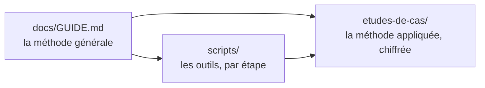

# giga-pano-hdr

Méthode, scripts et étude de cas pour assembler un **giga-panorama HDR** pris en grille à la rotule : géométrie dans ***Hugin***, fusion par ***multiblend***, HDR dans ***Lightroom***, pleine résolution en BigTIFF, pyramides de tuiles avec ***libvips***. Windows, PowerShell et Python.

---

## 📋 Pour qui ?

- Photographes qui prennent un panorama de **plusieurs centaines d'images** en grille régulière (lignes × colonnes, plusieurs expositions par position).
- Ceux dont le panorama à 100 % **dépasse ce qu'un logiciel grand public sait ouvrir** (plus de 500 Mpx, plusieurs Go) et qui veulent quand même le montrer, zoomable jusqu'au pixel.
- Ceux qui ont de grandes zones de **ciel uniforme**, où l'assistant de ***Hugin*** se perd.

## 🤚 Ce que ça ne fait PAS

- Ça n'assemble pas tout seul : la méthode enchaîne ***Lightroom***, ***Hugin***, des scripts et ***libvips***, avec des contrôles entre chaque étape.
- Ça ne comble pas un trou de prise de vue et ne remplace pas une prise de vue soignée.
- Ça s'arrête aux tuiles : afficher et publier dépend de la visionneuse choisie.

---

## ✨ Trois choses, bien séparées



| Vous voulez… | Ouvrez |
| --- | --- |
| **Comprendre et refaire** la méthode, phase par phase, sans les chiffres d'un panorama précis | [`docs/GUIDE.md`](docs/GUIDE.md) |
| **Voir ce que ça donne en vrai** : 222 positions × 7 expositions, 200 mm, durées, RAM, tailles, incidents | [`etudes-de-cas/2026-06-19-wattenberg-200mm/ETUDE-DE-CAS.md`](etudes-de-cas/2026-06-19-wattenberg-200mm/ETUDE-DE-CAS.md) |
| Les **mesures, hypothèses et décisions** de cette étude de cas | [`…/TESTS-ANALYSES.md`](etudes-de-cas/2026-06-19-wattenberg-200mm/TESTS-ANALYSES.md) |
| **Quel script pour quelle étape**, et sa portée (générique ou paramétré par la grille) | [`scripts/INDEX.md`](scripts/INDEX.md) |

Le guide donne la **procédure** et ses raisons. L'étude de cas donne les **valeurs** (grille, pas, tailles d'export, noms de fichiers) et ce qui a été **mesuré** (durées, RAM, disque, défauts). Les deux suivent la même numérotation d'étapes (**3E**, **6C.4**…), que les scripts citent aussi.

---

## 🚀 Démarrage rapide

1. Installer ***Hugin***, ***multiblend***, ***Python*** (+ ***Pillow***), ***ExifTool***, ***libvips*** : [Phase 0 du guide](docs/GUIDE.md#-phase-0--préparer-le-poste-et-lappareil).
2. Cloner ce dépôt ; les scripts se lancent depuis `scripts\` :
   ```powershell
   $OUTILS = 'D:\Depots\giga-pano-hdr\scripts'
   $T      = 'D:\Panoramas\<date>\<focale>'     # dossier de travail du panorama, hors catalogue Lightroom
   cd $OUTILS
   python verifier_ordre.py "$T\Export-TIFF-L" --grille <lignes> <colonnes>
   ```
3. Suivre le guide dans l'ordre, ou aller droit à l'[aide-mémoire](docs/GUIDE.md#aide-mémoire--la-séquence-complète) pour la séquence complète des commandes.

---

## 📁 Structure du dépôt

```
giga-pano-hdr\
├── README.md                              ← ce fichier : l'aiguillage
├── docs\
│   ├── GUIDE.md                           ← la méthode générale (phases 0 à 7)
│   └── NETTOYAGE-ancien-depot.md          ← à faire dans l'ancien dépôt, après la clôture de son issue #46
├── scripts\                               ← 43 scripts .py / .ps1 / .cmd, un dossier (ils s'appellent entre eux)
│   └── INDEX.md                           ← quel script pour quoi, portée de chacun
├── tests\                                 ← tests unitaires des scripts qui ont des fonctions pures
└── etudes-de-cas\
    └── 2026-06-19-wattenberg-200mm\       ← un dossier par panorama étudié
        ├── ETUDE-DE-CAS.md                ← la méthode appliquée, phase par phase
        ├── TESTS-ANALYSES.md              ← le carnet : M-xx, T-xx, P-xx, D-xx, J-xx
        ├── donnees\table_raw_LCE.csv      ← correspondance RAW → L_C_E
        └── lightroom\presets\             ← les préréglages Lightroom qui ont servi
```

---

## 🛠️ Tests et garde-fous

```powershell
python -I -m unittest discover -s tests -v     # fonctions pures de controle_reglages_export, ecart_paires, verifier_renvois
python scripts\verifier_renvois.py             # numérotation du guide : identifiants cités, liens internes, restes de l'ancien système (0 écart attendu)
```

---

## 📚 Pour aller plus loin

- La visionneuse qui affiche ces panoramas est un autre projet (plugin ***Piwigo*** *GigaPanoramaViewer*) ; ce dépôt n'en dépend pas.
- Ce que l'on fera ensuite : un **lanceur unique** avec des menus pour aiguiller vers le bon script selon la situation. Les scripts restent tels quels ; le lanceur ne fera qu'orienter.

---

## 👏 Crédits

Julien Moreau, avec ***Claude Code***. Les logiciels tiers (***Hugin***, ***multiblend***, ***libvips***, ***ExifTool***, ***OpenSeadragon***) appartiennent à leurs auteurs.

---

**Version** : 1.0
**Dernière mise à jour** : 2026-10-18
