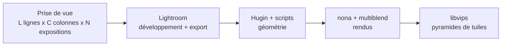
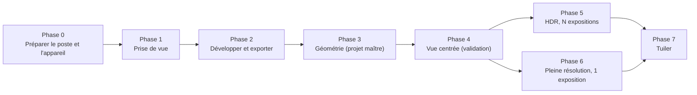
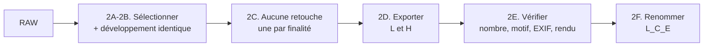
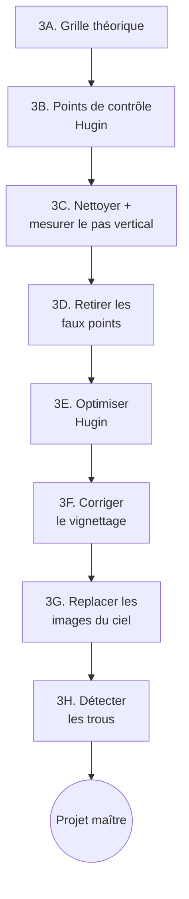
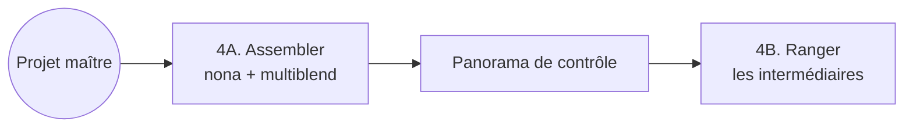
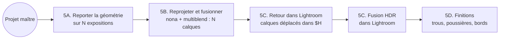
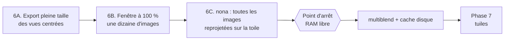
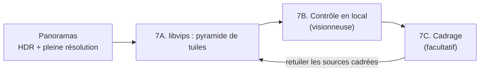

# Assembler un giga-panorama HDR en grille avec Hugin (Windows)

Méthode pour assembler un panorama de **plusieurs lignes et colonnes** pris à la rotule, avec ***Hugin*** pour la géométrie et ***multiblend*** pour la fusion, quand des zones entières (ciel, herbe) ne donnent aucun point de contrôle ; puis pour en tirer **deux panoramas superposables**, un HDR pour les vues d'ensemble et une pleine résolution pour le zoom à 100 % des pixels, et les découper en **tuiles** pour une visionneuse à zoom profond.

---

Ce guide est **général** : il donne la procédure, ses raisons et ses pièges, sans les chiffres d'une prise de vue particulière. Les durées, tailles et réglages réellement mesurés sur un panorama complet sont dans une [étude de cas](../etudes-de-cas/2026-06-19-wattenberg-200mm/ETUDE-DE-CAS.md) (222 positions × 7 expositions, 200 mm), qui suit la même numérotation d'étapes. Lire le guide pour comprendre et refaire ; ouvrir l'étude de cas pour voir ce que ça donne en vrai.



**Comment lire ce guide ?** Dans l'ordre pour refaire un panorama. Dans le désordre pour comprendre : le [postulat](#-le-postulat-et-les-bonnes-questions) et la [vue d'ensemble](#-vue-densemble--huit-phases) donnent la logique ; chaque phase redonne son *pourquoi* avant son *comment*.

---

## 📋 Pour qui ?

- Photographes qui prennent un panorama **à la rotule, en grille régulière** (lignes × colonnes, recouvrement constant).
- Panoramas de **plusieurs centaines d'images**, où l'assistant automatique de ***Hugin*** se perd.
- Zones de **ciel uniforme** (ou de surface sans détail) qui ne donnent aucun point de contrôle.
- Panoramas dont le résultat à 100 % dépasse ce qu'un logiciel grand public sait ouvrir d'un bloc (plus de 500 Mpx, plusieurs Go).

---

## 🤚 Ce que ça ne fait PAS

- Ça **ne comble pas un trou de prise de vue** : si deux images voisines ne se recouvrent pas, la bande noire reste, et il faut retoucher à la main.
- Ça **ne remplace pas la prise de vue soignée** : un recouvrement d'au moins 15 % partout est la meilleure assurance.
- Le **HDR** n'est pas produit à 100 % des pixels : la fusion HDR passe par ***Lightroom***, plafonné à 512 Mpx. Le détail à 100 % est servi par une seule exposition ([Phase 6](#-phase-6--pleine-résolution)).
- La méthode n'a été éprouvée que sur une **grille numérotée dans l'ordre de prise de vue**, parcourue dans le même sens à chaque ligne.
- Elle s'arrête aux tuiles : afficher et publier dépend de la visionneuse choisie.

---

## 🎯 Le postulat et les bonnes questions

### Le postulat

Quatre constats, dont découle toute la méthode :

1. **Un téléobjectif voit petit.** Couvrir un large champ demande des centaines de positions, et le résultat à 100 % dépasse le milliard de pixels : plus que ce que n'importe quel logiciel grand public sait ouvrir d'un bloc.
2. **Les outils automatiques s'arrêtent avant.** L'assistant de ***Hugin*** compare toutes les paires et diverge dans le ciel ; ***Lightroom*** plafonne à 65 000 px sur un côté et **512 Mpx** au total.
3. **Mais on connaît la géométrie.** La rotule a tourné par pas réguliers : la grille théorique est une très bonne première approximation. On n'a pas à *chercher* la position des images, seulement à la **vérifier et à la corriger**.
4. **Le but est un affichage, pas un fichier.** Personne n'ouvrira un TIFF de plusieurs Go : le public verra des **tuiles** zoomables. Chaque version n'a donc pas besoin d'exister dans un format ouvrable par ***Lightroom***.

> **Le postulat central** : *on ne devine pas la géométrie, on la connaît, on la mesure, puis on la rend à plusieurs échelles.*

Quatre règles de conduite en découlent :

| Règle | Ce qu'elle impose | Où elle s'applique |
| --- | --- | --- |
| **Valider en petit avant de calculer en grand** | <ul><li>Aucun calcul de plusieurs heures sans le même calcul réussi à plus petite échelle</li></ul> | Phases 4 à 6 (rendus de test, fenêtre à 100 %) |
| **Une seule géométrie, plusieurs rendus** | <ul><li>Le projet « maître » est établi une fois sur les vues centrées</li><li>La vue centrée, le HDR et la pleine résolution en sont dérivés</li></ul> | Phases 3 à 6 |
| **Ranger dès que c'est fait** | <ul><li>Une image intermédiaire dont le rendu est terminé et vérifié quitte le dossier : elle pèse autant que toute la toile</li><li>Les projets `.pto`, légers, restent</li></ul> | Chaque rendu |
| **Chaque outil fait ce qu'il fait le mieux** | <ul><li>***Lightroom*** développe et fusionne le HDR</li><li>***Hugin*** établit la géométrie</li><li>***nona*** reprojette</li><li>***multiblend*** fusionne</li><li>De petits scripts mesurent, corrigent et enchaînent</li><li>***libvips*** tuile</li></ul> | Tout le guide |

### Les bonnes questions

| Question | Réponse | Détail |
| --- | --- | --- |
| Pourquoi ne pas tout faire dans ***Lightroom*** ? | Il assemble jusqu'à 512 Mpx et 65 000 px seulement ; au-delà, il faut un autre outil. Il reste utile avant (développement) et après (fusion HDR, finitions). | [Phase 6](#-phase-6--pleine-résolution) |
| Pourquoi ne pas laisser l'assistant d'***Hugin*** faire ? | Sur des centaines d'images avec de grandes zones de ciel, il compare des dizaines de milliers de paires inutiles, trouve de faux points dans les feuillages et rien dans le ciel : lent, et il diverge. | [Phase 3](#-phase-3--établir-la-géométrie) |
| Pourquoi partir d'une grille théorique ? | Les images sans point de contrôle (ciel) n'ont que ça pour être placées, et elle permet de **détecter les faux points** : un bon point tombe près de son homologue quand les images sont à leur place de grille. | [**3A**](#3a--générer-le-projet-de-grille) à **3D** |
| Pourquoi traiter d'abord la vue centrée, seule ? | Un défaut de prise de vue (trou, recouvrement faible) se voit aussi bien sur les vues centrées que sur toutes les expositions, mais coûte N fois moins cher à découvrir. | [Phase 4](#-phase-4--assembler-la-vue-centrée) |
| Pourquoi un HDR *et* une pleine résolution ? | <ul><li>La fusion HDR se fait dans ***Lightroom***, plafonné à 512 Mpx, alors que la pleine résolution en fait plusieurs milliers et n'existe qu'en une exposition</li><li>On produit **deux panoramas** superposables</li></ul> | Phases [5](#-phase-5--le-hdr), [6](#-phase-6--pleine-résolution) et [7](#-phase-7--tuiler) |
| Pourquoi des rendus de test avant le rendu complet ? | <ul><li>Se tromper coûte une nuit de calcul</li><li>Un rendu de quelques milliers de pixels révèle les défauts en minutes ; une fenêtre de quelques positions vérifie le HDR et la pleine résolution avant le gros calcul</li></ul> | Phases 4 à 6 |
| Pourquoi développer dans ***Lightroom***, une fois, identiquement ? | ***Hugin*** ne développe pas correctement les RAW, et le moindre réglage différent d'une image à l'autre devient un raccord visible. | [Phase 2](#-phase-2--développer-et-exporter) |
| Pourquoi deux exports ? | <ul><li>Exporter plus grand que nécessaire remplit le disque, et réduire fortement pendant l'assemblage risque du crénelage (***nona*** n'a pas d'anti-crénelage)</li><li>Un export **réduit** (toutes les expositions) sert à la géométrie et au HDR</li><li>Un export **pleine taille** (les vues centrées) au zoom à 100 %</li></ul> | [**2D**](#2d--exporter-l-et-h) |
| Pourquoi des tuiles ? | Un fichier de plusieurs Go ne se montre pas tel quel : une pyramide de tuiles ne charge que ce qui est à l'écran, au bon niveau de zoom. | [Phase 7](#-phase-7--tuiler) |
| Et les trous qu'on ne peut pas boucher ? | <ul><li>On les détecte tôt ([**3H**](#3h--détecter-les-trous)) et on les retouche à la fin ([**5D**](#5d--finitions-sur-le-hdr))</li><li>La vraie parade est un recouvrement d'au moins 15 %</li></ul> | Phases 1, 3 et 5 |

---

## ✨ Vue d'ensemble : huit phases



| Phase | Question à laquelle elle répond | Entrée → Sortie | Étapes |
| :---: | --- | --- | :---: |
| **[0. Préparer le poste et l'appareil](#-phase-0--préparer-le-poste-et-lappareil)** | De quoi a-t-on besoin avant de commencer ? | Un PC Windows et l'appareil<br>→ logiciels, préréglages, disques et capteur prêts | 0A – 0E |
| **[1. Prise de vue](#-phase-1--prise-de-vue)** | Qu'est-ce qui conditionne tout le reste ? | Une grille<br>→ L × C × N RAW dans l'ordre | 1A – 1B |
| **[2. Développer et exporter](#-phase-2--développer-et-exporter)** | Comment obtenir des images identiques et nommées ? | RAW<br>→ TIFF `L{ligne}_C{colonne}_E{expo}` | 2A – 2F |
| **[3. Établir la géométrie](#-phase-3--établir-la-géométrie)** | Où est chaque image, avec certitude ? | TIFF<br>→ **projet maître** (vues centrées optimisées) | 3A – 3H |
| **[4. Assembler la vue centrée](#-phase-4--assembler-la-vue-centrée)** | Le maître donne-t-il un panorama propre ? | Maître<br>→ panorama de contrôle, trous repérés | 4A – 4B |
| **[5. Le HDR](#-phase-5--le-hdr)** | Comment étendre aux N expositions ? | Maître<br>→ N calques alignés<br>→ fusion HDR, finitions | 5A – 5D |
| **[6. Pleine résolution](#-phase-6--pleine-résolution)** | Comment atteindre 100 % des pixels sans se tromper ? | Maître + export pleine taille<br>→ panorama géant (BigTIFF) | 6A – 6C |
| **[7. Tuiler](#-phase-7--tuiler)** | Comment le rendre affichable à n'importe quel zoom ? | <ul><li>Panoramas</li><li>Pyramides de tuiles</li><li>Contrôle local</li><li>(Cadrage)</li></ul> | 7A – 7C |

> **Numérotation.** Chaque geste porte un identifiant : le chiffre de sa phase, puis une lettre qui repart à A dans chaque phase (**3E** : cinquième étape de la Phase 3) ; une sous-étape ajoute un point et un chiffre (**3C.2**). Les scripts, l'index et l'étude de cas citent les mêmes identifiants.

**Notations du guide.** `L` lignes, `C` colonnes, `N` expositions par position ; `k = ligne × C + colonne` est le numéro d'une position. Les variables PowerShell `$OUTILS`, `$T`, `$P` et `$H` sont définies en [**0D**](#0d--préparer-les-disques-et-les-emplacements). Les noms de fichiers des commandes (`pano_grille_opt.pto`, `vue_centree.pto`…) sont des repères : on enregistre sous un **nouveau nom à chaque étape** pour pouvoir revenir en arrière.

Pressé ? La séquence complète des commandes est dans l'[aide-mémoire](#aide-mémoire--la-séquence-complète).

---

## 🔧 Phase 0 — Préparer le poste et l'appareil

**Pourquoi cette phase ?** Les logiciels, les préréglages ***Lightroom*** et les dossiers de travail se préparent une seule fois ; la propreté du capteur se vérifie avant chaque sortie. Les phases suivantes les supposent en place.

| | |
| --- | --- |
| **Entrée** | <ul><li>Un PC Windows</li><li>***Lightroom Classic***</li><li>L'appareil et l'objectif de la prise de vue</li></ul> |
| **Sortie** | <ul><li>Logiciels installés et vérifiés</li><li>Préréglages en place</li><li>Dossiers de travail créés, place libre</li><li>Capteur propre et sa carte des poussières</li></ul> |
| **Étapes** | <ul><li>**0A** (installer)</li><li>**0B** (vérifier)</li><li>**0C** (préréglages)</li><li>**0D** (disques et emplacements)</li><li>**0E** (capteur)</li></ul> |

### 0A — Installer les logiciels

| Logiciel | Rôle | Où |
| --- | --- | --- |
| ***Hugin*** | <ul><li>Géométrie (***CPFind***, optimiseur, ***cpclean***) et reprojection (***nona***)</li><li>***enblend*** pour la variante simple de fusion</li></ul> | <https://hugin.sourceforge.io/download/><br>(installeur Windows 64 bits) |
| ***multiblend*** | <ul><li>Fusion des images reprojetées, **à toutes les échelles** : bien plus rapide qu'***enblend***, moins de RAM, et BigTIFF au-delà de 4 Go</li><li>Un exécutable seul, à installer **hors d'un dossier temporaire** (par exemple `D:\Outils\multiblend\`)</li></ul> | <http://horman.net/multiblend/> |
| ***Python*** 3 | <ul><li>Tous les scripts du guide</li><li>Les scripts de géométrie n'utilisent que la bibliothèque standard</li><li>Les scripts de **mesure sur images** demandent **Pillow**</li></ul> | <ul><li><https://www.python.org/downloads/windows/></li><li>Cocher *Add python.exe to PATH*</li><li>Puis `pip install pillow`</li></ul> |
| ***ExifTool*** | Lecture et copie des métadonnées d'exposition | <https://exiftool.org/><br>Renommer `exiftool(-k).exe` en `exiftool.exe`, le placer dans le `PATH` |
| ***Adobe Lightroom Classic*** | Développement des RAW, export, fusion HDR, finitions | Abonnement Adobe |
| ***libvips*** | <ul><li>Conversion de couleur et découpe en tuiles (Phase 7)</li><li>Recadrage en flux</li></ul> | <ul><li><https://github.com/libvips/build-win64-mxe/releases/latest></li><li>Archive `vips-dev-x64-all-*.zip`, dézippée dans un dossier **durable** (par exemple `D:\Outils\libvips`)</li><li>Les scripts prennent le chemin de `vips.exe` en paramètre</li></ul> |
| ***PowerShell*** | Les scripts `.ps1`, écrits sans caractères accentués pour tourner **aussi bien sous Windows PowerShell 5.1 que sous PowerShell 7** | Inclus dans Windows ; PowerShell 7 : <https://learn.microsoft.com/powershell/> |
| ***ImageMagick*** | Facultatif : conversions ponctuelles de petites images | <https://imagemagick.org/> |

Les versions avec lesquelles la méthode a été établie sont dans l'étude de cas ([Configuration de référence](../etudes-de-cas/2026-06-19-wattenberg-200mm/ETUDE-DE-CAS.md#️-configuration-de-référence)). Le lanceur ***panorama.py*** (menu **Préparer**) affiche les versions installées et propose d'installer ce qui manque ([Le lanceur](#le-lanceur-et-les-menus-de-pilotage)).

### 0B — Vérifier l'installation

Chaque commande doit afficher une version ; ***nona*** doit proposer `--bigtiff` :

```powershell
& 'C:\Program Files\Hugin\bin\nona.exe' --help | Select-String 'version|bigtiff'
& 'C:\Program Files\Hugin\bin\enblend.exe' --version | Select-Object -First 1
python --version
exiftool -ver
python -c "import PIL; print('Pillow', PIL.__version__)"
& 'D:\Outils\multiblend\multiblend.exe' --help | Select-Object -First 1
& 'D:\Outils\libvips\vips-dev-8.18\bin\vips.exe' --version
```

Les programmes en ligne de commande de ***Hugin*** (`nona.exe`, `enblend.exe`, `cpclean.exe`, `cpfind.exe`, `pano_trafo.exe`) sont dans `C:\Program Files\Hugin\bin`.

### 0C — Installer les préréglages Lightroom

Trois préréglages, à créer une fois et à conserver dans un dépôt :

| Préréglage | Type | Rôle |
| --- | --- | --- |
| Développement « PANO – *boîtier* + *objectif* – WB *valeur* » | `.xmp` (sous-dossier `Settings\`) | <ul><li>Correction de profil, aberrations chromatiques</li><li>Balance des blancs fixe, profil couleur, réduction du bruit</li></ul> ([**2B**](#2b--appliquer-un-développement-identique)) |
| Export « PANO TIFF (H) E0 » | `.lrtemplate` (`Export Presets\User Presets\`) | Export H, pleine taille, vues centrées ([**2D**](#2d--exporter-l-et-h)) |
| Export « PANO TIFF (L) HDR » | `.lrtemplate` | Export L, réduit, toutes les expositions ([**2D**](#2d--exporter-l-et-h)) |

**Où sont les préréglages ?** Cela dépend de l'option *Préférences → Préréglages → Stocker les préréglages avec ce catalogue* ; le bouton *Afficher les préréglages Lightroom*, au même endroit, ouvre le bon dossier. Décochée (défaut) : `%APPDATA%\Adobe\Lightroom\` pour les exports, `%APPDATA%\Adobe\CameraRaw\` pour le développement. Cochée : `Paramètres Lightroom\`, à côté du catalogue. Copier les fichiers **Lightroom fermé**.

**Les préréglages d'export sont génériques** : ils ne contiennent aucun dossier de panorama. *Exporter vers* vaut **Choisir le dossier ultérieurement** : à chaque export, ***Lightroom*** demande le dossier, et l'on désigne `$T` ; le sous-dossier `Export-TIFF-H` ou `Export-TIFF-L` s'y crée seul.

#### Le préréglage de développement

Il garantit que la correction optique et la balance des blancs sont identiques partout, et évite de cocher les groupes à la main à chaque panorama. Un préréglage de développement est **lié au couple boîtier + objectif** : la correction de profil retrouve le profil d'objectif d'après les métadonnées, et la balance des blancs « Lumière du jour » ne donne pas la même valeur en kelvins sur tous les boîtiers.

1. Module **Développement**, sur une photo de référence réglée comme en [**2B**](#2b--appliquer-un-développement-identique).
2. Panneau **Préréglages** → **+** → **Créer un préréglage…**, nom qui porte le couple matériel.
3. Cocher **uniquement** les groupes utiles, **tout le reste décoché** :

| Groupe | Contenu | Remarque |
| --- | --- | --- |
| **Corrections de l'objectif** | <ul><li>*Activer les corrections de profil*</li><li>*Supprimer les aberrations chromatiques*</li></ul> | Mode **Par défaut** ou **Auto** :<br>le profil est retrouvé d'après les métadonnées.<br>Un autre objectif demande son propre préréglage |
| **Balance des blancs** | Un réglage **fixe** (« Lumière du jour », ou une température et une teinte chiffrées) | Jamais « Auto ». Pour un panorama en pleine lumière, la même valeur partout |
| Traitement | Profil couleur (ex. Adobe Color) | Le même partout |
| Détails | Réduction du bruit | Identique partout |

4. **Ne pas inclure** : exposition, tons, recadrage, transformation, masques, effets, et surtout **Correction de la brume** ([encadré de **2B**](#-un-réglage-identique-nest-pas-une-transformation-identique)).

### 0D — Préparer les disques et les emplacements

Les **outils**, les **images** et les **projets** ne sont pas au même endroit, et c'est voulu :

| Variable | Contenu | Où | Dans le dépôt Git ? |
| --- | --- | --- | :---: |
| `$OUTILS` | les scripts `.py` / `.ps1` de ce dépôt | `…\giga-pano-hdr\scripts` | **oui** |
| `$T` | le **dossier de travail** du panorama : exports Lightroom et projets.<br>**Pas les RAW** : ils restent dans le catalogue Lightroom | `D:\Panoramas\<date>\<focale>` *(exemple)* | **non** (plusieurs dizaines de Go) |
| `$P` | les projets ***Hugin***, **un sous-dossier par phase** | `$T\Assemblage-Hugin` | **non** |
| `$H` | les **calques HDR et le DNG HDR**, seuls fichiers de ce guide que ***Lightroom*** référence.<br>**Dans** le dossier des RAW du catalogue | `<dossier des RAW>\HDR` | **non** |

L'export Lightroom (`$T\Export-TIFF-L\`) est l'**entrée**, jamais modifiée après le renommage ; tout ce que produisent les étapes suivantes va dans `$P`.

> **Règle : `$T` est hors du catalogue Lightroom, donc hors du dossier des RAW, et sur un disque de données.**
> - **Hors du catalogue** : Lightroom surveille chaque dossier importé **et ses sous-dossiers**. Un dossier de travail rangé sous celui des RAW lui fait proposer de synchroniser des dizaines de milliers de fichiers (TIFF, `f_*.tif`, `.pto`, journaux, tuiles) : lenteur, catalogue gonflé, doublons.
> - **Sur un disque de données** : les rendus lisent et écrivent des dizaines de Go ; le disque système sert déjà au dossier `TEMP` et au cache de ***multiblend***.
> - **Pas de « Ajouter à ce catalogue »** à l'export : ces TIFF sont des copies des RAW, les réimporter créerait des doublons. Seuls les N calques HDR et le DNG HDR qui en résulte entrent dans Lightroom, par `$H` (Phase 5).
> - **Déplacer `$T` après coup** : déplacer les dossiers **ensemble** (`Export-TIFF-L`, `Export-TIFF-H`, `Assemblage-Hugin`) conserve les chemins relatifs des projets `.pto`.

**Créer tous les dossiers dès maintenant, avant le premier export** : les exports Lightroom de la Phase 2 ont besoin de leur dossier, et chaque phase écrit dans le sien. Le lanceur le fait en une fois : **Préparer → Nouveau panorama** (`python panorama.py`) demande `$T`, `$H`, la grille et les pas, crée l'arborescence ci-dessous, écrit `$T\panorama.json` et fait de ce panorama le **panorama courant**, qui préremplit ensuite tous les menus de pilotage.

```
$T\Export-TIFF-L\   $T\Export-TIFF-H\                      ← exports Lightroom (Phase 2, 6A)
$T\Assemblage-Hugin\   ($P)
    3_grille\  3_optimisation\  4_vue_centree\  5_hdr\  6_pleine_res\  7_tuiles\  7_galerie\  _a_supprimer\
$H\   $H\TIFF\                                             ← calques et DNG HDR (Phase 5) ; export du HDR (5C)
```

**À chaque séance de travail**, ouvrir PowerShell et définir ces emplacements : toutes les commandes du guide les utilisent et se lancent **depuis le dossier des outils**. Sans le lanceur, la dernière ligne crée les mêmes dossiers (sans effet s'ils existent) :

```powershell
$OUTILS = 'D:\Depots\giga-pano-hdr\scripts'          # à adapter à votre poste
$T      = 'D:\Panoramas\2026-06-19\200mm'             # à adapter à chaque panorama
$P      = "$T\Assemblage-Hugin"
$H      = '<dossier des RAW du panorama>\HDR'          # dans le catalogue Lightroom
cd $OUTILS
New-Item -ItemType Directory -Force -Path (@("$T\Export-TIFF-L", "$T\Export-TIFF-H", "$H\TIFF") + ('3_grille', '3_optimisation', '4_vue_centree', '5_hdr', '6_pleine_res', '7_tuiles', '7_galerie', '_a_supprimer' | ForEach-Object { "$P\$_" })) | Out-Null
```

**Place libre** : prévoir, pour la Phase 6, de l'ordre de **100 Go sur le disque de données** et **40 Go sur le disque système** (cache de ***multiblend***, dossier `TEMP`) pour un panorama de 2 Gpx ; le détail est dans l'étude de cas.

#### Organisation : un dossier par phase

Les projets `.pto` désignent les images par un **chemin relatif au projet** (`n"..\..\Export-TIFF-L\L0_C00_E0.tif"` depuis `$P\3_grille\`). ***Hugin*** et ***nona*** retrouvent les images tant que ce chemin reste vrai. Les scripts ***generer_pto.py***, ***generer_pto_hdr.py*** et ***propager_geometrie.py*** calculent ce chemin tout seuls d'après l'emplacement du `.pto` de sortie.

```
Dossier des RAW (dans le catalogue Lightroom ; on n'y écrit rien)
└── <date> - <lieu> - GigaPanorama\
    └── <focale>\                         ← RAW du panorama
        └── HDR\                          ← $H : les N calques HDR + le DNG HDR + TIFF\ (référencés par Lightroom)

D:\Panoramas\<date>\                      ← dossiers de travail, HORS catalogue, hors dépôt Git
└── <focale>\                             ← $T
    ├── Export-TIFF-L\                    ← ENTRÉE : export L, renommé, toutes les images réduites
    ├── Export-TIFF-H\                    ← export H : les vues centrées à pleine taille
    └── Assemblage-Hugin\                 ← $P : tout ce que l'on produit
        ├── 3_grille\                     ← 3A-3B : grille théorique, points de contrôle bruts
        ├── 3_optimisation\               ← 3C-3H : intermédiaires, puis le projet maître validé
        ├── 4_vue_centree\                ← 4A : rendus de test de la vue centrée
        ├── 5_hdr\                        ← Phase 5 : projet dérivé ; les calques y sont rendus, puis déplacés vers $H
        ├── 6_pleine_res\                 ← Phase 6 : fenêtre à 100 %, puis rendu complet
        ├── 7_tuiles\                     ← Phase 7 : pyramides de tuiles (et cadrage\ : sources recadrées, temporaires)
        └── _a_supprimer\
```

Le préfixe de chaque dossier est le numéro de sa phase : on isole une phase, on la refait ou on la supprime sans toucher aux autres.

***deplacer_projet.py*** range dans un dossier de phase un projet **existant** (ses chemins d'images sont réécrits ; `--images` le rattache à un autre dossier d'images portant les mêmes noms) :

```powershell
python deplacer_projet.py ancien\pano_grille_cp.pto "$P\3_grille\pano_grille_cp.pto" --images "$T\Export-TIFF-L"
```

### 0E — Vérifier la propreté du capteur

**Pourquoi avant de partir ?** Une poussière sur le capteur est à la **même place sur chaque image** : sur des centaines de positions, elle se répète tout au long du panorama. La corriger ensuite, image par image ([**6A.1**](#6a1--retoucher-sur-des-copies-virtuelles-facultatif)), est long : **l'outil d'effacement ne fait bien son travail que sur une surface unie**. Sur une surface texturée, il reste souvent une tache adoucie, à reprendre au tampon, à la main. Un capteur propre évite l'essentiel ; un test de quelques minutes suffit.

1. **Photographier une surface uniforme** (ciel sans nuage, mur blanc, écran blanc) :

| Réglage | Valeur | Pourquoi |
| --- | --- | --- |
| Diaphragme | **f/16 à f/22** | Plus il est fermé, plus l'ombre d'une poussière est nette : le test exagère ce que montrera la prise de vue |
| Mise au point | **Manuelle, à la distance minimale** (flou complet) | Seule l'ombre des poussières reste |
| Focale | La plus longue | Le fond est d'autant plus flou |
| Exposition | Manuelle, +1 IL environ | Un gris clair fait mieux ressortir les taches qu'un blanc brûlé |
| Orientation | **Celle de la prise de vue** | La carte obtenue se superpose aux images du panorama |

2. **Examiner l'image** dans ***Lightroom***, module **Développement** : outil de suppression des taches, case **Visualiser les taches** et son curseur.
3. **Si des taches apparaissent** : nettoyage automatique du boîtier, puis soufflette (jamais d'air comprimé en bombe) ; si une tache résiste, nettoyage humide ou atelier. **Refaire le test**.
4. **Garder la dernière image du test** : c'est la **carte des poussières** restantes, qui dira où regarder en **6A.1**.

> **Pendant la prise de vue**, ne pas changer d'objectif : c'est le moment où une nouvelle poussière entre dans le boîtier.

---

## 📸 Phase 1 — Prise de vue

**Pourquoi cette phase ?** Aucun logiciel ne rattrape une prise de vue incohérente. Tout ce qui suit (recouvrement, ordre, développement) est décidé ici, sur le terrain.

| | |
| --- | --- |
| **Entrée** | Un site, un trépied de niveau, une rotule, un appareil en tout manuel |
| **Sortie** | L × C × N RAW dans l'ordre de la grille |
| **Étapes** | <ul><li>**1A** (régler l'appareil)</li><li>**1B** (respecter l'ordre de la séquence)</li></ul> |
| **À retenir** | <ul><li>Tout en manuel</li><li>Recouvrement ≥ 15 % partout</li><li>**L'ordre de la séquence**</li></ul> |

```
Prise de vue ──► Ordre garanti ──► Rafale de N par position ──► L x C x N RAW
   (manuel)        (L0…, C0…)          (E0 en tête)
```

**Questions que l'on se pose ici**
- *Pourquoi tout en manuel ?* Une exposition, une mise au point ou une balance des blancs automatiques varient d'une image à l'autre : raccords visibles que rien ne corrige proprement.
- *Pourquoi l'ordre compte-t-il autant ?* Le nom `L_C_E` de chaque image est **calculé** d'après son rang, jamais lu dans l'image : une photo oubliée décale toute la grille.
- *Pourquoi plusieurs expositions ?* Elles alimentent le HDR (Phase 5). La première de chaque rafale, la **vue centrée**, sert seule à valider la méthode (Phase 4).

### 1A — Régler l'appareil (tout en manuel)

Rien ne change d'une image à l'autre :

| Réglage | Valeur | Pourquoi |
| --- | --- | --- |
| Boîtier, objectif, focale | Fixes, et un **profil d'objectif** existe dans Lightroom | Correction de la distorsion et du vignettage à la source |
| Mode d'exposition | **Manuel** (M) | Une exposition automatique varierait d'une image à l'autre |
| Ouverture | **Fixe**, plutôt fermée (f/8 à f/11) | Limite le vignettage ([**3F**](#3f--corriger-le-vignettage-tonalité-du-ciel)) |
| Sensibilité | **Fixe**, la plus basse | Bruit minimal et constant |
| Vitesse | Fixe pour la vue centrée ; la rafale d'expositions en dépend | Seule variable de l'exposition |
| Mise au point | **Manuelle** | Un autofocus qui accroche différemment change l'échelle et la netteté |
| Balance des blancs | **Fixe** (kelvins) | Un ciel à la teinte variable est le défaut le plus visible.<br>Lightroom applique ensuite sa propre valeur fixe |
| Format | RAW | Développement maîtrisé dans Lightroom |

#### Ce qui n'est pas dans l'EXIF, mais qu'il faut respecter

- **Pas de filtre polarisant** : son effet varie avec l'angle au soleil et crée des bandes dans un ciel bleu qu'aucun logiciel ne raccorde.
- **Trépied de niveau** : la rotule doit tourner autour d'un axe vertical. Un axe incliné fait dériver l'horizon et le roulis ; ***Hugin*** le corrige, mais chaque degré de roulis ôte du recouvrement utile aux bords.
- **Capteur vérifié avant de partir** ([**0E**](#0e--vérifier-la-propreté-du-capteur)), **pas de changement d'objectif** pendant la prise de vue.
- **Stabilisation désactivée** sur trépied, déclenchement sans contact.
- **Recouvrement d'au moins 15 %** partout, y compris sur les zones sans détail : c'est la valeur qui décide de l'existence des trous ([**3H**](#3h--détecter-les-trous)).
- **Une même lumière** : un nuage qui passe pendant la prise de vue se voit sur toute une colonne.
- **Rotule et point nodal** : pour un paysage lointain au téléobjectif, la parallaxe d'une rotule ordinaire est faible (rien sur le lointain ni le ciel, quelques dizaines de pixels sur un premier plan proche). Optimiser une translation dans ***Hugin*** n'a pas été essayé.

### 1B — Respecter l'ordre de la séquence

Le nom `L{ligne}_C{colonne}_E{exposition}` de chaque image est **calculé uniquement d'après son rang dans l'ordre de prise de vue**. Une photo oubliée, doublée ou prise dans un autre ordre **décale toute la grille qui la suit**.

```
Ordre de prise de vue :

   Ligne 0 (haut)   colonne 0 ──► colonne C-1      ← chaque ligne démarre du MÊME côté
   Ligne 1          colonne 0 ──► colonne C-1         (pas de parcours en serpentin)
   ...
   Ligne L-1 (bas)

   À chaque position, une rafale de N images dans un ordre FIXE, la vue centrée (0 IL) en tête :
       E0 (0 IL)  puis  E1 … E(N-1)
```

Calcul du nom d'après le rang `R` (à partir de 1) : `position = (R − 1) ÷ N` (division entière), `exposition = (R − 1) mod N`, `ligne = position ÷ C`, `colonne = position mod C`.

**Conséquences pratiques** :
- Les lignes sont parcourues **dans le même sens**. Le sens de rotation de la rotule détermine le signe du lacet dans ***generer_pto.py*** (section [Configuration](#️-configuration--les-scripts)).
- La **vue centrée en tête de rafale** se retrouve sans calcul : c'est l'image au temps de pose de la vue centrée ([**2D**](#2d--exporter-l-et-h), « Repérer la vue centrée »).
- **Après la prise de vue**, vérifier avant tout traitement avec ***verifier_ordre.py*** ([**2E**](#2e--vérifier-lexport)). Un écart se corrige à la source : retrouver la photo en trop ou manquante.
- **Bon réflexe** : à chaque début de ligne, photographier un repère (main devant l'objectif) pour repérer le changement de ligne. À exclure ensuite des exports, car il fausserait le compte.

---

## 🎨 Phase 2 — Développer et exporter

**Pourquoi cette phase ?** ***Hugin*** ne développe pas correctement les RAW. On les développe donc **une fois, de façon strictement identique**, dans ***Lightroom***, puis on exporte des TIFF que ***Hugin*** assemble tels quels. **Et un réglage identique ne garantit pas un rendu identique** : certains curseurs tiennent compte du contenu de chaque photo ([encadré de **2B**](#-un-réglage-identique-nest-pas-une-transformation-identique)).

| | |
| --- | --- |
| **Entrée** | Les RAW (Phase 1) |
| **Sortie** | Des TIFF 16 bits, vérifiés, nommés `L{ligne}_C{colonne}_E{expo}.tif` |
| **Étapes** | <ul><li>**2A** (sélectionner)</li><li>**2B** (développer)</li><li>**2C** (ne pas retoucher les originaux)</li><li>**2D** (exporter)</li><li>**2E** (vérifier)</li><li>**2F** (renommer)</li></ul> |
| **Outils** | <ul><li>***Lightroom***</li><li>***verifier_ordre.py***</li><li>***controle_reglages_export.py***</li><li>***ecart_paires.py***</li><li>***renommer_pano.py***</li><li>***renommer_par_raw.py***</li></ul> |



**Questions que l'on se pose ici**
- *Pourquoi deux exports ?* Une taille « juste » par usage : réduit pour la géométrie, la vue centrée et le HDR ; pleine taille pour la vue centrée à 100 % (**2D**).
- *Pourquoi exporter en TIFF 16 bits ?* Pour ne pas perdre de précision dans les ombres, ce qui compte pour la fusion HDR.
- *Peut-on nettoyer les images (poussières, véhicules, oiseaux) ?* Pas les originaux, qui servent aussi au HDR : chaque panorama se retouche à part ([**2C**](#2c--ne-pas-retoucher-les-originaux--une-retouche-par-finalité)).
- *Des réglages identiques suffisent-ils ?* **Non.** Correction de la brume et curseurs de tonalité donnent un rendu **propre à chaque photo** : deux voisines ne se raccordent plus ([encadré de **2B**](#-un-réglage-identique-nest-pas-une-transformation-identique)).
- *Comment être sûr que l'export est bon ?* **2E** : nombre, motif d'exposition, ordre, réglages identiques, **et un jugement du rendu** par une vue d'ensemble à petite taille.

### 2A — Sélectionner les photos, dans l'ordre

1. Isoler les photos du panorama : filtre par date et heure, par plage de noms, ou collection.
2. **Photo → Piles → Développer toutes les piles** : une pile repliée n'exporterait qu'une image.
3. Trier par **Heure de prise de vue**, croissant : l'ordre de la grille de Lightroom détermine les numéros d'export.
4. **Sélectionner tout** et compter : le nombre doit valoir `L × C × N`.

### 2B — Appliquer un développement identique

Régler **une** image de référence (exposition centrale, au milieu du panorama), puis **Synchroniser** vers toutes les autres, en cochant seulement les groupes ci-dessous, ou appliquer le préréglage de [**0C**](#0c--installer-les-préréglages-lightroom) à toute la sélection.

> ### ⚠️ À retenir : un réglage identique n'est pas une transformation identique
>
> Dans ***Lightroom***, plusieurs curseurs ne sont **pas une courbe fixe** appliquée à tous les pixels : ils **tiennent compte de ce que contient chaque photo**. Synchronisés avec la même valeur sur des centaines d'images, ils donnent des rendus **différents d'une photo à l'autre**, et deux images côte à côte, prises à la même exposition, ne se raccordent plus : sauts de luminosité, sauts de teinte, colonnes dans le ciel. Le contrôle des réglages enregistrés ne voit rien : ils sont identiques, c'est le rendu qui ne l'est pas.
>
> **Coupables mesurés** : la **Correction de la brume** et les curseurs de **tonalité** (Exposition, Contraste, Hautes lumières, Ombres, Blancs, Noirs). **Ont tenu** : la balance des blancs fixe et les réglages de **couleur** (Vibrance, Mixage des couleurs, Calibration).
>
> **Règle : tout ce qui touche à la tonalité reste à 0, la balance des blancs est fixe, et l'on juge le rendu par une vue d'ensemble à petite taille avant d'aller plus loin.**

| Réglage | Valeur | Pourquoi |
| --- | --- | --- |
| **Profil de l'objectif** | Activé, profil de l'objectif d'origine | Corrige la distorsion **et le vignettage** à la source |
| Supprimer les aberrations chromatiques | Activé | Évite des franges différentes d'une image à l'autre |
| Balance des blancs | **Valeur fixe**, identique partout | Un ciel à la teinte variable est le défaut le plus visible |
| <ul><li>Exposition</li><li>Contraste</li><li>Hautes lumières</li><li>Ombres</li><li>Blancs</li><li>Noirs</li></ul> | **0 partout** | Les écarts d'exposition viennent de la prise de vue.<br>Ces curseurs créent des sauts entre voisines (encadré) |
| <ul><li>Recadrage</li><li>Redressement</li><li>Transformation (*Upright*)</li></ul> | **Aucun** | Modifient la géométrie image par image |
| <ul><li>Masques</li><li>Filtres gradués et radiaux</li><li>Pinceaux</li></ul> | **Aucun** | Retouches locales différentes d'une image à l'autre |
| <ul><li>Poussières</li><li>Véhicules</li><li>Oiseaux</li></ul> | **Aucune retouche** sur les originaux | Une retouche par finalité : **2C** |
| ⛔ **Correction de la brume** (*Dehaze*) | **0, jamais** | Ne s'applique pas uniformément à un lot (encadré) |
| Texture, Clarté | **0** | À appliquer sur le panorama final |
| Netteté, réduction du bruit | **Identiques partout** | Une netteté différente se voit au raccord |

> **Ne jamais laisser un réglage « Auto »** : chaque photo serait développée différemment.

#### ⛔ Un réglage identique n'est pas une transformation identique

**1. La Correction de la brume** modifie la photo globalement, **d'après ce qu'elle contient**. Synchronisée sur des centaines d'images, elle donne autant de transformations légèrement différentes ; sur un ciel lisse et saturé, de petits écarts du RAW sont **amplifiés** : teinte et luminosité qui sautent d'une voisine à l'autre, bleu qui sort du gamut (rouge écrêté à 0), motif de bord de chaque image plus marqué. Ces écarts sont **irrécupérables** après coup : aucune correction de gain ne rend à une image sa teinte d'origine.

**2. Les curseurs de tonalité** (Exposition, Contraste, Hautes lumières, Ombres, Blancs, Noirs), même à valeur identique, ont produit des sauts de luminosité de plusieurs pour cent entre voisines, alors que le RAW neutre était plat. Avec tous ces curseurs à 0, la même ligne est restée plate. Ils ont été essayés **par groupes** : la part de chacun n'est pas isolée.

**Un contrôle des réglages ne suffit pas à le voir** : les réglages enregistrés sont identiques alors que le rendu ne l'est pas. Seul un rendu de test accentué le montre.

**Règle retenue** : brume, Exposition, Contraste, Hautes lumières, Ombres, Blancs et Noirs restent à 0 sur toutes les images, **y compris sur les copies virtuelles de [6A.1](#6a1--retoucher-sur-des-copies-virtuelles-facultatif)**. Le rendu se règle avec les curseurs de **couleur**. Pour du contraste, la voie sûre est de le poser **sur le HDR assemblé** en [**5D**](#5d--finitions-sur-le-hdr) ; l'écart de tonalité avec la pleine résolution est alors à juger à la bascule. Une courbe à points, Texture et Clarté restent à essayer.

**Contrôler avant de lancer toute la série** : régler le rendu sur une copie, **synchroniser sur une dizaine d'images voisines de ciel**, les exporter, les assembler en test ([**4A**](#4a--assembler-la-vue-centrée-nona-puis-multiblend), quelques milliers de pixels) et passer ***rehausser_ciel.py*** : s'il ne ressort ni colonne ni image isolée, la même valeur peut partir sur le reste.

**Si le profil d'objectif n'existe pas** : voir [le repli dans ***Hugin***](#repli-sans-profil-dobjectif--corriger-le-vignettage-dans-hugin), en **3F**.

Les mesures qui fondent cet encadré : [M-15 du carnet](../etudes-de-cas/2026-06-19-wattenberg-200mm/TESTS-ANALYSES.md).

### 2C — Ne pas retoucher les originaux : une retouche par finalité

Les originaux alimentent **les deux exports**, et à travers l'export L la géométrie et la fusion HDR. On n'y fait **aucune retouche** : retoucher une vue centrée obligerait à reporter la même retouche sur les N − 1 autres expositions, sinon la fusion HDR mélange une image nettoyée et d'autres qui ne le sont pas. Chaque panorama se retouche **là où il prend sa forme définitive** :

| Panorama | Où se fait la retouche | Quand | Étape |
| --- | --- | --- | :---: |
| **HDR** | Sur le **DNG HDR** fusionné, dans ***Lightroom*** | Après la fusion | [**5D**](#5d--finitions-sur-le-hdr) |
| **Pleine résolution** | Sur des **copies virtuelles** des vues centrées, réservées à l'export H : une fois assemblé, ce panorama ne repasse plus par ***Lightroom*** | Avant l'export H | [**6A.1**](#6a1--retoucher-sur-des-copies-virtuelles-facultatif) |

> **Réutiliser le projet maître après un réexport.** Tant que le développement de **2B** et les préréglages d'export ne changent pas (même taille, même profil d'objectif, aucune transformation), la géométrie de la Phase 3 reste juste : on **réexporte**, on **renomme** d'après la table RAW → `L_C_E` (***renommer_par_raw.py***), et le maître retrouve ses images sous les mêmes noms. **La Phase 3 ne se refait pas** : on reprend à la Phase 4. Il faut donc conserver la table et les projets `.pto` quand on vide les anciens exports et rendus.

### 2D — Exporter (L et H)

**Deux exports, pas plus.** Même développement ; seuls changent la sélection, la taille et le dossier (pourquoi pas un seul à pleine taille : [Phase 6](#deux-exports-plutôt-quun-seul-à-pleine-taille)) :

| Export | Photos | Taille (côté long) | Dossier | Rôle |
| --- | --- | :---: | --- | --- |
| **L** (*Low*, réduit) | L × C × N | **Réduite** : assez pour la largeur du HDR visé (tableau ci-dessous) | `Export-TIFF-L` | Phases 3 à 5<br>projet maître, vue centrée, HDR |
| **H** (*High*, pleine taille) | Les L × C vues centrées | **Aucun redimensionnement** | `Export-TIFF-H` | Phase 6<br>fenêtre à 100 %, puis pleine résolution |

**Pourquoi « L » et « H » plutôt qu'une taille dans le nom** : le rôle d'un export ne change pas d'un appareil à l'autre, sa taille si. Les dossiers, les préréglages et toutes les commandes du guide restent les mêmes ; les scripts lisent la taille réelle dans les fichiers.

Réglages communs aux deux exports :

| Réglage Lightroom | Valeur |
| --- | --- |
| Format | TIFF, 16 bits, compression ZIP<br>***nona*** et ***enblend*** la lisent |
| Espace colorimétrique | Adobe RGB (1998), celui qui a été testé avec ***Hugin*** |
| Netteté de sortie | Aucune |
| Métadonnées | **Toutes** (l'EXIF d'exposition sert à ***Hugin*** et à la fusion HDR) |
| Nom de fichier | Nom personnalisé + numéro de séquence, ordre trié par heure de prise de vue |
| Dossier de destination | **Choisi à l'export** : `$T`, **sans** « Ajouter à ce catalogue » |

| Paramètre | Préréglage « PANO TIFF (H) E0 » | Préréglage « PANO TIFF (L) HDR » |
| --- | --- | --- |
| Emplacement | **Choisir le dossier ultérieurement**<br>sous-dossier `Export-TIFF-H` | idem<br>sous-dossier `Export-TIFF-L` |
| Ajouter à ce catalogue | **Décoché** | **Décoché** |
| Nom des fichiers | `Pano_E0-` + numéro de séquence | `Pano_HDR-` + numéro de séquence |
| Redimensionnement | **Aucun** | Côté long **réduit**, *Ne pas agrandir* coché |

> **Renommer un dossier d'export** casse les chemins d'images des projets qui le référencent : les réécrire avec ***deplacer_projet.py*** `--images`.

**Quelle taille pour l'export L ?** Un panorama de largeur `W` n'a besoin que d'images réduites dans le rapport `W / largeur_à_100 %`. La largeur à 100 % se calcule en [Phase 6](#combien-de-pixels-à-100--). Exporter plus grand ne fait que dépenser du disque ; exporter trop petit nuit à la détection des points de contrôle (non mesuré en dessous de 2 000 px de côté long). Un côté long de **2 048 px** a donné une géométrie précise (erreur moyenne de l'ordre du tiers de pixel) et une marge confortable pour un HDR à 20 000 px.

**Un maître sert à toutes les tailles d'images.** La géométrie est en angles : pour rendre depuis un autre export, on ne refait ni détection ni optimisation, on **transpose** une copie du maître en trois commandes (extraire, redimensionner, rattacher aux images) :

```powershell
$D = "$P\6_pleine_res\complet"
python extraire_sous_projet.py  "$P\3_optimisation\pano_grille_opt.pto" "$D\complet.pto" --images 0-<L×C−1>
python redimensionner_projet.py "$D\complet.pto" "$D\complet.pto" --images <largeur> <hauteur> --pano <largeur du panorama>
python deplacer_projet.py       "$D\complet.pto" "$D\complet.pto" --images "$T\Export-TIFF-H"
```

L'ordre compte. La taille passée à `--images` est celle **lue** sur l'export avec ***tiffinfo.py***.

**Repérer la vue centrée grâce à l'EXIF : c'est la vitesse qui la distingue.** Les N images d'une rafale ne diffèrent que par le temps de pose (ouverture et ISO fixes). Dans le module **Bibliothèque**, barre de filtre (touche `\`), onglet **Métadonnées** :

| Export | Filtre **Objectif** | Filtre **Temps de pose** | Compte attendu |
| --- | --- | --- | :---: |
| **H** | Celui du panorama | Celui de la vue centrée, seulement | L × C |
| **L** | Celui du panorama | *aucun* | L × C × N |
| **Échantillon** (fenêtre à 100 %) | Celui du panorama | Vue centrée, puis sélection des images voulues | quelques-unes |

Le filtre **Objectif** écarte les autres séries de la même sortie. **Limite** : Lightroom Classic ne filtre pas sur la compensation d'exposition ; le filtre sur le temps de pose est donc le seul moyen de cibler E0, et il ne marche **que parce que la prise de vue est rigoureuse** (exposition manuelle, vitesse centrale identique). Si l'ordre de la rafale n'est pas connu, ***exiftool*** lit la compensation de chaque RAW (`-ExposureCompensation`).

**Contrôles avant d'exporter** : le compte doit être exact ; trié par heure, la liste filtrée au temps de pose central doit montrer une image toutes les N ; le filtre ne doit renvoyer **aucune** autre valeur (photo de test, marqueur).

**Renommer un export d'après le RAW d'origine.** ***renommer_par_raw.py*** renomme n'importe quel export en `L_C_E` d'après le **fichier RAW d'origine** lu dans les métadonnées de chaque TIFF, en s'appuyant sur un référentiel : un export déjà renommé, ou une **table CSV** (colonnes `raw,lce`) qui survit à la suppression des exports. Il ne dépend ni de la numérotation, ni de l'ordre de tri, ni du nombre de fichiers : un échantillon de 12 images se renomme comme les autres. Pour le **premier** export (sans référentiel), ***renommer_pano.py*** fait le renommage initial et écrit la table en même temps ([**2F**](#2f--renommer)).

```powershell
python renommer_par_raw.py "$P\table_raw_LCE.csv" "$T\Export-TIFF-H"             # essai à blanc
python renommer_par_raw.py "$P\table_raw_LCE.csv" "$T\Export-TIFF-H" --apply     # renomme + correspondance_raw.csv
python renommer_par_raw.py "$P\table_raw_LCE.csv" "$T\Export-TIFF-H" --undo      # annule
```

**Aucune constante à modifier pour la taille des images** : ***generer_pto.py***, ***generer_pto_hdr.py*** et ***propager_geometrie.py*** lisent la taille réelle dans les fichiers ou dans le projet.

### 2E — Vérifier l'export

Trois contrôles, du plus mécanique au plus visuel.

**1. L'ordre et le motif d'exposition**, d'après l'EXIF :

```powershell
python verifier_ordre.py "$T\Export-TIFF-L" --grille <L> <C>
```

Le script est **universel** : il détecte le nombre d'expositions par rafale, lit le motif dans la première rafale (la vue centrée peut être à n'importe quel rang), accepte un pas quelconque mais constant, puis vérifie que **chaque rafale** reproduit le motif, l'ordre chronologique, le nombre total d'images, l'unicité de l'ouverture, de l'ISO et de la focale. Options : `--expos N`, `--pas IL`, `--tol IL`, `--motif "0,-1,1"`.

**2. Les réglages de développement**, lus dans les TIFF avec ***exiftool*** :

```powershell
python controle_reglages_export.py "$T\Export-TIFF-H" --table "$P\table_raw_LCE.csv"
```

***controle_reglages_export.py*** vérifie que chaque réglage est **identique sur tous les fichiers** (il liste les champs qui diffèrent et les images en minorité), que les RAW sont distincts et qu'aucune vue centrée ne manque (avec la table), les dimensions, le profil, et **signale les curseurs que le guide impose à 0** ou fixes. Les retouches de taches, qui diffèrent par nature, sont exclues ; `--ignorer PointColors` accepte des *Point Color* voulus.

**3. Le rendu**, que les réglages ne disent pas ([encadré de **2B**](#-un-réglage-identique-nest-pas-une-transformation-identique)). ***ecart_paires.py*** compare, pour chaque paire de voisines d'une ligne, la **même scène** vue dans les deux, et signale les paires qui sortent du lot (luminosité et teinte). Il a besoin d'un **projet de même taille d'image**, donc **à partir de la Phase 3** :

```powershell
python ecart_paires.py "$P\3_optimisation\pano_grille_opt.pto" "$T\Export-TIFF-L" <ligne>
```

Un écart supérieur à 1 ou 2 % entre voisines, avec un **bruit faible** (moins de 3 %), est un vrai défaut ; au-delà, la mesure est incertaine (arbres, textures). Compléter par la vue d'ensemble à petite taille ([**6C.1**](#6c1--construire-le-projet)).

### 2F — Renommer

Les fichiers exportés sont classés par le **numéro qui termine leur nom**, qui suit l'ordre de prise de vue. Le rang `R` de chaque fichier donne `R − 1 = position × N + exposition`, avec `position = ligne × C + colonne`.

Avant de renommer, le script contrôle que le **nombre de fichiers** est celui attendu et que la **numérotation est continue** (aucun trou). Le **préfixe** des préréglages de [**2D**](#2d--exporter-l-et-h) donne le type d'export : `Pano_E0-` (export H) attend **L × C** vues centrées, toutes nommées `_E0` quel que soit `--expos` ; `Pano_HDR-` (export L) attend des rafales de `--expos` expositions. Avec un autre préfixe, un export de L × C fichiers est pris pour des vues centrées. Deux préfixes dans le même dossier (deux exports mélangés) arrêtent le script.

Il contrôle aussi le **motif d'exposition** lu dans l'EXIF (***exiftool***), et **s'arrête sans rien renommer** à la moindre anomalie (`--force` ne lève pas ce contrôle) :

- **rafales HDR** : chaque rafale reproduit le même motif, d'un nombre impair d'expositions toutes différentes, la première étant la référence (valeur médiane) autour de laquelle les autres sont décalées, puisqu'elle devient `_E0` ;
- **vues centrées seules** : toutes les images portent la même compensation, quelle qu'elle soit (pas forcément 0 IL). Une image d'une autre exposition glissée dans le lot est signalée par son nom.

```powershell
python renommer_pano.py "$T\Export-TIFF-L" --lignes <L> --colonnes <C> --expos <N> --table "$P\table_raw_LCE.csv"            # essai à blanc
python renommer_pano.py "$T\Export-TIFF-L" --lignes <L> --colonnes <C> --expos <N> --table "$P\table_raw_LCE.csv" --apply    # renomme + correspondance.csv
python renommer_pano.py "$T\Export-TIFF-L" --undo                                                                              # restaure
```

`--force` ignore un écart de nombre ou un trou de numérotation, en connaissance de cause.

**La table RAW → `L_C_E`, écrite et relue par le renommage.** Avec `--table` (prérempli d'après le panorama courant), ***renommer_pano.py*** lit aussi, dans le même appel à ***exiftool***, le RAW d'origine de chaque TIFF, que Lightroom y inscrit (`XMP-crs:RawFileName`) :

| Situation | Ce que fait le script |
| --- | --- |
| **Pas de table**, export **complet** en rafales (L × C × N, sans trou) | L'**écrit** avec le renommage : c'est le premier renommage de l'export L |
| **Une table existe** | **Contrôle le plan contre elle** avant de renommer : chaque RAW doit recevoir le nom que la table lui donne. Au moindre écart (ordre d'export faux, image en trop ou manquante, RAW inconnu), il s'arrête sans rien renommer et nomme les fichiers en cause |
| **Pas de table**, export partiel (vues centrées seules) ou image sans RAW d'origine | Renomme, sans écrire de table incomplète, et le dit |

| | |
| --- | --- |
| **Contenu** | Une ligne par RAW (`raw,lce`), ex. `20260619-091335-0000765.CR2,L0_C00_E0.tif` : L × C × N lignes, triées par nom `L_C_E` |
| **À quoi elle sert** | Renommer **tout export ultérieur**, quel que soit son ordre ou son nombre de fichiers : export H, réexports, échantillons, copies virtuelles ([**2D**](#2d--exporter-l-et-h), [**6A.2**](#6a2--exporter)) ; contrôler la couverture des vues centrées ([**2E**](#2e--vérifier-lexport)) ; contrôler chaque renommage suivant par ***renommer_pano.py*** |
| **Pourquoi elle compte** | Elle **survit** à la suppression des exports : c'est une **matrice** du panorama, à conserver avec le projet maître |

Pour un export déjà renommé autrement, `renommer_par_raw.py <export renommé> "$P\table_raw_LCE.csv" --table` écrit la même table.

---

## 📐 Phase 3 — Établir la géométrie

**Pourquoi cette phase ?** C'est le cœur de la méthode. On part de la **grille théorique**, on la corrige avec les mesures, puis on ne laisse ***Hugin*** optimiser que ce qui est fiable. Le résultat est le **projet maître** : une géométrie validée sur les vues centrées, dont tout le reste dérive.

| | |
| --- | --- |
| **Entrée** | Les vues centrées (`_E0`), nommées (Phase 2) |
| **Sortie** | Le projet maître (positions et objectif optimisés) |
| **Étapes** | **3A** à **3H** |
| **Outils** | <ul><li>***generer_pto.py***</li><li>***Hugin*** (***CPFind***, optimiseur)</li><li>***cpclean***</li><li>***filtrer_cp.py***</li><li>***placer_isoles.py***…</li></ul> |



**Questions que l'on se pose ici**
- *Pourquoi ne pas laisser l'assistant chercher les points partout ?* Il compare toutes les paires, trouve de faux points dans l'herbe et rien dans le ciel, puis diverge. Le mode *prealigned* limite la recherche aux voisines.
- *Pourquoi mesurer le pas vertical ?* Le pas théorique est une estimation ; l'écart médian des points de contrôle dit s'il est faux (**3C**).
- *Pourquoi un seul faux point est-il grave ?* L'optimiseur est un moindres-carrés : un point à 12° d'écart ruine tout (**3D**).
- *Que faire des images du ciel ?* On les place d'après leurs voisines (**3G**). C'est la raison d'être de la grille théorique.
- *Pourquoi optimiser en deux passes ?* Positions d'abord, objectif ensuite (**3E**).
- *Comment sait-on que la géométrie est bonne ?* **3H** (trous), puis Phase 4 (rendu de contrôle).

### 3A — Générer le projet de grille

```powershell
python generer_pto.py "$T\Export-TIFF-L" "$P\3_grille\pano_grille.pto"
```

Le projet est écrit dans `3_grille\`, chemins d'images relatifs. Constantes à adapter en tête de ***generer_pto.py*** :

| Constante | Sens |
| --- | --- |
| `COLS`, `ROWS` | colonnes, lignes |
| `FOCALE` | focale, mm |
| `LARGEUR_MM` | côté **horizontal** du capteur (24 en portrait, 36 en paysage, plein format) |
| `PAS_H` | pas horizontal, degrés |
| `PAS_V` | pas vertical, degrés (à mesurer, **3C**) |
| `LENS_W`, `LENS_H` | taille des images en pixels (valeur par défaut, **remplacée par la taille lue dans le premier TIFF**) |

> **Piège** : le champ de vue horizontal vaut `2 × atan(largeur_capteur / 2 / focale)`. En portrait, le petit côté du capteur est horizontal.

Le fichier généré ne déclare **aucune variable à optimiser** : c'est voulu, on les cochera en **3E**.

### 3B — Points de contrôle (dans ***Hugin***)

1. Ouvrir `3_grille\pano_grille.pto`.
2. Onglet **Photos**, section *Correspondance de motifs*, liste **Paramètres** → **Hugin's CPFind (prealigned)**.
3. **Créer des points de contrôle**.
4. **Fichier → Enregistrer sous** → `3_grille\pano_grille_cp.pto` (même dossier).

**Contrôle indispensable** : regarder la fenêtre de sortie (`i3 <> i105 : Found 0 matches`). Si les paires comparées **ne sont pas des voisines**, le mode *prealigned* n'est pas actif : arrêter et corriger le préréglage.

### 3C — Nettoyer et mesurer le pas vertical

#### 3C.1 — Nettoyage statistique

Programme externe, absent de l'interface d'***Hugin*** 2025 :

```powershell
& 'C:\Program Files\Hugin\bin\cpclean.exe' -p -n 2 -o "$P\3_optimisation\pano_grille_cp_clean.pto" "$P\3_grille\pano_grille_cp.pto"
python deplacer_projet.py "$P\3_optimisation\pano_grille_cp_clean.pto" "$P\3_optimisation\pano_grille_cp_clean.pto"
```

`-p` = comparaison par paires uniquement. La seconde commande est nécessaire : ***cpclean*** réécrit les chemins d'images en **absolus** ; ***deplacer_projet.py*** les remet en relatifs, en place.

#### 3C.2 — Vérifier la grille

```powershell
python diagnostic_cp.py "$P\3_optimisation\pano_grille_cp_clean.pto"
```

Écart des points de contrôle par rapport à la grille théorique, par type de paire (horizontale, verticale, diagonale). Résultat attendu : écart médian **autour de 1°** pour tous les types. Un écart nettement plus grand sur un type dit que le pas correspondant est faux.

#### 3C.3 — Trouver le bon pas vertical

```powershell
python diagnostic_pas_v.py "$P\3_optimisation\pano_grille_cp_clean.pto"
python corriger_pas_v.py "$P\3_optimisation\pano_grille_cp_clean.pto" "$P\3_optimisation\pano_grille_cp_clean_v.pto" <pas trouvé>
```

Le premier teste une plage de pas et affiche la médiane d'écart ; prendre le pas du **minimum**. Le second remet les images à la grille avec ce pas. Reporter la valeur dans `PAS_V` de ***generer_pto.py*** et ***generer_pto_hdr.py***.

### 3D — Retirer les faux points

**Un seul point à 12° d'écart ruine tout.** `cpclean` seul en laisse trop. On filtre avec un critère absolu : un bon point doit tomber à moins de ~2,5° de son homologue **quand les images sont à leur position de grille**.

```powershell
python filtrer_cp.py "$P\3_optimisation\pano_grille_cp_clean_v.pto" "$P\3_optimisation\pano_grille_f2.5.pto" 2.5
```

Le script indique aussi les images qui n'ont presque plus de points.

> **Piège : ce filtre peut supprimer de bons points.** Il juge chaque point par rapport à la **grille théorique**. Or la rotule tournée à la main décale parfois une ligne de plusieurs degrés. Pour une image dont le décalage réel dépasse le seuil, **tous** ses points valides sont retirés, et l'image passe pour « faible ». Parade : en **3G**, ***affiner_images_faibles.py*** doit prendre comme source les points **bruts** (`pano_grille_cp.pto`), pas ceux déjà filtrés.

### 3E — Optimiser (dans ***Hugin***)

***preparer_optimisation.py*** écrit dans le projet la liste des variables à optimiser (évite de cocher à la main) :

```powershell
python preparer_optimisation.py "$P\3_optimisation\pano_grille_f2.5.pto" "$P\3_optimisation\pano_grille_f2.5_pos.pto"             # passe 1 : lacet, tangage, roulis (sauf l'image 0)
python preparer_optimisation.py "$P\3_optimisation\pano_grille_opt1.pto" "$P\3_optimisation\pano_grille_opt1_obj.pto" --objectif   # passe 2 : + champ de vue, a, b, c
```

Puis ouvrir le projet produit et cliquer **Optimiser maintenant !**. Procédure manuelle équivalente, onglet **Optimisation** :

1. Décocher **« N'utiliser que les points de contrôle situés entre des images actives »**.
2. **Passe 1 — positions** : cocher **Lacet, Tangage, Roulis** de **toutes les images sauf la 0** (l'ancre). Objectif : rien. **Optimiser maintenant !**
3. Appliquer (**Yes**) seulement si l'erreur moyenne est raisonnable :

| Erreur moyenne | Verdict |
| :---: | --- |
| > 50 | Échec : ne pas appliquer, revoir **3C** et **3D** |
| ≈ 6 | Bon pour la passe 1 |
| ≈ 3 | Bon pour la passe 2 |

4. **Passe 2 — objectif** : cocher en plus **Angle (v), a, b, c** (pas d et e). Optimiser, appliquer.
5. **Enregistrer sous** un nouveau nom.

> Si l'optimisation tourne plus de 3 minutes sans que l'erreur baisse nettement, **Abandonner** : elle ne convergera pas.

**Contrôle après la passe 1 : une image peut avoir été expulsée.** Une image qui n'a que quelques points, tous faux, peut partir à l'autre bout de la sphère (lacet inversé de ~180°). Symptôme : un « maximum » aberrant dans la fenêtre de résultat, et des pas géants dans :

```powershell
python detecter_trous.py "$P\3_optimisation\pano_grille_opt1.pto" 1.0     # un pas de ~180° entre deux voisines = image expulsée
python voir_positions.py  "$P\3_optimisation\pano_grille_opt1.pto" <de> <à>
```

Remède avant la passe 2 : remettre les images faiblement connectées sur leur ligne, les exclure de l'optimisation et retirer leurs points, pour qu'elles ne faussent pas l'objectif :

```powershell
python placer_isoles.py "$P\3_optimisation\pano_grille_opt1.pto" "$P\3_optimisation\pano_grille_opt1_ciel.pto" <PAS_H> <PAS_V> 30
python preparer_optimisation.py "$P\3_optimisation\pano_grille_opt1_ciel.pto" "$P\3_optimisation\pano_grille_opt1_obj.pto" --objectif --exclure "<liste de placer_isoles>" --sans-cp-exclues
```

### 3F — Corriger le vignettage (tonalité du ciel)

**Symptôme** : dans un ciel lisse, des « colonnes » verticales à chaque raccord, surtout après une fusion HDR. La géométrie est bonne : c'est la **luminosité qui change d'une image à l'autre**, chaque image étant plus sombre sur ses bords.

**Première parade : le profil d'objectif de Lightroom** ([**2B**](#2b--appliquer-un-développement-identique)), qui corrige le vignettage à la source. Si une ondulation subsiste, ou si aucun profil n'existe, ***Hugin*** peut l'estimer (onglet **Photos**, section *Optimisation*) :

| Ligne | Choix | Pourquoi |
| --- | --- | --- |
| **Photométrique** | **Haute plage dynamique, exposition fixe**<br>puis **Calculer** | Les expositions sont connues (EXIF) et constantes d'une position à l'autre : on n'optimise que le **vignettage** (Vb, Vc, Vd) |
| **Géométrique** | **Ne pas toucher** | La géométrie est déjà optimisée et les images du ciel ont été placées à la main : un nouveau calcul les déplacerait |

Le vignettage est une propriété de l'**objectif**, partagée par toutes les images, y compris celles du ciel sans point de contrôle.

**Contrôles** : les colonnes **Vb, Vc, Vd** (onglet Photos, *Affichage → Paramètres photométriques*) ne sont plus à zéro ; les `Eev` n'ont pas changé. **Attention** : ce préréglage modifie aussi la **courbe de réponse** (`Ra` à `Re`) ; avec une seule exposition elle est mal contrainte : si le rendu a une dynamique ou une teinte inhabituelle, remettre `Ra` à `Re` à 0. Les paramètres de l'image 0 sont repris par ***propager_geometrie.py*** dans le projet HDR.

**Mesurer l'effet** : refaire un rendu de test de la vue centrée ([**4A**](#4a--assembler-la-vue-centrée-nona-puis-multiblend)) et mesurer l'ondulation du ciel avant/après :

```powershell
python mesurer_bandes_ciel.py rendu.tif <Y0> <Y1> <période en px> <tolérance> <X0> <X1>
python localiser_sauts_ciel.py rendu.tif <Y0> <Y1> <X0> <X1> <seuil>
python rehausser_ciel.py rendu.tif                                        # pour VOIR les raccords
```

**Choisir la zone de ciel** : réduire le rendu pour le regarder, repérer un rectangle de ciel pur, convertir ses coordonnées à l'échelle du rendu. Une zone qui touche le bord noir donne « 0 colonnes exploitables ».

#### Repli sans profil d'objectif : corriger le vignettage dans ***Hugin***

À utiliser si ***Lightroom*** n'a **aucun profil** pour l'objectif. **Une seule méthode a été testée** : l'estimation ci-dessus, qui réduit l'ondulation du ciel d'environ 20 %. Les autres pistes (base *lensfun*, image de référence *flat-field*, correction a posteriori) n'ont pas été essayées. Précautions de prise de vue : diaphragme fermé (f/8 à f/11), **pas de polariseur**, balance des blancs et exposition manuelles.

### 3G — Replacer les images « orphelines » (ciel)

Les images sans point de contrôle n'ont **aucune raison de bouger** pendant l'optimisation : elles restent à la position théorique, tandis que leurs voisines ont été corrigées. Résultat : trous et décalages.

***placer_isoles.py*** les replace en **interpolant, sur leur propre ligne**, entre les deux images solides les plus proches (chaque ligne a son propre décalage mécanique, d'où l'interpolation sur la ligne et non avec la ligne du dessous) :

```powershell
python placer_isoles.py "$P\3_optimisation\pano_grille_opt2.pto" "$P\3_optimisation\pano_grille_opt2_ciel.pto" <PAS_H> <PAS_V> 30
```

Arguments : entrée, sortie, pas horizontal, pas vertical, **seuil** (une image avec moins de 30 points est considérée comme mal contrainte). L'image 0 n'est jamais déplacée. Les variables des images replacées sont retirées de l'optimisation.

**Attention : l'interpolation peut se tromper de 0,5° à 0,7°** pour une image faible qui a pourtant quelques points valides (symptôme : crêtes floues dans le rendu). ***affiner_images_faibles.py*** compare, pour chaque image faible, les points d'origine à la position interpolée, récupère ceux qui concordent, et prépare un projet où **seules ces images** sont à optimiser :

```powershell
python affiner_images_faibles.py "$P\3_optimisation\pano_grille_opt2_ciel.pto" "$P\3_grille\pano_grille_cp.pto" "$P\3_optimisation\pano_grille_opt3_in.pto" 1.5 5 --rapport   # analyse seule
python affiner_images_faibles.py "$P\3_optimisation\pano_grille_opt2_ciel.pto" "$P\3_grille\pano_grille_cp.pto" "$P\3_optimisation\pano_grille_opt3_in.pto" 1.5 5
```

Arguments : projet de base (images faibles déjà replacées), projet contenant les points **bruts**, sortie, seuil (°), nombre minimal de points valides. Ouvrir la sortie dans ***Hugin*** et **Optimiser maintenant !**.

Outils d'inspection :

```powershell
python lister_pires_cp.py "$P\3_optimisation\pano_grille_opt2.pto" 12 --par-image   # points les plus éloignés de leur homologue
python voir_positions.py "$P\3_optimisation\pano_grille_opt2_ciel.pto" 0 24         # corrections par image
python detecter_aberrantes.py "$P\3_optimisation\pano_grille_opt2.pto" 1.0          # images qui s'écartent de leurs voisines
```

> Un écart de 1-2° entre deux voisines n'est **pas** forcément une erreur : c'est la précision mécanique de la rotule. ***detecter_aberrantes.py*** repère des tendances, il ne tranche pas image par image.

### 3H — Détecter les trous

```powershell
python detecter_trous.py "$P\3_optimisation\pano_grille_opt.pto" 1.0
python compter_cp_paire.py "$P\3_optimisation\pano_grille_opt.pto" <a>-<b> <c>-<d>
```

Le premier liste les paires de voisines qui se recouvrent de **moins de 1°** ; un recouvrement **négatif** = bande noire garantie. Le second dit si ces paires ont des points de contrôle. Si 0 point : ajouter 2-3 points à la main dans l'onglet **Points de contrôle**, réoptimiser les positions. **Si les images ne se recouvrent réellement pas**, la matière manque : seule une retouche ([**5D**](#5d--finitions-sur-le-hdr)) y remédie.

---

## 🧩 Phase 4 — Assembler la vue centrée

**Pourquoi cette phase ?** Avant d'engager toutes les expositions, on assemble **uniquement** les vues centrées. Le panorama obtenu juge la précision du raccord et la prise de vue (trous, ciel) pour N fois moins cher. Il sert aussi de **panorama de contrôle** pour le HDR et la pleine résolution.

| | |
| --- | --- |
| **Entrée** | Le projet maître (Phase 3) et les images `_E0` |
| **Sortie** | Un panorama de la vue centrée, la liste des défauts à retoucher |
| **Étapes** | <ul><li>**4A** (assembler)</li><li>**4B** (ranger les intermédiaires)</li></ul> |
| **Outils** | <ul><li>***redimensionner_projet.py***</li><li>***rendre_projet.ps1*** (***nona*** puis ***multiblend***)</li><li>***ranger_intermediaires.py***</li><li>Variante simple : ***Hugin*** (***nona***, ***enblend***)</li></ul> |



**Questions que l'on se pose ici**
- *Pourquoi un autre outil de fusion que celui d'Hugin ?* ***multiblend*** fusionne **une dizaine de fois plus vite** qu'***enblend*** à plusieurs centaines d'images, avec moins de RAM, des raccords indiscernables, et il respecte mieux la tonalité de chaque image ; il écrit du BigTIFF, indispensable en Phase 6. Un seul outil de fusion pour tout le guide.
- *Et pour un petit panorama ?* Rester dans l'interface de ***Hugin*** avec ***enblend*** est plus simple : variante de **4A**.
- *Quelle largeur pour le premier test ?* Quelques milliers de pixels : rapide, suffisant pour juger les raccords.
- *Les messages `unable to run Dijkstra optimizer` sont-ils graves ?* Non.
- *Et les finitions ?* Sur le HDR, en [**5D**](#5d--finitions-sur-le-hdr), jamais avant l'assemblage.

Si le panorama de contrôle est propre, on passe aux panoramas définitifs. Sinon, on corrige **dans la Phase 3**, pas plus loin.

### 4A — Assembler la vue centrée (***nona*** puis ***multiblend***)

***Hugin*** n'intervient plus : le projet maître est un fichier texte, que ***rendre_projet.ps1*** donne à ***nona*** (reprojection de chaque image) puis à ***multiblend*** (fusion).

1. **Choisir la largeur** (quelques milliers de pixels pour un test) avec ***redimensionner_projet.py***, qui règle la largeur du panorama (la hauteur suit) et crée le dossier de sortie :

   ```powershell
   python redimensionner_projet.py "$P\3_optimisation\pano_grille_opt.pto" "$P\4_vue_centree\vue_centree.pto" --pano 6000
   ```

   Le projet de sortie doit être à la **même profondeur de dossiers** que le maître, pour que les chemins d'images relatifs restent valables (sinon ***deplacer_projet.py***).
2. **Rendre** :

   ```powershell
   .\rendre_projet.ps1 -Projet "$P\4_vue_centree\vue_centree.pto" -Sortie "$P\4_vue_centree\rendu" -Nom vue_centree -Fusionneur multiblend
   ```

   Le panorama et le journal `rendu_log.txt` (durées, pics de RAM) sont seuls conservés. Au-delà de 4 Go de fichier, ajouter `-BigTiff -CompressionEnblend lzw`.

Deux particularités de ***multiblend*** :
- le panorama est la **boîte englobante** des images, pas la toile entière ;
- il n'écrit **aucun profil de couleur**. Sans importance pour juger les raccords ; pour l'ouvrir dans ***Lightroom***, lui rajouter le profil : `exiftool -overwrite_original -TagsFromFile "$T\Export-TIFF-L\L0_C00_E0.tif" -icc_profile panorama.tif`.

**Nettoyer les intermédiaires, une fois le panorama validé.** ***nona*** laisse un fichier `f_NNNN.tif` par image, chacun à la **taille de toute la toile**. ***rendre_projet.ps1*** les supprime **par défaut** à la fin, **seulement si le fusionneur a rendu le code 0 et que le panorama existe et n'est pas vide**. Pour les garder (relancer la fusion avec d'autres réglages sans refaire ***nona***) : `-GarderIntermediaires`, puis `-SansNona` à la relance.

### Variante de 4A — assembler dans l'interface de ***Hugin*** (***enblend***)

Pour un **petit panorama** (quelques dizaines d'images), l'onglet **Assemblage** pilote tout. Plus lent, et la fusion s'arrête à 4 Go par fichier.

| Réglage | Valeur |
| --- | --- |
| Projection | Cylindrique |
| Largeur du canevas | Quelques milliers de pixels pour un test |
| Recadrer | **Adapter le recadrage aux images** |
| Sortie | <ul><li>*Corrigé en exposition, faible plage dynamique*</li><li>TIFF</li><li>Compression LZW</li></ul> |
| Outil de construction | **Nona** |
| Outil de raccord | **enblend**, options : `--blend-colorspace=IDENTITY` |

`--blend-colorspace=IDENTITY` est **indispensable avec des TIFF Adobe RGB** : sans lui, ***enblend*** 4.3 mélange en CIELUV et produit du bruit coloré dans les zones très sombres.

#### Faire fusionner ***multiblend*** par l'interface de ***Hugin***

***Hugin*** permet de choisir **l'exécutable appelé à la place d'*enblend***, mais ***multiblend*** n'a pas la même syntaxe. ***enblend_vers_multiblend.cmd*** s'intercale : il reçoit la ligne de commande d'***enblend***, la traduit, et lance ***multiblend***.

1. ***multiblend*** installé (`D:\Outils\multiblend\multiblend.exe` par défaut ; sinon variable d'environnement `MULTIBLEND_EXE`).
2. **Fichier → Préférences → Enblend/Enfuse**, cocher **Personnalisé** pour ***enblend*** et indiquer le chemin complet de `scripts\enblend_vers_multiblend.cmd` (le `.ps1` du même nom doit rester **dans le même dossier**).
3. Onglet **Assemblage** : **Outil de raccord : enblend**, puis **Assembler !**.
4. Pour revenir à ***enblend***, décocher **Personnalisé**.

| ***Hugin*** envoie | L'adaptateur en fait |
| --- | --- |
| `-o sortie.tif`, la liste des images (après `--` ou dans un fichier `@liste`) | identique |
| `--compression=LZW` (ou `PACKBITS`) | identique ; `DEFLATE` devient `LZW` |
| `-w` / `--wrap=…` | `--wrap` / `--wrap=…` |
| `-l N` / `--levels=N` | `--levels N` |
| `-f LARGEURxHAUTEUR` et les options propres à ***enblend*** | **ignorées** |
| images pesant plus de 3 Go au total | `--bigtiff` ajouté |

Journal : `%TEMP%\enblend_vers_multiblend.log`. Options supplémentaires pour ***multiblend*** : variable d'environnement `MULTIBLEND_OPTIONS`. *Vérifié* par `hugin_stitch_project` ; *non vérifié* : le bouton **Assembler !** de l'interface elle-même, et un rendu complet, pour lequel ***rendre_projet.ps1*** reste la voie éprouvée.

### 4B — Ranger les images intermédiaires

**Après un assemblage lancé depuis *Hugin***, les images intermédiaires restent sur le disque. ***ranger_intermediaires.py*** les déplace dans `$P\_a_supprimer\` ; il ne supprime jamais rien, et on vide ce dossier à la main une fois le résultat vérifié :

```powershell
python ranger_intermediaires.py $P            # essai à blanc
python ranger_intermediaires.py $P --apply    # range
```

| Rangé | Jamais touché |
| --- | --- |
| <ul><li>`f_*.tif`</li><li>`*_exposure_layers_*.tif`</li><li>`liste_enblend.txt`</li></ul> | <ul><li>Les projets `.pto`</li><li>Les panoramas rendus</li><li>Les DNG, les PNG</li><li>Les journaux, les tuiles</li></ul> |

---

## 🌗 Phase 5 — Le HDR

**Pourquoi cette phase ?** Un panorama dont le ciel est brûlé ou les ombres bouchées perd une grande part de son intérêt. Les N expositions de chaque position permettent une fusion HDR. Comme la géométrie est en angles, le maître se **reporte tel quel** sur toutes les images : on ne refait ni détection ni optimisation.

| | |
| --- | --- |
| **Entrée** | Le projet maître et les L × C × N images de l'export L |
| **Sortie** | N calques alignés (un par exposition), puis un HDR fusionné dans ***Lightroom*** |
| **Prérequis** | Phases 3 et 4 concluantes |
| **Étapes** | <ul><li>**5A** (reporter la géométrie)</li><li>**5B** (assembler les calques)</li><li>**5C** (retour dans Lightroom, fusion)</li><li>**5D** (finitions)</li></ul> |
| **Outils** | <ul><li>***propager_geometrie.py***</li><li>***nona_images.ps1***</li><li>***fusionner_par_exposition.ps1*** (***multiblend***)</li><li>***Lightroom***</li><li>Variante : ***Hugin*** (calques seuls, ***enblend***)</li></ul> |



**Questions que l'on se pose ici**
- *Pourquoi un « retour » dans Lightroom ?* Les calques sortent de la chaîne ***Hugin*** : il faut les ramener dans le catalogue pour les fusionner, et c'est là que se joue l'hygiène des dossiers (**5C**).
- *Pourquoi N calques et non un panorama HDR direct ?* ***Hugin*** aligne, ***Lightroom*** fusionne et développe.
- *Pourquoi tester avant le gros calcul ?* Une erreur sur N × L × C images coûte une nuit.

### Deux projets en parallèle, un seul « maître »

| Projet | Images | Rôle | Qui le modifie |
| --- | :---: | --- | --- |
| Le **maître** (`pano_grille_opt.pto`) | L × C (`_E0`) | Valide la géométrie et tout le processus<br>ouverture et rendu rapides | ***Hugin*** (optimisation) et les scripts |
| Le **dérivé** (`pano_HDR.pto`) | L × C × N | Même géométrie, appliquée à tout le lot, pour produire les N calques | **Aucun** : on le **régénère** depuis le maître |

Toute correction de géométrie se fait **sur le maître**, puis ***propager_geometrie.py*** régénère le dérivé (une seconde). ***Hugin*** n'offre pas de filtre par exposition, et son interface est trop lente à plus de mille images pour désactiver les images une à une.

**Contrôle facultatif des piles** (dans ***Hugin***, onglet **Exposition** du dérivé) : les images apparaissent regroupées en « Ensemble 0 », « Ensemble 1 »… (L × C au total), chacun avec les N images `_E0` à `_E(N−1)` et leur `Eev`.

### 5A — Reporter la géométrie sur les N expositions

```powershell
python propager_geometrie.py "$P\3_optimisation\pano_grille_opt.pto" "$P\5_hdr\pano_HDR.pto" <largeur du HDR>
```

Le script produit un projet où chaque pile = l'exposition 0 (qui porte la position optimisée) + N − 1 images **liées** à elle ; l'objectif optimisé est partagé ; l'`Eev` de chaque image est calculé depuis l'EXIF ; le dernier argument fixe la **largeur** du panorama. ***generer_pto_hdr.py*** produit le même type de projet à partir de la grille théorique ; à n'utiliser que si la vue centrée n'a pas eu lieu.

### La taille du HDR

Le HDR se rend **sous le plafond de Lightroom Classic** (65 000 px sur un côté **et** 512 Mpx), avec une marge pour la retouche. Un HDR à 20 000 px (100 Mpx) se retouche aisément ; le plafond réel (≈ 45 000 px pour un rapport 4:1) coûte plusieurs fois plus de calcul pour un gain jugé marginal, puisque le détail est servi par la pleine résolution ([Phase 6, deux sources](#deux-sources--le-hdr-et-la-pleine-résolution)).

### 5B — Assembler les N calques (***nona*** puis ***multiblend***)

Par défaut, on **sort de *Hugin*** pour le rendu : son interface est très lente à plus de mille images, et ***enblend*** met des heures. Le projet dérivé est un fichier texte : deux scripts s'en chargent.

```powershell
$HD = "$P\5_hdr"
.\nona_images.ps1 -Projet "$HD\pano_HDR.pto" -Sortie "$HD\rendu" -De 0 -A <L×C×N − 1> -IgnorerExposition
.\fusionner_par_exposition.ps1 -Rendu "$HD\rendu" -Sortie $HD -Fusionneur multiblend -Prefixe pano_HDR -ExportExif "$T\Export-TIFF-L"
```

À savoir :
- **`-IgnorerExposition` est indispensable** (`nona --ignore-exposure`). Par défaut, ***nona*** ramène chaque image à l'exposition du panorama : les N expositions sortent saturées et identiques.
- ***nona_images.ps1*** rend les images une par une et **saute celles qui sont déjà rendues** : on peut l'interrompre et le relancer.
- ***fusionner_par_exposition.ps1*** regroupe les images par **rang modulo N** : le groupe *k* est l'exposition `_Ek` de toutes les positions. Il écrit `pano_HDR_E0.tif` à `pano_HDR_E(N−1).tif` et un journal (durée, pic de RAM par groupe).
- **Chaque calque est la boîte englobante** des images, pas la toile. Les calques d'un même jeu ont la même boîte : ils restent alignés. Relever l'origine (`vips find_trim` sur un calque) : le cadrage de la [Phase 7](#7c--cadrer-les-deux-sources-facultatif) en a besoin.
- ***multiblend* n'écrit aucun profil de couleur**, et ni lui ni ***nona*** ne conservent l'EXIF. `-ExportExif` recopie sur chaque calque l'EXIF d'exposition **et** le profil de `L0_C00_E<k>.tif` : la fusion HDR de *Lightroom* classe les expositions d'après l'EXIF et doit savoir dans quel espace sont les pixels.
- Une fois les calques validés, les intermédiaires (`$HD\rendu`) se rangent avec ***ranger_intermediaires.py***.

#### Tester avant de lancer le gros calcul

Prendre une **fenêtre** de quelques positions : même chaîne, en quelques minutes. La position *k* a les images `N×k` à `N×k + N − 1` :

```powershell
python extraire_sous_projet.py "$HD\pano_HDR.pto" "$HD\fenetre.pto" --images <plages>
.\nona_images.ps1 -Projet "$HD\fenetre.pto" -Sortie "$HD\fenetre_rendu" -De 0 -A <nombre − 1> -IgnorerExposition
.\fusionner_par_exposition.ps1 -Rendu "$HD\fenetre_rendu" -Sortie "$HD\fenetre_calques" -Fusionneur multiblend -Prefixe pano_HDR -ExportExif "$T\Export-TIFF-L"
```

Vérifier : les **N fichiers**, de **même taille** ; des **niveaux moyens différents** d'une exposition à l'autre (des calques tous blancs : `-IgnorerExposition` oublié) ; le **profil** (`exiftool -ProfileDescription`) et l'**EXIF** ; l'**ordre** des calques (celui des piles, pas celui de la luminosité) ; éventuellement la **fusion HDR dans *Lightroom*** de ces calques de fenêtre (**5C**).

### Variante de 5B — assembler dans l'interface de ***Hugin*** (***enblend***)

Pour un petit HDR, ou pour rester dans l'interface. Ouvrir le projet dérivé.

> **⚠️ L'interface de *Hugin* est très lente avec plus de mille images.** Ouvrir le projet et **patienter** ; aller **directement dans l'onglet Assemblage**, sans passer par *Photos*, *Optimisation* ni l'aperçu OpenGL ; régler, lancer **Assembler !** et ne plus toucher à la fenêtre. Décocher « Afficher la sortie détaillée » dans le processeur de traitement par lots, réduire les fenêtres, empêcher la mise en veille.

**Ne rien optimiser**. Onglet **Assemblage** :

| Réglage | Valeur |
| --- | --- |
| *Sorties de panorama* | **Tout décocher** |
| *Calques* | **Cocher seulement** « Calques raccordés ayant une exposition similaire, sans correction d'exposition » |
| Format | TIFF, compression LZW |
| Outil de raccord | enblend, option `--blend-colorspace=IDENTITY` |

> **Piège : « Corrigé en exposition, faible plage dynamique » est cochée par défaut.** Avec elle, ***Hugin*** fusionne toutes les images en un seul panorama d'exposition moyenne.

#### Erreur « Nom de fichier ou extension trop long » (code 206)

***Hugin*** peut passer tous les noms de fichiers à ***enblend*** en une seule ligne de commande, que Windows limite à environ 32 700 caractères. Parades : cocher seulement l'option **Calques** (plusieurs appels plus petits) ; choisir un **préfixe de sortie très court** dans un dossier au chemin court (`D:\pano\p`).

#### Variante Hugin : tester avant de lancer le gros calcul

Mettre une petite largeur dans l'onglet Assemblage et lancer. Vérifier le **nombre de fichiers finaux** (un par exposition ; tant que le rendu tourne, on ne voit que des `_exposure_layers_NNNN.tif`), l'**ordre** des calques, le **format** (TIFF 16 bits RGBA, profil conservé), l'**espace disque** temporaire, et les **EXIF** : ***Hugin*** **ne conserve pas** l'exposition dans les calques. ***exiftool*** les recopie depuis les originaux (exposition `k` = fichier `L0_C00_E{k}.tif`) :

```powershell
cd "$P\5_hdr"
for ($i = 0; $i -lt <N>; $i++) {
    exiftool -q -overwrite_original -TagsFromFile "$T\Export-TIFF-L\L0_C00_E$i.tif" `
        -ExposureTime -FNumber -ISO -ExposureCompensation -FocalLength -FocalLengthIn35mmFormat `
        -ExposureProgram -ExposureMode -MeteringMode -ShutterSpeedValue -ApertureValue -LensModel `
        "pano_HDR_exposure_000$i.tif"
}
```

**On écrit l'EXIF directement dans les calques, pas dans des copies** : Lightroom range le DNG HDR **à côté des fichiers fusionnés**. Contrôle : les temps de pose écrits sont ceux de la rafale, et l'empreinte des pixels (`exiftool -ImageDataMD5`) est identique avant et après.

### 5C — Retour dans Lightroom : réimporter les calques et fusionner

Les N calques sont l'unique production de l'assemblage qui **revient** dans le catalogue. Ils y entrent par un **sous-dossier du dossier des RAW**, jamais depuis `$T` ([règle de **0D**](#0d--préparer-les-disques-et-les-emplacements)) :

1. **Écrire l'EXIF** dans les calques (fait par `-ExportExif` avec le rendu par scripts).
2. **Les déplacer** dans `$H` (même volume : instantané) :
   ```powershell
   New-Item -ItemType Directory -Force $H | Out-Null
   Move-Item "$P\5_hdr\pano_HDR_E?.tif" $H
   ```
3. **Importer**, module **Bibliothèque** : clic droit sur le dossier des RAW → **Synchroniser le dossier…**, ou **Importer** depuis `$H` en mode **Ajouter**.
4. **Lire l'EXIF** : sélectionner les calques → **Métadonnées → Lire les métadonnées à partir du fichier**.
5. **Fusionner** : *Photo → Fusion de photos → HDR*. Le DNG HDR se range dans `$H`. Un avertissement sur `WhiteBalance` est sans conséquence.
6. **Exporter le TIFF** du HDR dans `$H\TIFF\`, **sans recadrage** : c'est cette version que l'on tuile ([**7A**](#7a--tuiler-avec-libvips)), et c'est elle que l'on recadre par calcul ([**7C**](#7c--cadrer-les-deux-sources-facultatif)). Lightroom n'ayant pas d'option « ignorer le recadrage » à l'export, et la fusion HDR rognant d'office quelques pixels : **exporter depuis une copie virtuelle** du DNG, recadrage **réinitialisé**. **Contrôler la taille** (`vipsheader`) : celle de la toile HDR (ex. 20 000 × 5 000). À refaire après chaque retouche du DNG (**5D**), sur une **nouvelle** copie virtuelle : l'ancienne garde l'ancien développement.

> **Si le catalogue signale le dossier comme manquant** : clic droit → **Rechercher le dossier manquant…**.

> **Le bord supérieur du panorama est en escalier** : c'est la limite réelle de couverture de la ligne du haut (chaque image inclinée par son roulis). Ce n'est pas une erreur : on recadre.

### 5D — Finitions sur le HDR

Ces retouches se font **après** l'assemblage final. Elles ne concernent que ce que ***Lightroom*** peut ouvrir, donc le HDR, pas la pleine résolution ; celle-ci se nettoie **avant** l'assemblage, sur des copies virtuelles ([**6A.1**](#6a1--retoucher-sur-des-copies-virtuelles-facultatif)).

| Finition | Origine | Comment |
| --- | --- | --- |
| **Bandes noires** (paires qui ne se recouvrent pas) | La matière manque | Retouche locale (Tampon, remplissage selon le contenu).<br>***detecter_trous.py*** donne leur position |
| **Bord supérieur en escalier** | Roulis des images | Recadrer ; pour les panoramas diffusés, [**7C**](#7c--cadrer-les-deux-sources-facultatif) |
| **Poussières du capteur** | À la même place dans chaque image | Outil *Correction des taches*, avec *Visualiser les taches* : elles se répètent à intervalle régulier |
| Dehaze, Texture, Clarté, netteté de sortie | Traitement d'image | Une seule fois, sur le panorama final.<br>**Attention à la Correction de la brume** : la pleine résolution ne peut pas la recevoir ([**2B**](#-un-réglage-identique-nest-pas-une-transformation-identique)), et un HDR qui l'aurait ne s'accorderait plus avec elle |

#### Recadrage

Le HDR et la pleine résolution sont destinés à être superposés et doivent garder **le même cadre**. Le cadre se **décide** ici, à l'œil sur le HDR, mais ne s'**applique** à aucun export :

| Quoi | Où | Qui |
| --- | --- | --- |
| **Décider** le cadre | Sur le **DNG HDR lui-même** (pas sur la copie virtuelle de l'export) : outil Recadrage, rapport libre, angle à 0 | Vous, dans ***Lightroom*** |
| **Garder la mesure** | Le catalogue l'enregistre en **fractions de l'image** (gauche, haut, droite, bas), valables pour les deux sources | ***Lightroom***, sans export ni sidecar |
| **Lire la mesure** et l'appliquer aux **deux** TIFF non recadrés | [**7C**](#7c--cadrer-les-deux-sources-facultatif) : `vips extract_area` sur le HDR **et** sur la pleine résolution, même rectangle | ***cadrage_lightroom.py*** |

D'où l'export **non recadré** de **5C** : un TIFF déjà recadré par ***Lightroom*** ne pourrait plus être mis au même cadre que la pleine résolution, que ***Lightroom*** ne peut pas ouvrir. Le recadrage reste une décision de composition, **sans rotation** : un décalage d'horizon se corrige dans ***Hugin***, avant le rendu.

---

## 🔭 Phase 6 — Pleine résolution

**Pourquoi cette phase ?** Le zoom à 100 % est le but du projet, mais il exige des **milliards de pixels** : un seul calcul de plusieurs heures, qu'on ne lance qu'après l'avoir vérifié sur une petite fenêtre.

| | |
| --- | --- |
| **Entrée** | Le projet maître et l'export H (les vues centrées à pleine taille) |
| **Sortie** | Un panorama d'une seule exposition, en **BigTIFF** 16 bits LZW, écrit par ***multiblend*** |
| **Étapes** | <ul><li>**6A** (export H, avec nettoyage facultatif)</li><li>**6B** (fenêtre à 100 %)</li><li>**6C** (rendu complet)</li></ul> |
| **Outils** | <ul><li>***extraire_sous_projet.py***</li><li>***redimensionner_projet.py***</li><li>***deplacer_projet.py***</li><li>***nona_images.ps1***</li><li>***rendre_projet.ps1***</li><li>***rendre_lisible.ps1***</li><li>***surveiller_multiblend.ps1***</li><li>***profil_jonction.ps1***</li><li>***nona*** `--bigtiff`</li><li>***multiblend***</li></ul> |



### Combien de pixels à 100 % ?

Le panorama à « 100 % » est celui où **un pixel du panorama = un pixel d'une image d'origine**, au centre de l'image.

| Grandeur | Calcul |
| --- | --- |
| Champ horizontal d'une image | `2 × atan(largeur_capteur / 2 / focale)` |
| Définition d'une image d'origine | largeur en pixels ÷ champ horizontal (px/°) |
| Largeur du panorama (cylindrique) | champ `v` du projet, en degrés |
| **Largeur à 100 %** | champ du panorama × définition |
| **Hauteur à 100 %** | selon le rapport du projet |

**Arrondir à un multiple de 1 024** (par exemple 88 × 1 024 = 90 112 px) est un **confort, pas une nécessité** : les moitiés successives d'une pyramide de tuiles tombent alors juste, sans arrondi d'un niveau à l'autre. ***libvips*** et les visionneuses gèrent très bien des tuiles de bord incomplètes. Une réduction de 3 % par rapport au 100 % strict est invisible. Reconfirmer avec **Calculer la taille optimale** dans le projet pleine taille.

### Deux sources : le HDR et la pleine résolution

Le HDR et la pleine résolution ne peuvent pas être le même fichier : la fusion HDR se fait dans ***Lightroom***, plafonné à **512 Mpx**, alors que la pleine résolution en fait des milliers. On produit donc **deux panoramas**, destinés à être superposés ([Phase 7](#-phase-7--tuiler)) : le HDR pour les vues d'ensemble, la pleine résolution pour le détail. Les deux se superposent dans un même cadre (même rapport, même recadrage).

### Limites dures

| Limite | Valeur | Conséquence |
| --- | --- | --- |
| **TIFF classique** | **4 Go par fichier** | <ul><li>Atteint à ≈ 500 Mpx en RGBA 16 bits non compressé. **BigTIFF obligatoire** au-delà</li><li>***nona*** accepte `--bigtiff`</li><li>***enblend*** 4.3 **lit** le BigTIFF mais **ne sait pas écrire plus de 4 Go** (`Maximum TIFF file size exceeded`) : on le remplace par ***multiblend***</li></ul> |
| **Lightroom Classic** | 65 000 px sur un côté **et** 512 Mpx | La pleine résolution ne passe jamais par Lightroom après l'export |
| **Photoshop** | PSD : 30 000 px ; PSB : 300 000 px | La pleine résolution n'est ouvrable qu'en PSB, et pèse plusieurs Go en mémoire |
| **RAM** | Celle du poste | <ul><li>***nona*** écrit chaque image reprojetée sur toute la toile (de l'ordre de 8 octets par pixel de toile, en RGBA 16 bits)</li><li>***multiblend*** demande, sans cache, de l'ordre de 25 Go par Gpx de zone utilisée : on borne sa mémoire avec `--cache-threshold`, le reste va dans un cache sur le disque système (**6C**)</li></ul> |
| **Disque** | Intermédiaires de ***nona*** + fichier final + cache | Budget en **6C.5** |

### Deux exports plutôt qu'un seul à pleine taille

**Idée** : exporter une fois toutes les images à pleine taille, puis réduire au rendu (« qui peut le plus peut le moins »). Deux faits tranchent :

1. **Le HDR reste sous le plafond de Lightroom.** Les N − 1 expositions autres que la centrale n'ont donc **aucune utilité à pleine taille** : exporter tout à pleine taille multiplie par 5 à 7 le poids des sources pour rien.
2. ***nona* n'applique pas d'anti-crénelage** (« only the non-antialiasing interpolators of panotools are supported »). Réduire fortement des sources pleine taille pendant la reprojection **pourrait** produire du crénelage ou du moiré : non mesuré. Réduire de moitié un export déjà réduit par Lightroom n'a montré aucun défaut.

**Dans un empilement HDR, toutes les images doivent avoir la même taille** : on n'assemble pas E0 à pleine taille avec les autres expositions réduites. D'où **deux projets** dérivés du même maître.

**Précision de la géométrie à 100 %** : le maître optimisé sur l'export réduit se transpose à la pleine taille **sans dérive visible** (vérifié sur une fenêtre à 100 %, **6B**).

### 6A — Exporter les vues centrées à pleine taille

L'export H ne sert **qu'à la pleine résolution** : c'est le seul endroit où l'on peut nettoyer les vues centrées et leur donner un rendu à elles, sans toucher au HDR.

#### 6A.1 — Retoucher sur des copies virtuelles (facultatif)

***Lightroom*** n'a qu'un développement par RAW, et les originaux ne se retouchent pas ([**2C**](#2c--ne-pas-retoucher-les-originaux--une-retouche-par-finalité)). On travaille sur des **copies virtuelles** des vues centrées, réservées à l'export H.

1. **Créer les copies** : filtre sur le temps de pose de la vue centrée, *Photo → Créer des copies virtuelles*. Les ranger dans une **collection** dédiée.
2. **Régler le rendu sur une copie, puis synchroniser** vers les autres, **sans cocher la retouche des taches**.
3. **Nettoyer image par image** : poussières, véhicules, oiseaux, passants.

| Retouche sur les copies | Admise ? | Pourquoi |
| --- | :---: | --- |
| Suppression d'une poussière, d'un véhicule, d'un oiseau (outil de **suppression des taches**), image par image | **Oui** | Remplace quelques pixels par une matière voisine, sans rien déplacer |
| <ul><li>Balance des blancs</li><li>TSL, étalonnage, calibration</li><li>Vibrance, netteté, réduction du bruit</li><li>**Identiques sur toutes les copies**</li></ul> | **Oui** | Global et synchronisé : aucun raccord mesuré |
| ⛔ <ul><li>Exposition</li><li>Contraste</li><li>Hautes lumières</li><li>Ombres</li><li>Blancs</li><li>Noirs</li></ul> même valeur partout | **Non** | Sauts de luminosité entre voisines malgré des réglages identiques ([**2B**](#-un-réglage-identique-nest-pas-une-transformation-identique)) |
| ⛔ **Correction de la brume**, même valeur partout | **Non** | Agit selon le contenu de chaque image |
| Le même réglage, différent d'une copie à l'autre | **Non** | Raccord visible |
| <ul><li>Masques</li><li>Filtres gradués et radiaux</li><li>Pinceaux</li></ul> | **Non** | Retouche locale de tonalité |
| <ul><li>Recadrage, redressement, *Upright*</li><li>Distorsion ou vignettage manuels</li><li>Changement de profil d'objectif</li></ul> | **Non** | Déplace les pixels : la géométrie du maître ne correspond plus |

**Les poussières : seulement là où elles se voient.** La carte de [**0E**](#0e--vérifier-la-propreté-du-capteur) dit où regarder ; on ne corrige que les images où la tache se voit réellement (une tache légère invisible sur un feuillage ne se voit que sur une surface uniforme ; la remplacer partout fabrique plus de défauts qu'elle n'en retire).

**Dans la zone de recouvrement**, un même défaut apparaît sur deux images voisines (parfois quatre). ***multiblend*** choisit, pixel par pixel, l'image qui fournit le raccord : un défaut retouché sur une seule des deux peut ressortir. Règle : **un défaut situé dans le recouvrement se retouche sur toutes les images qui le montrent**, avec le même outil. **Préférer *Correction* ou *Duplication* à l'IA générative** dans le recouvrement : deux inventions différentes au même endroit se voient au raccord.

> **Accorder le rendu au HDR.** Dans la visionneuse, la pleine résolution prend le relais du HDR quand on zoome. Une tonalité différente de celle du HDR **fini** (après **5D**) se voit comme un saut. Régler le HDR d'abord, puis ajuster les copies en comparant une même zone : la fenêtre à 100 % (**6B**) contre le HDR.

Un TIFF exporté depuis une copie virtuelle porte le nom de son RAW d'origine : ***renommer_par_raw.py*** le renomme correctement. Un essai sur 2 ou 3 copies avant toute la série reste une bonne habitude.

#### 6A.2 — Exporter

Avec le préréglage « PANO TIFF (H) E0 » ([**2D**](#2d--exporter-l-et-h)), en désignant `$T` comme dossier et le **profil d'objectif activé**, depuis la collection des copies virtuelles ou depuis les originaux filtrés. Compter L × C images. Les renommer avec ***renommer_par_raw.py***. *(Un export sans la correction de profil ne se superpose plus au maître.)*

**Contrôle** : les contrôles de [**2E**](#2e--vérifier-lexport) sur `$T\Export-TIFF-H` (***controle_reglages_export.py***, puis ***ecart_paires.py*** après la construction du projet, [**6C.1**](#6c1--construire-le-projet)).

### 6B — Rendre une fenêtre à 100 %

Une dizaine d'images, **dont un trou connu** (**3H**), pour vérifier que la géométrie du maître se transpose, que la netteté est là et que le rendu des images raccorde. Exporter d'abord ces seules vues centrées à pleine taille.

**Construire la fenêtre à partir du maître** :

```powershell
$F = "$P\6_pleine_res\fenetre_A"
python extraire_sous_projet.py "$P\3_optimisation\pano_grille_opt.pto" "$F\fenetre_A_maitre.pto" --images <plages>
python redimensionner_projet.py "$F\fenetre_A_maitre.pto" "$F\fenetre_A_pleine.pto" --images <largeur> <hauteur> --pano <largeur du panorama>
python deplacer_projet.py "$F\fenetre_A_pleine.pto" "$F\fenetre_A_pleine.pto" --images "$T\Export-TIFF-H"
```

Contrôle : les chemins d'images du projet doivent tous exister.

**Rendre la fenêtre**, en deux temps, comme le rendu complet : ***nona*** reprojette chaque image sur **toute la toile** (d'où la RAM), puis ***multiblend*** fusionne.

```powershell
.\nona_images.ps1 -Projet "$F\fenetre_A_pleine.pto" -Sortie "$F\rendu" -De 0 -A <nombre − 1> -BigTiff
.\rendre_projet.ps1 -Projet "$F\fenetre_A_pleine.pto" -Sortie "$F\rendu" -Nom fenetre_A -BigTiff -CompressionEnblend lzw -Fusionneur multiblend -SansNona -Lisible
```

**Rendre l'échantillon lisible** : avec `-Lisible`, ***rendre_lisible.ps1*** écrit à côté du panorama `<Nom>_lisible.tif` (TIFF **classique** 16 bits, transparence aplatie sur noir, profil de couleur des images) et `<Nom>_sRGB.jpg`. Le panorama de ***multiblend*** est un **BigTIFF sans profil** : la plupart des logiciels ne l'ouvrent pas. C'est la copie à ouvrir dans ***Lightroom*** pour juger les retouches de **6A.1**. Au-delà d'environ 700 Mpx, ni le TIFF classique ni le JPEG ne contiendraient le panorama : la copie est **réduite** à 6 000 px de large (`-LargeurApercu`), sous les noms `<Nom>_apercu_lisible.tif` et `<Nom>_apercu_sRGB.jpg`. C'est la vue d'ensemble du contrôle **6C.5** ; le détail de la pleine résolution se regarde par extraits (`vips crop`).

**Ce qu'il faut vérifier** : la **géométrie** (la bande noire du trou connu a la largeur attendue : recouvrement négatif × définition en px/° ; les détails se prolongent de part et d'autre), la **netteté** à 100 %, les **raccords** sur un aperçu d'ensemble. La largeur d'une bande se mesure dans le canal alpha (`vips extract_band … 3`, puis `vips crop` d'une ligne et `vips csvsave`).

### 6C — Rendu complet : ***nona***, puis ***multiblend***

Le rendu se fait en **deux temps séparés par une pause** : ***nona*** reprojette chaque image sur la toile (une image intermédiaire `f_NNNN.tif` par vue), puis ***multiblend*** les fusionne en un seul BigTIFF. Le fichier produit est la **zone utilisée** de la toile, pas la toile entière, et ne contient pas sa position dans la toile ([Phase 7](#position-des-deux-sources-lune-par-rapport-à-lautre)).

#### 6C.1 — Construire le projet

```powershell
$D6 = "$P\6_pleine_res\complet"
python extraire_sous_projet.py  "$P\3_optimisation\pano_grille_opt.pto" "$D6\complet.pto" --images 0-<L×C − 1>
python redimensionner_projet.py "$D6\complet.pto" "$D6\complet.pto" --images <largeur> <hauteur> --pano <largeur du panorama>
python deplacer_projet.py       "$D6\complet.pto" "$D6\complet.pto" --images "$T\Export-TIFF-H"
```

**Avant les heures de calcul : une vue d'ensemble à petite taille (quelques minutes).** Le même projet, réduit, donne le **panorama entier des images retouchées** : c'est le moyen de juger le rendu d'ensemble (teinte, contraste, raccords du ciel, image qui sort du lot) **avant** de lancer le rendu complet, et après chaque réexport :

```powershell
$AP = "$P\6_pleine_res\apercu"
python redimensionner_projet.py "$D6\complet.pto" "$AP\apercu.pto" --pano 6000
.\rendre_projet.ps1 -Projet "$AP\apercu.pto" -Sortie "$AP\rendu" -Nom apercu -Fusionneur multiblend
```

**Les couleurs paraîtront ternes si le profil manque.** ***multiblend*** n'écrit **aucun profil** : un panorama Adobe RGB est lu comme du sRGB, d'où des couleurs pâles. Les valeurs ne sont pas changées : seule l'étiquette manque. Pour un aperçu fidèle : `vips thumbnail apercu.tif apercu.jpg 2800 --height 700 --size down --import-profile adobergb.icc --export-profile srgb` (le fichier `.icc` s'extrait d'un export : `exiftool -icc_profile -b -w icc fichier.tif`, vers un dossier de travail).

#### 6C.2 — Reprojeter les images avec ***nona***

Ne rien lancer de lourd pendant ce temps (pas de *Lightroom*, pas de mise en veille) :

```powershell
.\nona_images.ps1 -Projet "$D6\complet.pto" -Sortie "$D6\rendu" -De 0 -A <L×C − 1> -BigTiff
```

***nona_images.ps1*** rend les images une par une et **saute celles qui existent déjà** : après une coupure, la même commande reprend. **Interrompre pour libérer la machine** : arrêter le script (`Ctrl+C`), **puis** le processus `nona.exe` (`Stop-Process -Name nona`). On ne perd que l'image en cours (écrite sous un nom provisoire `tmp_NNNN.tif`, renommé en `f_NNNN.tif` une fois terminée) ; à la reprise, le script supprime les `tmp_*.tif` restants.

#### 6C.3 — ⛔ Point d'arrêt avant ***multiblend*** : contrôler la RAM

Sans cache, ***multiblend*** demande de l'ordre de 25 Go par Gpx de zone utilisée. Avec le cache disque (**6C.4**), son processus reste borné, mais **le système n'a presque plus de RAM libre pendant la fusion**. Une fois ***nona*** terminé et **avant** la fusion :

1. s'assurer que ***nona*** est terminé et que rien d'autre ne doit tourner ;
2. relever la RAM libre : `[math]::Round((Get-CimInstance Win32_OperatingSystem).FreePhysicalMemory / 1MB, 1)` (Go) ;
3. fermer navigateur, ***Lightroom*** et toute application lourde ;
4. vérifier qu'aucun ***nona***, ***enblend*** ni ***multiblend*** ne tourne et que le disque système a assez de place pour le cache ;
5. ne lancer la fusion qu'une fois ces conditions réunies.

#### 6C.4 — Fusionner avec ***multiblend***

```powershell
.\rendre_projet.ps1 -Projet "$D6\complet.pto" -Sortie "$D6\rendu" -Nom complet_multiblend -BigTiff -CompressionEnblend lzw -Fusionneur multiblend -OptionsMultiblend '--cache-threshold=4G' -SansNona
```

`--cache-threshold=4G` limite la mémoire du processus à 4 Go ; le reste va dans un fichier de cache sous `%TEMP%`. Le résultat est **identique, pixel pour pixel**, à une fusion sans cache, et plus lent d'au plus 15 %. Pour suivre le rendu, lancer dans une autre fenêtre ***surveiller_multiblend.ps1*** (`-Sortie releves.csv`), qui relève toutes les 20 s la mémoire du processus, la **RAM libre du système** et la taille du cache. **Le « pic de RAM » du journal est trompeur avec cette option** (il compte aussi le fichier de cache) : c'est la RAM libre du système qui dit la pression réelle.

Une fois la fusion réussie, ***rendre_projet.ps1*** **supprime les intermédiaires** ; `-GarderIntermediaires` pour les conserver.

#### 6C.5 — Contrôler le rendu complet

1. **Durées** et **RAM** dans `rendu_log.txt` et dans le relevé de ***surveiller_multiblend.ps1***.
2. **Ouverture du fichier** : `vipsheader complet_multiblend.tif` donne la taille et 4 bandes `ushort`.
3. **Aperçu complet** : `vips thumbnail complet_multiblend.tif apercu.jpg 2800 --height 700 --size down`, profil rendu à la réduction (**6C.1**), **comparé à la vue d'ensemble** de 6C.1, qui doit lui ressembler.
4. **Juger le ciel au rehaussement, pas à l'œil nu.** Réduire le panorama à quelques milliers de pixels (`vips thumbnail … --size force`), puis ***rehausser_ciel.py*** sur la bande de ciel. **Aucune colonne ni image isolée ne doit ressortir** : c'est l'objectif, et le moyen de **comparer deux rendus** ; ce n'est pas un seuil d'acceptation (voir la note ci-dessous). Les extraits à 100 % seuls ne le montrent pas : une colonne est plus large qu'un extrait. En cas de doute, ***ecart_paires.py*** sur les images sources ([**2E**](#2e--vérifier-lexport)).
5. **Examen à 100 %** de 3 ou 4 zones : une jonction de ciel, une jonction de feuillage, un trou connu, une paire saine comme référence. Pour un extrait fidèle, convertir le profil et sortir en **8 bits** (`vips icc_transform … srgb --input-profile adobergb.icc --depth 8`) : en 16 bits, un `cast` en 8 bits sature l'image en blanc.
6. **Mesurer une jonction** avec ***profil_jonction.ps1*** : profil par bandes, fichier fusionné contre les deux images qui se recouvrent. Attendu : écart à la source la plus proche de quelques dixièmes de pour cent, sans dépassement (pas de halo).

> **Le seuil de tolérance se juge dans la visionneuse, pas sur la vue d'ensemble.** Des écarts de bande visibles sur le panorama entier ou au rehaussement du ciel peuvent disparaître quand on zoome jusqu'à l'effacement du HDR : à cette échelle, on ne regarde plus qu'une photo agrandie. Ce qui décide est donc **7B** (le fondu HDR → pleine résolution, à tous les zooms), pas 6C.5 seul (mesuré dans l'étude de cas : [M-17](../etudes-de-cas/2026-06-19-wattenberg-200mm/TESTS-ANALYSES.md#m-17--nouvel-export-réglages-de-développement-plus-marqués--un-écart-visible-sur-le-panorama-entier-invisible-une-fois-zoomé)). Corollaire pour **6A** : brume, tonalité et saturation agissent **à l'échelle d'une image** ; les régler avec modération et minutie, parce qu'un réglage fort devient une différence de colonne sur le panorama.

**Ce qui reste visible dans le fichier** : le bord supérieur en escalier, les trous de prise de vue, les poussières non retouchées. Ce sont des finitions, à faire hors ***Lightroom*** (ou en amont, **6A.1**).

**Budget disque** : un calque RGBA 16 bits non compressé pèse 8 octets par pixel de toile ; les intermédiaires de ***nona*** pèsent, compressés, de l'ordre de 2 fois le fichier final ; le fichier final LZW de l'ordre de 6 à 7 octets par pixel utile ; le cache de ***multiblend*** de l'ordre de 2 à 3 fois le fichier final. Prévoir, pour 2 Gpx : ≈ 60 Go sur le disque de données et ≈ 40 Go sur le disque système.

---

## 🌐 Phase 7 — Tuiler

**Pourquoi cette phase ?** Un fichier de plusieurs gigaoctets ne se montre pas tel quel. On le découpe en une **pyramide de tuiles** : une visionneuse à zoom profond ne charge que ce qui est à l'écran. Le guide s'arrête au paquet prêt à mettre en ligne : la publication elle-même dépend de la visionneuse et de l'hébergement.

| | |
| --- | --- |
| **Entrée** | Le HDR (niveaux bas) et le panorama pleine résolution (niveau haut) |
| **Sortie** | Une pyramide de tuiles par panorama : un fichier `.dzi` et un dossier `_files` |
| **Étapes** | <ul><li>**7A** (tuiler)</li><li>**7B** (contrôler en local)</li><li>**7C** (cadrer, facultatif)</li><li>**7D** (empaqueter pour la mise en ligne)</li></ul> |
| **Outils** | <ul><li>***libvips*** (`vips dzsave`, `vips extract_area`)</li><li>***tuiler.ps1***</li><li>***controler_tuiles.py***</li><li>***cadrage_lightroom.py***</li><li>***empaqueter.py***</li></ul> |
| **Ordre** | <ul><li>On **tuile d'abord les panoramas tels qu'ils sont**</li><li>On les **contrôle en local**</li><li>Seulement ensuite, si l'on veut, on **cadre** (puis on retuile et on recontrôle)</li></ul> |



**Pourquoi tuiler avant de cadrer ?** Le contrôle de l'assemblage se fait **dans la visionneuse, à tous les zooms** : c'est la seule vue qui montre le résultat tel que le visiteur le verra. Cadrer est un choix de composition, **facultatif**, qui ne doit pas être un préalable au contrôle : un défaut découvert après le cadrage coûterait un cadrage et un tuilage refaits.

**Questions que l'on se pose ici**
- *Le HDR est-il du « vrai » HDR ?* Non : du HDR tone-mappé en 8 bits, adapté à un écran ordinaire.
- *Pourquoi deux pyramides ?* Parce que le HDR et la pleine résolution ne peuvent pas être le même fichier ([Phase 6](#deux-sources--le-hdr-et-la-pleine-résolution)).

### 7A — Tuiler avec ***libvips***

**Quand** : dès que les deux panoramas sont terminés, **sans les recadrer**. Le tuilage prend quelques minutes.

***libvips*** (`vips dzsave`) fabrique une pyramide à partir d'une image géante **sans la charger en entier en mémoire** (***ImageMagick*** charge l'image en RAM et convient mal à 2 Gpx). ***tuiler.ps1*** enchaîne trois temps : conversion Adobe RGB → sRGB en 8 bits (`vips icc_transform`), aplatissement du canal alpha sur noir, puis `vips dzsave`. **Format retenu : tuiles de 512 px en WebP, qualité 85**, environ **deux fois plus légères** que du JPEG de qualité 90 (`-Format jpg -Qualite 90` reste possible).

⚠️ ***multiblend* n'écrit aucun profil de couleur**, alors que l'export *Lightroom* (le HDR) porte le sien. Sans profil, la conversion vers sRGB n'a pas lieu et la pleine résolution paraît plus terne que le HDR. On donne donc au tuilage le profil des images sources : `-ProfilDepuis` le prend dans **une image de l'export H** (***exiftool***), sans fichier `.icc` à conserver à part (`-ProfilEntree fichier.icc` reste possible) :

```powershell
.\tuiler.ps1 -Image "$P\6_pleine_res\complet\rendu\complet_multiblend.tif" -Sortie "$P\7_tuiles\complet_webp\complet" -ProfilDepuis "$T\Export-TIFF-H\L0_C00_E0.tif" -Vips 'D:\Outils\libvips\vips-dev-8.18\bin\vips.exe'
.\tuiler.ps1 -Image "$H\TIFF\pano_HDR_non_recadre.tif" -Sortie "$P\7_tuiles\hdr_webp\hdr" -Vips 'D:\Outils\libvips\vips-dev-8.18\bin\vips.exe'
```

**Prévoir** des fichiers temporaires de l'ordre de la taille du panorama non compressé en 8 bits (supprimés à la fin) et quelques centaines de Mo pour les pyramides. Le WebP est lu par les navigateurs récents (essayé dans Chromium et Firefox, ordinateur et téléphone ; Safari non essayé).

### 7B — Contrôler en local, dans une visionneuse

**Pourquoi** : c'est le seul endroit où l'on voit le **fruit de tout le travail** comme le verra le visiteur : les deux pyramides superposées, à tous les zooms, avec les vraies couleurs. **À faire avant tout envoi en ligne** : les navigateurs gardent les tuiles en cache, un défaut vu après coup coûte un nouveau dossier et un nouveau dépôt.

**Lancer** : ***controler_tuiles.py*** sert une page ***OpenSeadragon*** (embarquée dans `scripts\visionneuse\`) et les deux pyramides sur ce poste, puis ouvre le navigateur ; Entrée arrête le serveur. Une page doit être servie en HTTP : `file://` bloque le chargement des tuiles. La pleine résolution apparaît avec le zoom (`--fondu curseur` pour un curseur). Pour des sources **non recadrées**, il faut donner le **cadre de la pleine résolution dans celui du HDR** ([Position des deux sources](#position-des-deux-sources-lune-par-rapport-à-lautre)) ; des sources cadrées ensemble (**7C**) ont le même cadre.

```powershell
python controler_tuiles.py "$P\7_tuiles\hdr_webp\hdr.dzi" "$P\7_tuiles\complet_webp\complet.dzi" --box <x>,<y>,<largeur>   # sources non recadrées
python controler_tuiles.py "$P\7_tuiles\hdr_cadre_webp\hdr.dzi" "$P\7_tuiles\complet_cadre_webp\complet.dzi"            # sources cadrées (7C)
```

Toute autre visionneuse Deep Zoom convient, avec les mêmes données.

**Que regarder** (à 100 %, puis en dézoomant) :

| Contrôle | Ce qu'on cherche | Si défaut |
| --- | --- | --- |
| **Raccords** | Couture, double image, colonne plus claire ou plus sombre dans le ciel | Retour aux Phases 4 à 6 (rendu, développement) |
| **Trous** de prise de vue | Bande noire ou floue | [**3H**](#3h--détecter-les-trous) et retouche |
| **Couleurs** | Pleine résolution aussi vive que le HDR ; pas de saut de tonalité au passage HDR → pleine résolution | Profil d'entrée absent, ou réglage HDR à reprendre ([**5D**](#5d--finitions-sur-le-hdr)) |
| **Position HDR / pleine résolution** | Aucun décalage au fondu entre les deux sources | Valeur du cadre |
| **Bords et coins** | Vide noir, bord en escalier | Cadrage ([**7C**](#7c--cadrer-les-deux-sources-facultatif)) |
| **Fluidité** | Pas d'à-coup au déplacement et au zoom | Visionneuse |

Le contrôle ne modifie rien : il décide de la suite : **panorama bon** (mise en ligne), **cadrage voulu** (**7C**) ou **défaut à reprendre en amont**.

### 7C — Cadrer les deux sources (facultatif)

**Quand** : après le contrôle en local, si la composition le demande (bord noir, bord en escalier, recentrage). `vips extract_area` lit le TIFF géant en flux : c'est le moins coûteux pour recadrer. On **retuile ensuite** (**7A**) et on **recontrôle** (**7B**).

**Le principe** : le cadrage est un choix de composition, fait **à l'œil sur le HDR**, seule vue d'ensemble lisible. Le HDR et la pleine résolution sont la même projection à deux échelles : le recadrage de Lightroom, enregistré en **fractions de l'image**, vaut pour les deux. ***cadrage_lightroom.py*** le relit, le convertit en pixels de chaque source et refuse un cadre qui sortirait de la zone utile de la pleine résolution. **Sans rotation**.

1. **Cadrer dans Lightroom**, sur le DNG HDR, outil Recadrage, rapport libre, angle à 0 (si ce n'est déjà fait en [**5D**](#recadrage)). Ne pas valider par un export recadré.
2. **Lire le recadrage** (rien n'est modifié) :
   ```powershell
   python cadrage_lightroom.py        # demande l'emplacement du catalogue .lrcat, puis le nom du fichier
   ```
   Le script lit le **catalogue** en lecture seule (Lightroom fermé, de préférence). Sans catalogue : `--dng fichier.dng`. Il imprime le rectangle en pixels HDR et en pixels de la pleine résolution, ainsi que les commandes. **Si le HDR vient de calques de *multiblend*** (boîte englobante, pas la toile), ajouter `--origine-hdr X,Y --toile-hdr LxH` (`X,Y` : `vips find_trim` sur un calque).
3. **Exporter le HDR sans recadrage** : Lightroom n'a pas d'option « ignorer le recadrage » à l'export. Créer une **copie virtuelle** du DNG, y **réinitialiser le recadrage** (y compris le recadrage automatique de la fusion HDR, de quelques pixels), exporter en TIFF dans `$H\TIFF\`. **Contrôler la taille** avec `vipsheader` : elle doit être celle du DNG d'origine.
4. **Recadrer les deux sources** avec les commandes imprimées :
   ```powershell
   $V = 'D:\Outils\libvips\vips-dev-8.18\bin\vips.exe'
   $C = "$P\7_tuiles\cadrage"; New-Item -ItemType Directory -Force $C | Out-Null
   & $V extract_area "$H\TIFF\pano_HDR_non_recadre.tif" "$C\hdr_cadre.tif" X Y L H
   & $V extract_area "$P\6_pleine_res\complet\rendu\complet_multiblend.tif" "$C\complet_cadre.tif[bigtiff,tile]" X Y L H
   ```
   ⚠️ **`[tile]` est indispensable.** Avec `[bigtiff]` seul, ***libvips*** écrit des bandes de 128 lignes, énormes sur une image très large : le fichier se crée sans erreur mais **ne se relit plus** (`Cumulated memory allocation … beyond the … limit`). Contrôler la relecture : `& $V thumbnail "$C\complet_cadre.tif" "$C\apercu.jpg" 1600`.

   **Contrôle facultatif du vide** : `python cadrage_lightroom.py --controle "$C\complet_cadre.tif"` donne, **par coin**, la largeur et la hauteur du vide dans le canal alpha. Il ne juge pas : laisser un peu de noir dans les coins est un choix de composition légitime.
5. **Tuiler** les deux TIFF cadrés (**7A**, `-ProfilDepuis` toujours donné à la pleine résolution), puis **recontrôler** (**7B**). Les deux sources ayant **le même cadre**, aucun décalage n'est à corriger entre elles.
6. **Supprimer** `$C` une fois les tuiles contrôlées.

### 7D — Empaqueter pour la mise en ligne

**Quand** : une fois les tuiles contrôlées (**7B**), cadrées ou non. L'hébergement reçoit **un seul fichier ZIP**, décompressé sur place dans la racine des panoramas.

```powershell
python empaqueter.py pano-<focale>-<date> "$P\7_tuiles\hdr_cadre_webp\hdr.dzi" "$P\7_tuiles\complet_cadre_webp\complet.dzi" "$P\7_galerie" --titre "<titre>"
```

***empaqueter.py*** copie les deux pyramides dans `<Sortie>\<Nom>\` (`hdr\`, `complet\`), y écrit `panorama.json` (tailles lues dans les `.dzi`, cadre `box` de la pleine résolution dans le HDR), puis `<Nom>.zip` **sans compression** (les tuiles le sont déjà). `--box` vaut `0,0,1` par défaut, pour des sources cadrées ensemble ; pour des sources non recadrées, donner le cadre de la [position des deux sources](#position-des-deux-sources-lune-par-rapport-à-lautre). Le format est celui de la visionneuse ***GigaPanoramaViewer*** (`panorama.json` version 1).

**Un nouveau rendu va sous un nouveau nom** : les navigateurs gardent les tuiles en cache, des tuiles remplacées sous le même nom ne seraient pas revues. Le script refuse un dossier `<Nom>` déjà présent.

### Position des deux sources l'une par rapport à l'autre

Pour qu'une visionneuse superpose exactement les deux pyramides, il faut connaître leur position relative, or aucune des deux n'occupe toute la toile :
- le panorama de ***multiblend*** est **rogné à la zone utilisée** et **ne dit pas où il se trouve** dans la toile ; on le calcule avec `vips find_trim "f_NNNN.tif[page=0]" --background 0 --threshold 1` sur les intermédiaires de ***nona*** (le plus petit bord gauche et le plus petit haut), puis on le **vérifie** avec ***profil_jonction.ps1*** ;
- le **HDR exporté peut être rogné par *Lightroom*** de quelques pixels (« Dimensions du fichier » contre « Dimensions actuelles ») : le plus simple est d'**annuler le recadrage** avant l'export ;
- un HDR fusionné à partir de calques de ***multiblend*** est la **boîte englobante** de la toile HDR : relever l'origine avec `vips find_trim` sur un calque et la donner à ***cadrage_lightroom.py*** (`--origine-hdr`).

Le cadre se transmet à la visionneuse sous la forme (x, y, largeur) de la pleine résolution **en largeurs du HDR**. **Si les deux sources ont été cadrées** (**7C**), elles ont le même cadre et ces décalages disparaissent.

---

## 📁 Structure des fichiers

```
…\giga-pano-hdr\                         ← ce dépôt
├── docs\GUIDE.md                        ← ce guide : la procédure
├── scripts\                             ← $OUTILS : *.py, *.ps1, *.cmd (INDEX.md les classe par étape)
└── etudes-de-cas\<panorama>\            ← un dossier par panorama : étude de cas, carnet, table RAW → L_C_E, préréglages

$T\Export-TIFF-L\                        ← export L : toutes les images réduites, renommées
├── L0_C00_E0.tif … L{L-1}_C{C-1}_E{N-1}.tif
└── correspondance.csv                   ← ancien nom → nouveau nom (pour annuler le renommage)

$T\Export-TIFF-H\                        ← export H : les vues centrées à pleine taille
├── L0_C00_E0.tif … L{L-1}_C{C-1}_E0.tif
└── correspondance_raw.csv               ← écrit par renommer_par_raw.py

$P = $T\Assemblage-Hugin\
├── table_raw_LCE.csv                    ← correspondance RAW → L_C_E (survit aux exports)
├── 3_grille\
│   ├── pano_grille.pto                  ← 3A : grille théorique
│   └── pano_grille_cp.pto               ← 3B : + points de contrôle bruts (source de 3G)
├── 3_optimisation\
│   └── pano_grille_opt*.pto             ← 3C à 3G : intermédiaires, puis le projet maître
├── 4_vue_centree\                       ← 4A : rendus de contrôle
├── 5_hdr\
│   └── pano_HDR.pto                     ← Phase 5 : dérivé du maître (les calques partent dans $H)
├── 6_pleine_res\                        ← 6B : fenêtre ; 6C : complet\ et apercu\
├── 7_tuiles\                            ← 7A : pyramides ; 7C : cadrage\ (intermédiaires)
└── 7_galerie\                           ← 7D : <Nom>\ et <Nom>.zip, à mettre en ligne

$H = <dossier des RAW>\HDR\              ← dans le catalogue Lightroom
├── pano_HDR_E0…E{N-1}.tif               ← Phase 5 : les N calques
├── pano_HDR.dng                         ← le HDR fusionné par Lightroom : il porte le recadrage décidé en 5D
└── TIFF\pano_HDR_non_recadre.tif        ← export d'une copie virtuelle au recadrage réinitialisé (5C) : entrée du tuilage et du cadrage (7A, 7C)
```

Tous ces dossiers sont créés en **Phase 0** ([**0D**](#0d--préparer-les-disques-et-les-emplacements)), avant le premier export.

**Convention de nom** : `L{ligne}_C{colonne}_E{exposition}.tif`, ligne 0 = haut, colonne 0 = côté où chaque ligne commence, exposition 0 = vue centrée. Un tri alphabétique donne l'ordre de prise de vue.

---

## 🧰 Ce qui se fait dans ***Hugin*** et ce qui demande un script

| Étape | Dans ***Hugin*** seul ? | Ce qu'il faut en plus | Pourquoi |
| --- | :---: | --- | --- |
| **2A** à **2D** — développement et export | Non (Lightroom) | Lightroom | ***Hugin*** ne développe pas correctement les RAW |
| **2E** — vérifier l'export | Non | <ul><li>***verifier_ordre.py***</li><li>***controle_reglages_export.py***</li><li>***ecart_paires.py***</li><li>(+ ***exiftool***, ***libvips***)</li></ul> | Ordre et motif ; réglages uniformes ; rendu entre voisines |
| **2F** — renommer en `L_C_E` | Non | ***renommer_pano.py***, ***renommer_par_raw.py*** | ***Hugin*** ne connaît pas la grille |
| **3A** — placer les images en grille | **Non** | ***generer_pto.py*** | Saisir à la main le lacet et le tangage de centaines d'images n'est pas réaliste |
| **3B** — points de contrôle | **Oui** | rien | *CPFind (prealigned)* |
| **3C.1** — nettoyage statistique | Non | `cpclean.exe` (livré avec ***Hugin***) | Absent de l'interface 2025 |
| **3C** et **3D** — mesurer le pas, filtrer les faux points | Non | <ul><li>***diagnostic_pas_v.py***</li><li>***corriger_pas_v.py***</li><li>***filtrer_cp.py***</li></ul> | Propres à la grille |
| **3E** — optimiser | **Oui** | ***preparer_optimisation.py*** (facultatif) | Les cases se cochent aussi à la main |
| **3G** — images du ciel | Non | ***placer_isoles.py***, ***affiner_images_faibles.py*** | Propres aux images sans point de contrôle |
| **4A** — assembler la vue centrée | Possible (variante) | ***redimensionner_projet.py***, ***rendre_projet.ps1*** | Hors ***Hugin*** : bien plus rapide<br>Dans ***Hugin*** pour un petit panorama |
| **4B** — ranger les intermédiaires | Non | ***ranger_intermediaires.py*** | ***Hugin*** laisse ses images de travail sur le disque |
| **5B** — assembler les calques HDR | Possible (variante) | <ul><li>***propager_geometrie.py***</li><li>***nona_images.ps1***</li><li>***fusionner_par_exposition.ps1***</li></ul> | Interface très lente à plus de mille images |
| **5C** — retour dans Lightroom | Non (Lightroom) | `Move-Item`, ***exiftool*** | Les calques reviennent par `$H` |
| **5D** — finitions | Non (Lightroom) | Lightroom | |
| **7A** — tuiler | Non | ***tuiler.ps1*** (`vips dzsave`) | |
| **7B** — contrôler en local | Non | ***controler_tuiles.py*** (page ***OpenSeadragon*** servie en HTTP) | Contrôle avant toute mise en ligne |
| **7C** — cadrage (facultatif) | Non (Lightroom) | ***cadrage_lightroom.py***, `vips extract_area` | La pleine résolution, trop grande pour Lightroom, reçoit le cadrage par calcul |
| **7D** — empaqueter | Non | ***empaqueter.py*** | Un seul ZIP à mettre en ligne, au format de la visionneuse |

**Pour un petit panorama** (une ligne, quelques dizaines d'images), l'assistant d'***Hugin*** suffit en général : ces scripts ne servent que pour les grandes grilles où l'assistant se perd.

### Aide-mémoire : la séquence complète

```powershell
$OUTILS = 'D:\Depots\giga-pano-hdr\scripts'      # à adapter
$T      = 'D:\Panoramas\<date>\<focale>'          # à adapter
$IMG    = "$T\Export-TIFF-L"
$P      = "$T\Assemblage-Hugin"
$GRILLE = "$P\3_grille"; $OPT = "$P\3_optimisation"; $HDR = "$P\5_hdr"
$H      = '<dossier des RAW>\HDR'                 # à adapter
cd $OUTILS

# 2E. Après l'export Lightroom
python verifier_ordre.py $IMG --grille <L> <C>
# 2F. Renommer
python renommer_pano.py $IMG --lignes <L> --colonnes <C> --expos <N> --table "$P\table_raw_LCE.csv"   # essai à blanc, puis --apply : écrit la table RAW -> L_C_E
# 3A. Projet de grille (vues centrées)
python generer_pto.py $IMG "$GRILLE\pano_grille.pto"
# 3B. HUGIN : ouvrir pano_grille.pto -> Photos -> CPFind (prealigned) -> Créer des points -> Enregistrer sous 3_grille\pano_grille_cp.pto
# 3C. Nettoyage et mesures, puis filtrage des faux points (3D)
& 'C:\Program Files\Hugin\bin\cpclean.exe' -p -n 2 -o "$OPT\pano_grille_cp_clean.pto" "$GRILLE\pano_grille_cp.pto"
python deplacer_projet.py "$OPT\pano_grille_cp_clean.pto" "$OPT\pano_grille_cp_clean.pto"
python diagnostic_cp.py    "$OPT\pano_grille_cp_clean.pto"
python diagnostic_pas_v.py "$OPT\pano_grille_cp_clean.pto"
python corriger_pas_v.py "$OPT\pano_grille_cp_clean.pto" "$OPT\pano_grille_cp_clean_v.pto" <PAS_V>
python filtrer_cp.py "$OPT\pano_grille_cp_clean_v.pto" "$OPT\pano_grille_f2.5.pto" 2.5
python preparer_optimisation.py "$OPT\pano_grille_f2.5.pto" "$OPT\pano_grille_f2.5_pos.pto"
# 3E. HUGIN, passe 1 : ouvrir pano_grille_f2.5_pos.pto -> Optimisation -> Optimiser -> Yes -> Enregistrer sous pano_grille_opt1.pto
python detecter_trous.py "$OPT\pano_grille_opt1.pto" 1.0          # un pas de ~180° = image expulsée
python placer_isoles.py "$OPT\pano_grille_opt1.pto" "$OPT\pano_grille_opt1_ciel.pto" <PAS_H> <PAS_V> 30
python preparer_optimisation.py "$OPT\pano_grille_opt1_ciel.pto" "$OPT\pano_grille_opt1_obj.pto" --objectif --exclure "<liste de placer_isoles>" --sans-cp-exclues
# 3E. HUGIN, passe 2 : ouvrir pano_grille_opt1_obj.pto -> Optimiser -> Yes -> Enregistrer sous pano_grille_opt2.pto
python filtrer_cp.py "$OPT\pano_grille_opt2.pto" "$OPT\pano_grille_opt2_f.pto" 0.6
# 3G. Images du ciel
python placer_isoles.py "$OPT\pano_grille_opt2_f.pto" "$OPT\pano_grille_opt2_ciel.pto" <PAS_H> <PAS_V> 30
python affiner_images_faibles.py "$OPT\pano_grille_opt2_ciel.pto" "$GRILLE\pano_grille_cp.pto" "$OPT\pano_grille_opt3_in.pto" 1.5 5
# 3G. HUGIN, réoptimisation : ouvrir pano_grille_opt3_in.pto -> Optimiser -> Yes -> Enregistrer sous pano_grille_opt.pto (le maître)
# 3H. Trous
python detecter_trous.py "$OPT\pano_grille_opt.pto" 1.0
# 4A. Vue centrée (hors Hugin) : largeur de test, puis nona + multiblend
python redimensionner_projet.py "$OPT\pano_grille_opt.pto" "$P\4_vue_centree\vue_centree.pto" --pano 6000
.\rendre_projet.ps1 -Projet "$P\4_vue_centree\vue_centree.pto" -Sortie "$P\4_vue_centree\rendu" -Nom vue_centree -Fusionneur multiblend
# 4B. Après un assemblage lancé depuis Hugin : ranger les intermédiaires (essai à blanc, puis --apply)
python ranger_intermediaires.py $P
# 5A. HDR : reporter la géométrie sur les N expositions
python propager_geometrie.py "$OPT\pano_grille_opt.pto" "$HDR\pano_HDR.pto" <largeur du HDR>
# 5B. Calques HDR (hors Hugin) : nona sans correction d'exposition, puis multiblend par exposition
.\nona_images.ps1 -Projet "$HDR\pano_HDR.pto" -Sortie "$HDR\rendu" -De 0 -A <L×C×N − 1> -IgnorerExposition
.\fusionner_par_exposition.ps1 -Rendu "$HDR\rendu" -Sortie $HDR -Fusionneur multiblend -Prefixe pano_HDR -ExportExif $IMG
# 5C. Retour dans Lightroom : déplacer les calques dans $H, importer, fusionner
Move-Item "$HDR\pano_HDR_E?.tif" $H
# 6C. Pleine résolution (après 6A, l'export H, et 6B, la fenêtre à 100 %)
$D6 = "$P\6_pleine_res\complet"
python extraire_sous_projet.py  "$OPT\pano_grille_opt.pto" "$D6\complet.pto" --images 0-<L×C − 1>
python redimensionner_projet.py "$D6\complet.pto" "$D6\complet.pto" --images <largeur> <hauteur> --pano <largeur du panorama>
python deplacer_projet.py       "$D6\complet.pto" "$D6\complet.pto" --images "$T\Export-TIFF-H"
.\nona_images.ps1 -Projet "$D6\complet.pto" -Sortie "$D6\rendu" -De 0 -A <L×C − 1> -BigTiff
# 6C.3. POINT D'ARRÊT : relever la RAM libre, fermer navigateur et Lightroom, puis lancer la fusion
.\rendre_projet.ps1 -Projet "$D6\complet.pto" -Sortie "$D6\rendu" -Nom complet_multiblend -BigTiff -CompressionEnblend lzw -Fusionneur multiblend -OptionsMultiblend '--cache-threshold=4G' -SansNona
# 7A. Tuiler les sources non recadrées, puis 7B. les contrôler en local
$V = 'D:\Outils\libvips\vips-dev-8.18\bin\vips.exe'
.\tuiler.ps1 -Image "$D6\rendu\complet_multiblend.tif" -Sortie "$P\7_tuiles\complet_webp\complet" -ProfilDepuis "$T\Export-TIFF-H\L0_C00_E0.tif" -Vips $V
.\tuiler.ps1 -Image "$H\TIFF\pano_HDR_non_recadre.tif" -Sortie "$P\7_tuiles\hdr_webp\hdr" -Vips $V
python controler_tuiles.py "$P\7_tuiles\hdr_webp\hdr.dzi" "$P\7_tuiles\complet_webp\complet.dzi" --box <x>,<y>,<largeur>   # Entrée pour arrêter
# 7C. Cadrer les deux sources (facultatif), puis retuiler (7A) et recontrôler (7B)
python cadrage_lightroom.py                      # imprime les commandes extract_area (valeurs X Y L H)
$C = "$P\7_tuiles\cadrage"; New-Item -ItemType Directory -Force $C | Out-Null
& $V extract_area "$H\TIFF\pano_HDR_non_recadre.tif" "$C\hdr_cadre.tif" X Y L H
& $V extract_area "$D6\rendu\complet_multiblend.tif" "$C\complet_cadre.tif[bigtiff,tile]" X Y L H
# 7D. Empaqueter les tuiles contrôlées : dossier autonome et ZIP à mettre en ligne (nouveau nom à chaque rendu)
python empaqueter.py pano-<focale>-<date> "$P\7_tuiles\hdr_cadre_webp\hdr.dzi" "$P\7_tuiles\complet_cadre_webp\complet.dzi" "$P\7_galerie" --titre "<titre>"
```

---

## ⚙️ Configuration : les scripts

Les scripts du dossier `scripts\` (`$OUTILS`) sont classés par étape dans [`INDEX.md`](../scripts/INDEX.md), avec leur rôle en une ligne et leur **portée** (générique, ou paramétré par la grille). Chacun porte en tête de fichier son **mode d'emploi** : contexte, mode opératoire, entrées (arguments et constantes), sorties, exemple.

**Constantes codées en dur** (à adapter si la prise de vue change) : la taille des images est lue dans les fichiers ou dans le projet, mais les scripts de diagnostic et de placement supposent le **nombre de colonnes et de lignes et le champ horizontal** d'une prise de vue donnée. Les modifier en tête de chaque script. Les signes de rotation supposent la colonne 0 à **droite** et la ligne 0 en **haut** ; pour une prise de vue gauche → droite, inverser le signe du lacet dans ***generer_pto.py***.

**Chemins d'installation** (***Hugin***, ***multiblend***, ***libvips***) : paramètres optionnels des scripts PowerShell concernés (`-Hugin`, `-Multiblend`, `-Vips`, avec un chemin par défaut en tête de script), variable `MULTIBLEND_EXE` pour l'adaptateur, ou menu **Configuration** du lanceur, qui les transmet.

### Le lanceur et les menus de pilotage

Toutes les commandes de ce guide restent valables telles quelles. Deux facilités s'y ajoutent, sans rien changer aux scripts appelés avec des arguments :

- **Le lanceur** ***panorama.py*** (`python panorama.py` depuis `$OUTILS`) aiguille vers le bon script **par phase du guide** : chaque sous-menu liste des tâches, nomme le script appelé et déclare ce qu'il écrit et où (`[écrit — cible]` ou `[lecture seule]`). Les gestes qui se font dans ***Hugin*** ou ***Lightroom*** (**3B**, **3E**, **5C**, **6A**, **7C**) y apparaissent grisés, avec leur rappel. La Phase 0 y est outillée : versions des outils, installation de ce qui manque (sur confirmation), dossiers des préréglages ***Lightroom***, création de l'arborescence d'un nouveau panorama.
- **Le menu de pilotage** d'un script Python s'affiche quand on le lance **sans argument, dans un terminal** : la liste numérotée de ses arguments, préremplie, où l'on règle chaque valeur avant de taper `L` pour lancer. Avec des arguments, ou appelé par un autre programme, un script ne pose **jamais** de question. Les scripts PowerShell n'ont pas ce menu : le lanceur le leur fournit. Depuis le lanceur, après chaque exécution, le menu de pilotage revient avec les mêmes réglages (un essai à blanc se relance avec `--apply`), et les chemins se saisissent **en entier** : le lanceur exécute les scripts depuis `$OUTILS`, où un chemin relatif ou abrégé (`…\rendu`) créerait un dossier dans le dépôt ; il le refuse avant de lancer.

Le préremplissage vient de deux fichiers JSON, hors dépôt :

| Fichier | Contenu | Qui l'écrit |
| --- | --- | --- |
| `%LOCALAPPDATA%\giga-pano-hdr\config.json` | Chemins des outils, panoramas connus, panorama **courant** | Le lanceur (Configuration, Nouveau panorama) |
| `$T\panorama.json` | `T`, `P`, `H`, grille, expositions, focale, pas, largeurs du HDR et de la pleine résolution, projet maître | Le lanceur (Nouveau panorama) ; à la main ensuite, par exemple pour `maitre` une fois **3G** terminé |

Quand une **constante en dur** d'un script (`COLS`, `PAS_V`…) contredit le panorama courant, le menu de pilotage l'affiche en avertissement et demande confirmation avant de lancer : c'est le rappel d'adapter la constante, pas une interdiction.

---

## ❓ FAQ

**« Found 0 matches » partout pendant la détection** : normal pour les paires en diagonale ou sans détail. Anormal si les paires comparées ne sont pas voisines (préréglage *prealigned* absent).

**L'optimisation reste bloquée à une erreur élevée (plus de 100)** : il reste des faux points. Refaire **3D** avec un seuil plus strict (2,0), vérifier le pas vertical (**3C.3**).

**L'aperçu ne change pas après la détection** : les points de contrôle ne déplacent rien tant qu'on n'a pas **optimisé** ; et les cases de l'optimiseur sont décochées par défaut dans les projets générés.

**Bruit coloré dans les ombres après assemblage** : avec ***enblend***, ajouter `--blend-colorspace=IDENTITY`. ***multiblend*** n'en a pas besoin.

**Des « colonnes » visibles dans un ciel lisse** : d'abord le développement ([encadré de **2B**](#-un-réglage-identique-nest-pas-une-transformation-identique) : brume et tonalité à 0), puis le vignettage ([**3F**](#3f--corriger-le-vignettage-tonalité-du-ciel)). Juger au rehaussement (***rehausser_ciel.py***), pas à l'œil nu.

**Bandes noires verticales** : [**3H**](#3h--détecter-les-trous). Si les images ne se recouvrent réellement pas, retouche.

**La distance focale affichée par ***Hugin*** n'est plus celle de l'objectif** : après l'optimisation du champ de vue, ***Hugin*** recalcule la focale correspondante. Ce n'est pas une erreur : le champ réel d'un zoom change légèrement avec la mise au point.

**Erreur 206 « Nom de fichier ou extension trop long » à l'assemblage** : Windows limite la ligne de commande à ~32 700 caractères. Voir [la variante Hugin de 5B](#erreur--nom-de-fichier-ou-extension-trop-long--code-206).

**Les couleurs du rendu paraissent ternes** : ***multiblend*** n'écrit aucun profil ; rendre le profil Adobe RGB à la réduction, à l'extrait ou au tuilage (**6C.1**, **7A**).

**Pourquoi pas l'assistant « Aligner » d'***Hugin*** ?** Sur des centaines d'images avec de grandes zones de ciel, il lance des détections sur toutes les paires et optimise tout d'un coup : lent, et il diverge facilement.

---

## 📚 Pour aller plus loin

- [Étude de cas : 222 positions × 7 expositions, 200 mm](../etudes-de-cas/2026-06-19-wattenberg-200mm/ETUDE-DE-CAS.md) : la méthode appliquée, avec les durées, la RAM, les tailles et les incidents.
- [Carnet de tests et d'analyses](../etudes-de-cas/2026-06-19-wattenberg-200mm/TESTS-ANALYSES.md) : mesures, hypothèses, pistes et décisions de cette étude de cas.
- [Index des scripts](../scripts/INDEX.md) : quel script pour quelle étape.

---

## 🔗 Ressources

- ***Hugin*** : <https://hugin.sourceforge.io> ; téléchargement : <https://hugin.sourceforge.io/download/>
- ***multiblend*** : <http://horman.net/multiblend/>
- ***ExifTool*** : <https://exiftool.org/>
- ***libvips*** : <https://www.libvips.org/> ; binaires Windows : <https://github.com/libvips/build-win64-mxe/releases>
- ***Python*** : <https://www.python.org/downloads/windows/>
- Aide des outils de ***Hugin*** : `& 'C:\Program Files\Hugin\bin\<outil>.exe' --help` (`nona`, `enblend`, `cpclean`, `pano_trafo`)

---

## 👏 Crédits

Méthode établie par Julien Moreau sur un panorama de 222 positions (1554 images avec les expositions), avec ***Claude Code***. Les mesures qui la fondent sont dans l'étude de cas.

---

**Version** : 7.2
**Dernière mise à jour** : 2026-10-18
