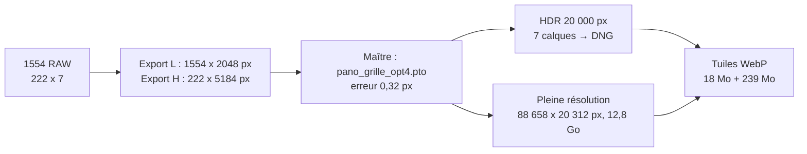

# Étude de cas : Wattenberg, 200 mm, 222 positions × 7 expositions

La [méthode générale](../../docs/GUIDE.md) appliquée à un panorama réel : 6 lignes × 37 colonnes = **222 positions**, 7 expositions par position (**1554 RAW**), Canon EOS-1D X et 70-200 mm à 200 mm, pris le 2026-06-19 à Wattenberg. Résultat : un HDR à 20 000 px et une pleine résolution de **88 658 × 20 312 px** (1,8 Gpx), tuilés et mis en ligne.

---

Ce document suit la **numérotation du guide** (phases 0 à 7, étapes **3E**, **6C.4**…). Pour chaque phase il donne ce que le guide ne doit pas affirmer : les **valeurs retenues**, les **noms de fichiers réels**, les **durées, RAM et tailles mesurées**, et les **incidents** rencontrés. Les mesures détaillées, les hypothèses et les décisions sont dans le [carnet de tests et d'analyses](TESTS-ANALYSES.md) (fiches M-xx, T-xx, P-xx, D-xx).



---

## 📋 Comment lire cette étude

| Vous cherchez… | Allez à |
| --- | --- |
| Le matériel et la machine | [Configuration de référence](#️-configuration-de-référence) |
| Les valeurs à mettre dans les scripts (grille, pas, focale) | [Paramètres du panorama](#-paramètres-du-panorama) |
| Les durées, la RAM, le disque, phase par phase | [Ce que ça a coûté](#-ce-que-ça-a-coûté--ram-disque-durées) |
| Ce qui s'est passé à chaque étape | [La méthode appliquée](#-la-méthode-appliquée-phase-par-phase) |
| L'enquête sur les colonnes dans le ciel | [Phase 2](#phase-2--développer-et-exporter) et [Phase 6](#phase-6--pleine-résolution), puis l'[état du chantier](#-état-du-chantier) |
| Les fichiers fournis dans ce dossier | [Fichiers de cette étude](#-fichiers-de-cette-étude) |

---

## 🖥️ Configuration de référence

Tout ce qui est chiffré ici a été **mesuré sur cette machine**. Une autre configuration donnera d'autres durées, mais les mêmes proportions.

| Composant | Valeur |
| --- | --- |
| Système | Windows 11 Professionnel |
| Processeur | Intel Core i5-12600K, 10 cœurs (6 performants + 4 efficaces), 16 threads |
| Mémoire vive | **32 Go** (2 × 16 Go DDR5 à 4 800 MHz) ; fichier d'échange ≈ 5,5 Go |
| Carte graphique | NVIDIA GeForce RTX 3070 (8 Go) + Intel UHD 770 : ne sert qu'à l'aperçu OpenGL de ***Hugin*** |
| Disques | 2 SSD NVMe de 1 To. **C:** (système, `TEMP`, cache de ***multiblend***) ; **D:** (photos, projets) |
| Appareil et objectif | **Canon EOS-1D X** (plein format) + **EF 70-200 mm f/2.8L IS II USM** à **200 mm, f/10** ; images portrait 3456 × 5184 px. Profil Adobe disponible : « Adobe (Canon EF 70-200mm f/2.8 L IS II USM) » |

| Logiciel | Version utilisée |
| --- | --- |
| ***Hugin*** | 2025.0.1 (***nona*** 2025.0.1, ***enblend*** 4.3), `Hugin-2025.0.1-win64.msi` |
| ***multiblend*** | 2.0.0 (archive `multiblend2.0rc5.zip`), dans `D:\Outils\multiblend\` |
| ***Python*** / ***Pillow*** | 3.14 (3.13 fonctionne) / 12.2 |
| ***ExifTool*** | 13.33 |
| ***Adobe Lightroom Classic*** | 15.4.1 |
| ***libvips*** | 8.18.7, `vips-dev-x64-all-8.18.7.zip`, dans `D:\Outils\libvips\vips-dev-8.18\` |
| ***PowerShell*** | 7.6.6 (Windows PowerShell 5.1 non essayé sur les scripts récents) |
| ***ImageMagick*** | 7.1.2 (facultatif) |

**Ce que ça implique** : 32 Go suffisent largement jusqu'à 20 000 px (***multiblend*** moins de 4 Go). À 90 112 px, ***multiblend*** demanderait ≈ 37 Go sans cache : on le borne à 4 Go et le reste va sur C: (≈ 33 Go de cache). **Moins de 32 Go n'a pas été essayé.**

---

## 🎯 Paramètres du panorama

Les valeurs **en dur en tête des scripts** (voir la section [Configuration du guide](../../docs/GUIDE.md#️-configuration--les-scripts)) et celles passées en argument :

| Paramètre | Valeur | Où |
| --- | --- | --- |
| Grille | **6 lignes × 37 colonnes** = 222 positions | `ROWS`, `COLS` ; `--grille 6 37` ; `--lignes 6 --colonnes 37` |
| Expositions | **7** : E0 (0 IL) puis −3, −2, −1, +1, +2, +3 IL | `--expos 7` |
| Focale, capteur | **200 mm**, 24 mm horizontal (portrait, plein format) | `FOCALE`, `LARGEUR_MM` |
| Champ d'une image | **6,87° × 10,29°** (le petit côté est horizontal) | calculé |
| Pas horizontal | **5,0°** (recouvrement 1,87°, soit 27 %) | `PAS_H` |
| Pas vertical | **5,8°**, mesuré en **3C.3** (théorique : estimé plus bas ; recouvrement 4,5°, soit 44 %) | `PAS_V` |
| Sens de prise de vue | Chaque ligne commence au **bord droit** et avance vers la gauche ; ligne 0 en haut | signes du lacet dans ***generer_pto.py*** |
| Numéro d'image | `k = ligne × 37 + colonne` ; image 0 = `L0_C00` | partout |
| Export L | 1554 images, côté long **2 048 px** (1365 × 2048), ≈ 19 Go | `Export-TIFF-L` |
| Export H | 222 vues centrées, **5 184 px** (3456 × 5184, aucun redimensionnement), 16,8 Go | `Export-TIFF-H` |
| Largeur du HDR | **20 000 px** (toile 20 000 × 5 000) | `propager_geometrie.py … 20000` |
| Largeur de la pleine résolution | **90 112 px** (toile 90 112 × 22 528 ; zone utile 88 658 × 20 312) | `--pano 90112` |
| Projet maître | `$P\3_optimisation\pano_grille_opt4.pto` | |

**Emplacements** (variables PowerShell de **0D**) :

```powershell
$OUTILS = 'D:\Gotcha\Documents\DIY\GitHub\giga-pano-hdr\scripts'
$T      = 'D:\Panoramas\2026-06-19\200mm'
$P      = "$T\Assemblage-Hugin"
$H      = 'D:\Gotcha\Mes images\Image Transfer\2026-06-19 - Wattenberg - GigaPanorama\200mm\HDR'
```

Le dossier des RAW contient aussi deux autres séries de la même sortie, au 50 mm (91 CR2, panorama HDR rendu par Lightroom à 26 362 px) et au 85 mm (273 CR2, non traité).

---

## 📦 Ce que ça a coûté : RAM, disque, durées

Chiffres mesurés pour **222 positions, 1554 images**. Les cases *non chronométré* ou *non relevé* sont **inconnues**, pas nulles.

| Phase | Outil qui travaille | RAM (pic) | Disque produit | Durée |
| --- | --- | :---: | --- | --- |
| **1. Prise de vue** | l'appareil | — | 1554 RAW | **40 min 43 s** (09:13:35 → 09:54:18) |
| **2. Développer et exporter** | ***Lightroom*** | export H : ≈ 7,0 Go | export L : **≈ 19 Go** ; export H : **16,8 Go** (≈ 78 Mo par TIFF) | export H : **3 min 54 s** ([M-14](TESTS-ANALYSES.md#m-14--export-h-depuis-222-copies-virtuelles--3-min-54-s)) ; export L *non chronométré* |
| **3. Géométrie** | ***Hugin***, scripts Python | *non relevée* | projets `.pto`, légers | *non chronométrée* ; une optimisation au-delà de 3 min sans baisse de l'erreur ne converge pas |
| **4. Vue centrée** à 6 000 px | ***nona*** + ***multiblend*** | 0,1 Go + 0,3 Go | 60 Mo | **1 min 26** (***nona*** 72 s, ***multiblend*** 14 s) |
| **5. HDR** à 20 000 px | ***nona*** + ***multiblend***, puis ***Lightroom*** | ***nona*** 0,7 Go ; ***multiblend*** **3,5 Go** par groupe | intermédiaires 12 Go (supprimés), 7 calques 4,5 Go, DNG ≈ 80 Mo | **≈ 2 h** (*estimé* : ***nona*** ≈ 1 h 44 à 4,0 s par image, ***multiblend*** ≈ 16 min à 140 s par groupe) ; avec ***Hugin*** et ***enblend*** : **≈ 5 h** mesurées (1 h 09 + 3 h 52) |
| **6. Pleine résolution** | ***nona***, puis ***multiblend*** | ***nona*** **13,5 Go** ; ***multiblend*** 4,2 Go de processus, **RAM libre du système à 0,2 Go** pendant ≈ 4 min | intermédiaires **35,1 Go** sur D:, cache **≈ 33 Go** sur C:, panorama **12,8 Go** | **≈ 3 h 35** : ***nona*** 12 080 s (3 h 21, ≈ 53 s par image), ***multiblend*** 1 305 s (21 min 45) ([M-16](TESTS-ANALYSES.md#m-16--rendu-complet-des-222-images-à-90-112-px-avec-le-développement-validé-brume-et-tonalité-à-0)) |
| **7. Tuilage** WebP Q85 | ***libvips*** | 5,6 Go | temporaires ≈ 12 Go (supprimés), pyramides **239 Mo + 18 Mo** | pleine résolution **≈ 1 min 50**, HDR moins de 10 s |

**Totaux** :
- **Calcul** : ≈ 5 h 40 pour les trois grands rendus, sans ***Lightroom*** ni ***CPFind*** ni optimisation. Avec ***Hugin*** et ***enblend*** pour le HDR : ≈ 8 h 40.
- **Disque, fichiers qui restent** (hors RAW) : export L 19 Go + export H 17 Go + calques 4,2 Go + DNG + panorama 12,8 Go + pyramides 0,26 Go ≈ **53 Go**.
- **Disque, au plus fort** (Phase 6) : ≈ 88 Go sur D:, ≥ 40 Go sur C: → **prévoir 100 Go libres sur D: et 40 Go sur C:**.
- **Temporaires vidés** après contrôle : 63 Go d'intermédiaires sur ce panorama.

**Contrôle optionnel à pleine échelle** de la vue centrée (45 056 px, ancien export, ***enblend***) : ***nona*** 47 min + ***enblend*** 2 h 08 = **2 h 55**, ***enblend*** à 20,3 Go de RAM ([M-01](TESTS-ANALYSES.md#m-01--rendu-de-la-vue-centrée-à-45-056-px)). Inutile : 6 000 px suffisent à juger les raccords.

---

## 🚀 La méthode appliquée, phase par phase

### Phase 0 — Préparer le poste et l'appareil

- **0C, préréglages** : les trois fichiers qui ont servi sont dans [`lightroom/presets/`](lightroom/presets/) : `PANO - 1DX + 70-200 II - WB 5500K.xmp` (développement : profil d'objectif, aberrations, balance « Lumière du jour » = **5 500 K, teinte +10** sur ce boîtier, Adobe Color, bruit de couleur 25), `PANO TIFF (H) E0.lrtemplate` et `PANO TIFF (L) HDR.lrtemplate`. Enregistrés par ***Lightroom Classic*** 15.4.1 ; les préréglages d'export ne portent aucun dossier. Le catalogue stocke ses préréglages à côté de lui (`D:\Gotcha\Pictures\Mon Lightroom\Paramètres Lightroom\`).
- **0D** : `$T` sur D:, hors du catalogue. Les anciens dossiers `10_grille`, `20_optimisation`, `30_phase1_centree`, `40_hdr`, `50_pleine_res`, `60_tuiles` (époque des premières mesures) ont été renommés `3_grille`, `3_optimisation`, `4_vue_centree`, `5_hdr`, `6_pleine_res`, `7_tuiles` ; le carnet cite encore les anciens noms.
- **0E, capteur** : **non fait avant cette prise de vue.** Conséquence mesurée : une petite tache sombre tous les ~5° dans le ciel lisse, et **2 h de nettoyage pour environ 220 vues centrées** en **6A.1** ([M-13](TESTS-ANALYSES.md#m-13--nettoyage-des-poussières-sur-les-vues-centrées--2-h-pour-220-images)). C'est ce qui a motivé l'étape 0E du guide.

### Phase 1 — Prise de vue

Valeurs **relevées dans l'EXIF des 1554 RAW** :

| Réglage | Valeur |
| --- | --- |
| Mode, ouverture, ISO | Manuel, **f/10**, **ISO 100**, identiques sur 1554 images |
| Vitesse de la vue centrée | **1/100 s** ; rafale : 1/800 (−3), 1/400 (−2), 1/200 (−1), 1/50 (+1), 1/25 (+2), 1/13 s (+3) |
| Rafale | *Continuous High*, 7 images, 0,09 à 0,13 s entre deux ; positions séparées d'au moins 3,9 s |
| Mesure | Spot (sans effet en manuel) |
| Balance des blancs du boîtier | **Auto** (4 765 à 5 807 K selon l'image) : sans conséquence, Lightroom applique sa valeur fixe |
| Mise au point | Manuelle |
| Durée | 40 min 43 s |

**Ordre** : 6 lignes parcourues de droite à gauche, sans serpentin ; E0 en tête de rafale. Aucun repère de début de ligne n'a été photographié (le guide le recommande désormais). Le roulis optimisé dépasse 1° sur plusieurs images de la ligne du haut : trépied pas tout à fait de niveau. Le point nodal n'a pas été respecté (rotule ordinaire) : aucun effet visible sur le lointain ni le ciel ; petits décalages possibles sur un toit ou un balcon proches.

### Phase 2 — Développer et exporter

**2B, développement final** (export D, validé le 2026-10-18) : profil d'objectif et aberrations activés, balance **6 100 K, teinte −10**, Vibrance +15, Mixage des couleurs (verts, jaunes, oranges), Calibration, étalonnage (teinte des ombres), **brume et tous les curseurs de tonalité à 0**, netteté 40 et bruit chromatique 25 (valeurs par défaut d'un RAW). 8 images retouchées en *Point Color* (L1 C06-C07, L2 C05 à C10).

**L'enquête sur les colonnes dans le ciel** (issue #46 du dépôt de la visionneuse, 2026-10-17 et 18 ; fiche [M-15](TESTS-ANALYSES.md#m-15--correction-de-la-brume--des-écarts-de-teinte-entre-images)). Le premier rendu complet montrait des colonnes verticales dans le ciel, une par image, et des images qui sortaient du lot en teinte (L0_C23 : −4,9 % puis +6,2 % en vert par rapport à ses voisines). Cinq exports ont été comparés sur un rendu réduit à 6 000 px et par ***ecart_paires.py*** :

| Export | Brume | Tonalité | Ondulation du ciel, ligne 0 | Luminosité entre voisines, ligne 1 |
| --- | :---: | --- | --- | --- |
| Initial | +45 | Noirs −41 | 1,18 % (plus bas : 2,54 %) | — |
| A | 0 | Contraste +25, Ombres −20, Noirs −10 | 0,80 % | −7 à +9 % |
| B | 0 | Contraste +25, HL −100, Expo +0,3, Blancs −10 | 0,40 % | −11 à +7 % |
| C | +24 | tous à 0 | 0,66 % | ≤ 3,7 %, sauts de teinte (−11 % en bleu) |
| **D** (retenu) | **0** | **tous à 0** | **0,32 % / 0,51 %** | **−1,3 à +1,3 %** |

Ce qui a été établi : le défaut vient des **images**, pas de la fusion (motif identique d'une image à l'autre, dispersion 0,2 à 0,35 %) ; la **brume** causait les sauts de teinte et le rouge écrêté à 0 dans le ciel (le bleu sortait du gamut Adobe RGB) ; les **curseurs de tonalité** causaient les sauts de luminosité de la ligne 1 (crête et ciel mêlés) alors que le RAW neutre était plat à ±0,6 %. Un essai de correction par **gain 2D** mesuré sur 13 ciels purs (de 0,94 à 1,11) ramenait l'ondulation de 1,18 à 0,61 % mais ne corrigeait pas les écarts de teinte : **non retenu**. Deux images portaient un *Point Color* posé par erreur (L2_C14, L3_C06), repérées par ***controle_reglages_export.py***. Les curseurs de tonalité ont été essayés **par groupes** : la part de chacun n'est pas isolée (Contraste +25 est commun aux exports fautifs A et B).

**2D, exports** : nom `Pano_HDR-` / `Pano_E0-` + numéro de séquence (Lightroom complète à deux chiffres : `Pano_HDR-01.tif` … `Pano_HDR-1554.tif`, sans conséquence). Filtre Bibliothèque : **Objectif** = EF70-200mm f/2.8L IS II USM (écarte le 50 et le 85 mm), **Temps de pose** = 1/100 s pour l'export H (222), aucun pour l'export L (1554). L'export 2048 est à 39,5 % de la taille d'origine ; sa « taille optimale » Hugin est 36 758 × 9 190 px. Un ancien export à 2 560 px a été supprimé ([D-02](TESTS-ANALYSES.md#-décisions-et-leurs-raisons)).

**2E, résultat du contrôle sur l'export L** : nombre, motif (+0, −3, −2, −1, +1, +2, +3), ordre : conformes ; f/10, ISO 100, 200 mm identiques sur 1554 ; profil `Adobe (Canon EF 70-200mm f/2.8 L IS II USM)` partout ; aucun recadrage ni Upright. Sur l'export H final : 0 champ divergent hors *Point Color* et *Dust Removal*.

**2F** : premier renommage par ***renommer_pano.py*** ; la table RAW → `L_C_E` (1554 lignes) est fournie dans [`donnees/table_raw_LCE.csv`](donnees/table_raw_LCE.csv), copie de `$P\table_raw_LCE.csv`. Tous les réexports suivants ont été renommés par ***renommer_par_raw.py*** d'après cette table (testé sur 6 images arbitraires, puis sur 3 copies virtuelles avant les 222).

### Phase 3 — Établir la géométrie

Fichiers successifs dans `3_grille\` et `3_optimisation\` (conservés, légers) :

| Étape | Commande ou geste | Fichier produit | Résultat |
| --- | --- | --- | --- |
| **3A** | `generer_pto.py` | `pano_grille.pto` | 222 images `_E0`, chemins relatifs `..\..\Export-TIFF-L\` |
| **3B** | Hugin, CPFind *prealigned* | `pano_grille_cp.pto` | points bruts (source de **3G**) |
| **3C.1** | `cpclean -p -n 2`, puis `deplacer_projet.py` (chemins remis en relatifs) | `pano_grille_cp_clean.pto` | |
| **3C.2** | `diagnostic_cp.py` | | écart médian ≈ 1° en horizontal, **2,7° en vertical** : le pas vertical théorique était faux |
| **3C.3** | `diagnostic_pas_v.py`, `corriger_pas_v.py … 5.8` | `pano_grille_cp_clean_v58.pto` | minimum à **5,8°** |
| **3D** | `filtrer_cp.py … 2.5` | `pano_grille_v58_f2.5.pto` | écart médian des bons points : 0,9° |
| **3E** passe 1 | `preparer_optimisation.py`, Hugin | `pano_grille_opt1.pto` | erreur moyenne 0,66, **maximum 115** : une image expulsée (lacet inversé de ~180°) |
| **3E** remède | `placer_isoles.py … 5 5.8 30`, `preparer_optimisation.py --objectif --exclure "1,7-19,30,45-51,221" --sans-cp-exclues` | `pano_grille_opt1_obj.pto` | les images faibles remises sur leur ligne et exclues |
| **3E** passe 2 | Hugin | `pano_grille_opt2.pto` | champ de vue optimisé **7,18°** (Hugin affiche alors 191 mm au lieu de 200) |
| **3G** | `filtrer_cp.py … 0.6`, `placer_isoles.py … 5 5.8 30`, `affiner_images_faibles.py … 1.5 5`, Hugin | `pano_grille_opt3.pto` puis **`pano_grille_opt4.pto`** (le maître) | **erreur moyenne 0,32 px** à 2 048 px (≈ 0,8 px à 5 184 px) |
| **3H** | `detecter_trous.py … 1.0` | | trois paires à recouvrement **négatif** : 135-136 (L3, C24-C25, −0,52°), 165-166 (L4, C17-C18, −0,42°), 199-200 (L5, C14-C15, −0,94°) ; 0 point de contrôle sur ces paires ; plus 29-30 |

**Incidents** :
- **3D** : le filtre à 2,5° a retiré **75 points valides sur 100** à l'image 30, parce que la ligne du haut est décalée de **+4,6° de lacet** par rapport à la grille théorique : d'où un fantôme à la jonction 29-30, corrigé en **3G** en reprenant les points bruts.
- **3G** : l'interpolation s'est trompée de 0,5 à 0,7° aux images 30 et 31 (sommet d'une crête floue) : d'où ***affiner_images_faibles.py***.
- **3F, vignettage** : mesure sur la ligne de ciel du haut, chaque image ≈ 3 % plus sombre sur son bord droit. *Photométrique → Calculer* a donné `Vb = −0,12`, `Vc = 0,27`, `Vd = −0,25` (≈ 10 % dans les coins), et a aussi modifié la courbe de réponse (`Ra` à `Re` : −3,296 / −0,103 / 0,42 / −0,139 / 0,208). Effet : ≈ 20 % d'ondulation en moins, et 2 niveaux plus clair ([J-04](TESTS-ANALYSES.md)). **Cette correction n'est pas dans le maître final** : le profil d'objectif de Lightroom et le développement « tout à 0 » ont suffi (ondulation finale 0,30 à 0,55 %).

### Phase 4 — Assembler la vue centrée

- **4A** à 6 000 px : `redimensionner_projet.py … --pano 6000` → `4_vue_centree\vue_centree.pto`, puis `rendre_projet.ps1 -Nom pano_grille_opt4 -Fusionneur multiblend` : **1 min 26**, panorama `pano_grille_opt4.tif` de 5 903 × 1 352 px (boîte englobante de la toile 6 000 × 1 500), 60 Mo.
- **Choix de *multiblend*** ([M-12](TESTS-ANALYSES.md#m-12--multiblend-ou-enblend-pour-la-vue-centrée-et-le-hdr-à-20-000-px-issue-31), [D-08](TESTS-ANALYSES.md#-décisions-et-leurs-raisons)) : à 222 images et 20 000 px, ***multiblend*** **140 s** et 3,5 Go contre ***enblend*** **1 572 s** et 4,0 Go ; raccords, ombres, trou indiscernables ; ***multiblend*** respecte mieux la tonalité des images (écart au centre 0,16 % contre 0,84 %). Le halo de bordure vu en [M-08](TESTS-ANALYSES.md#m-08--ciel--multiblend-contre-enblend---blend-colorspaceidentity) ne s'est pas reproduit.
- **Adaptateur `enblend_vers_multiblend.cmd`** : vérifié par `hugin_stitch_project` sur 84 images à 20 000 × 5 000 px ; le bouton *Assembler !* de l'interface n'a pas été essayé.

### Phase 5 — Le HDR

- **5A** : `propager_geometrie.py pano_grille_opt4.pto 5_hdr\pano_HDR_opt4.pto 20000`. Dans Hugin, onglet Exposition : 222 ensembles, `Eev` 13,3 pour `_E0`, 16,3 / 15,3 / 14,3 pour `_E1` à `_E3`, 12,3 / 11,3 / 10,3 pour `_E4` à `_E6`.
- **5B, fenêtre de test** : lignes 3 et 4, colonnes 18 à 23 (images 903-944 et 1162-1203, 84 images) : ***nona*** 338 s, ***multiblend*** 6 s par groupe. Calques de la vue centrée : boîte englobante **19 677 × 4 509 px**, origine **(323 ; 246)** dans la toile 20 000 × 5 000.
- **5B, rendu complet** : fait à l'origine **dans Hugin avec *enblend*** (5 h : ***nona*** 1 h 09, ***enblend*** 3 h 52, 12,1 Go d'intermédiaires), avant la décision D-08. Fichiers `pano_HDR_opt4_exposure_0000.tif` à `0006.tif`, TIFF 16 bits RGBA, profil conservé, EXIF recopié par ***exiftool*** depuis `L0_C00_E{n}.tif`. Erreur 206 rencontrée (ligne de commande trop longue) : résolue par l'option *Calques* seule.
- **5C** : calques déplacés dans `$H`, importés par *Synchroniser le dossier*, EXIF relu, fusion HDR → `pano_20000_E0-HDR.dng` (≈ 80 Mo). HDR validé dans Lightroom ([J-10](TESTS-ANALYSES.md)). Export TIFF : `$H\TIFF\pano_20000_E0-HDR.tif` (recadré par Lightroom : 19 976 × 4 994, soit 12 px à gauche et 3 px en haut) et `pano_20000_E0-HDR_non_recadre.tif` (20 000 × 5 000, copie virtuelle sans recadrage).
- **Taille figée à 20 000 px** ([D-01](TESTS-ANALYSES.md#-décisions-et-leurs-raisons)) : 45 056 px aurait coûté ≈ 20 h avec ***enblend*** pour un gain marginal ; conséquence acceptée : le HDR reste moins défini que le panorama Lightroom du 50 mm (26 362 px), le détail vient de la pleine résolution.

### Phase 6 — Pleine résolution

**Combien de pixels à 100 %** : 3456 px ÷ 6,867° = **503 px/°** ; champ `v185` → **≈ 93 046 × 23 263 px (2,16 Gpx)** (recoupe 36 758 × 2,53125). Rendu à **90 112 × 22 528 px** (88 × 1 024, soit 96,8 % de la définition d'origine) ; zone utile **88 658 × 20 312 px** (1,80 Gpx), origine **(1 454 ; 1 111)** dans la toile.

| Largeur | Densité sur 185° | Rôle |
| :---: | :---: | --- |
| 20 000 px (HDR) | 108 px/° | Vue d'ensemble, plage dynamique complète |
| 26 362 px (panorama Lightroom du 50 mm) | 142 px/° | comparaison |
| **90 112 px** (pleine résolution) | 487 px/° | Le détail du 200 mm, **3,4 fois** plus défini que le 50 mm |

**Deux exports plutôt qu'un** ([D-02](TESTS-ANALYSES.md#-décisions-et-leurs-raisons)) : tout à 5 184 px aurait pesé ≈ 122 Go (167 Go non compressé, rapport ZIP 0,73 mesuré) et imposé à ***nona*** une réduction à 21 % pour le HDR ; les deux exports pèsent ≈ 36 Go.

- **6A.1** : 222 copies virtuelles dans une collection « PANO 200mm — rendu H » ; nettoyage des poussières, véhicules, oiseaux : **2 h** ([M-13](TESTS-ANALYSES.md#m-13--nettoyage-des-poussières-sur-les-vues-centrées--2-h-pour-220-images)). Les retouches de brume et de tonalité faites sur ces copies sont à l'origine de l'enquête de la Phase 2.
- **6A.2** : export H depuis les 222 copies virtuelles : **3 min 54 s**, ≈ 4 cœurs occupés, 16,8 Go ([M-14](TESTS-ANALYSES.md#m-14--export-h-depuis-222-copies-virtuelles--3-min-54-s)).
- **6B, fenêtre à 100 %** (`6_pleine_res\fenetre_A\`) : images 133-138 et 170-175 (L3 et L4, C22 à C27, qui contiennent le trou 135-136). ***nona*** **609 s** (≈ 51 s par image, 13,4 Go), ***multiblend*** **68 s** (6,1 Go) ; panorama 16 190 × 7 993 px, 907 Mo. La bande noire du trou mesure **≈ 144 px** (−0,30° × 487 px/°), les haies se prolongent de part et d'autre : la géométrie se transpose sans dérive. Copie lisible par `-Lisible` en ≈ 12 s.
- **6C.1** : `complet.pto` (222 images, `--images 3456 5184 --pano 90112`, rattaché à `Export-TIFF-H`) ; vue d'ensemble `apercu\` à 6 000 px : ***nona*** 215 s, ***multiblend*** 16 à 19 s, 5 903 × 1 352 px, 57 Mo. Saturation d'une zone de ciel : 0,65 sans profil, 0,82 avec le profil rendu à la réduction.
- **6C.2** : ***nona*** **12 080 s (3 h 21)**, 13,5 Go constants, 35,1 Go d'intermédiaires (≈ 158 Mo par image), 0 erreur. Reprise après interruption vérifiée (coupure à 25 s, fichier provisoire de 12 Mo, image refaite en entier : 170 Mo).
- **6C.3** : RAM libre relevée, navigateur et Lightroom fermés (≥ 20 Go libres), C: ≥ 40 Go.
- **6C.4** : ***multiblend*** `--cache-threshold=4G` : **1 305 s (21 min 45)**, processus 4,2 Go, RAM libre du système à 0,2 Go pendant ≈ 4 min, cache ≈ 33 Go sur C:. Sans cache il aurait fallu ≈ 37 Go ([M-10](TESTS-ANALYSES.md#m-10--multiblend---cache-threshold--la-ram-du-processus-est-plafonnée-le-fichier-est-identique) : résultat identique pixel pour pixel, au plus 15 % plus lent). BigTIFF LZW 16 bits de **12,8 Gio**.
- **6C.5** ([M-16](TESTS-ANALYSES.md#m-16--rendu-complet-des-222-images-à-90-112-px-avec-le-développement-validé-brume-et-tonalité-à-0)) : `vipsheader` 88 658 × 20 312, 4 bandes `ushort`. **Ondulation du ciel** : 0,552 % en y 2 500-3 500 et 0,295 % en y 1 000-2 000 (contre **2,39 %** sur le rendu avec brume, supprimé) ; au rehaussement, ni colonne ni plaque, seul un grain fin. Extraits à 100 % (jonction de ciel, feuillage, trous 135-136, 165-166, 199-200, paire saine **156-157** : L4, C08-C09, +1,59°, 25 points) : ni couture ni double image. ***profil_jonction.ps1*** sur deux jonctions de ciel : écart ≤ 0,35 % à la source la plus proche, aucun dépassement. **Non jugés** : les trous un à un (aucune bande visible dans les extraits, coordonnées estimées), les poussières, les 8 images en *Point Color*.

**Budget disque mesuré** à quatre largeurs (222 images) :

| Largeur | Mpx | Un calque RGBA 16 bits | Intermédiaires ***nona*** | Final LZW |
| :---: | :---: | :---: | :---: | :---: |
| 5 000 px | 6 | 50 Mo | 0,09 Go | 42 Mo |
| 20 000 px | 100 | 0,8 Go | 1,7 Go | 0,65 Go |
| 45 056 px | 507 | 4,1 Go | 8,9 Go | 3,27 Go |
| **90 112 px** | 2 030 (utile : 1 800) | 16 Go | **35,1 Go** | **12,8 Go** |

**Pourquoi pas *enblend* à cette taille** ([M-06](TESTS-ANALYSES.md#m-06--enblend-lit-le-bigtiff-mais-ne-sait-pas-écrire-plus-de-4-go), [M-07](TESTS-ANALYSES.md#m-07--multiblend-écrit-le-bigtiff--enblend-vers-png-plante), [D-07](TESTS-ANALYSES.md#-décisions-et-leurs-raisons)) : ***enblend*** 4.3 s'arrête à `Maximum TIFF file size exceeded` au-delà de 4 Go et plante vers PNG ; ***multiblend*** a écrit un BigTIFF de 20 images en 109 s et 8,2 Go.

### Phase 7 — Tuiler

- **7A, sources non recadrées** : pleine résolution (88 658 × 20 312) → **9 311 tuiles, 239 Mo**, 18 niveaux, ≈ 1 min 50 (icc_transform 48 s et 1,5 Go, flatten 8 s et 5,0 Go, dzsave 56 s et 5,6 Go ; temporaires 6,9 + 5 Go). HDR (19 976 × 4 994) → **556 tuiles, 18 Mo**, moins de 10 s. En JPEG Q90 : 518 Mo et 38 Mo, en 62 s. Profil donné à la pleine résolution : `7_tuiles\profils\AdobeRGB_export_Lightroom.icc` (560 octets, extrait d'un export Lightroom).
- **7B** : contrôle dans le banc d'essai `page-autonome/` du dépôt de la visionneuse (OpenSeadragon), servi par `python -m http.server 8000`, `7_tuiles` rattaché par une jonction. Cadre de la pleine résolution dans le HDR : `box=0.016135,0.012329,0.983864` (x = 1 454 / 90 112, y = 1 111 / 90 112, largeur = 88 658 / 90 112). Résultat : les deux pyramides s'ouvrent, le fondu automatique passe du HDR à la pleine résolution à 1,000× sans erreur (seul un 404 sur `favicon.ico`). Tuiles WebP essayées dans Chromium et Firefox, ordinateur et téléphone.
- **7C, cadrage** : décidé sur le DNG HDR dans Lightroom (le recadrage automatique de la fusion, 12 px à gauche et 3 px en haut, réinitialisé sur la copie virtuelle exportée en `pano_20000_E0-HDR_non_recadre.tif`). ***cadrage_lightroom.py*** a lu le catalogue et imprimé les deux `extract_area` : HDR **0,5 s** (478 Mo), pleine résolution **42 s** (13 Go, `[bigtiff,tile]`). Résultat : **84 804 × 19 081 px** (1,62 Gpx) et **18 822 × 4 235 px**. Contrôle du vide par coin : bas-gauche 2 496 × 192 px, bas-droit 2 048 × 128 px, coins du haut pleins, 0,04 % de surface vide : laissé tel quel (choix de composition). Écart entre les deux cadres < 0,5 px pleine résolution (rapport d'échelle 4,5056).
- **7A bis, sources cadrées** : pleine résolution **66 s** (5,7 Go), **8 471 tuiles, 305 Mo** ; HDR **6 s**, 484 tuiles, 17 Mo. Recontrôle en local sans `box`.
- **Mise en ligne** (hors de ce guide, 2026-10-18) : panorama cadré mis en ligne à la place de l'ancien (même nom, 8 958 fichiers, 342 Mo), vérifié en HTTPS.

---

## 🔬 État du chantier

**Issue #46 du dépôt de la visionneuse** (« Assemblage : colonnes dans le ciel du rendu pleine résolution ») : **ouverte** au 2026-10-18. L'enquête est close (cause : le développement Lightroom, pas la fusion ni la prise de vue), le rendu complet avec le développement validé est fait, tuilé, cadré et en ligne. L'auteur refermera l'issue **après avoir jugé le rendu final dans la visionneuse en ligne**, à fort zoom, où les disparités d'assemblage seront peut-être moins flagrantes qu'à l'échelle globale où elles ont été mesurées.

**Reste à faire** :
- [ ] Nouvel export puis rendu (**6A** → **6C**), contrôlé par ***controle_reglages_export.py***, ***ecart_paires.py***, la vue d'ensemble et le ciel rehaussé (leçon de M-15 : valider sur le **rendu**, pas sur les réglages).
- [ ] Tuilage, contrôle local, mise en ligne (**7A**, **7B**).
- [ ] Définir un seuil de tolérance des écarts en pleine résolution (fiche M-16).
- [ ] Validation du rendu final en ligne, puis clôture de l'issue.
- [ ] Facultatif : bissection des curseurs de tonalité (séparer Contraste, Ombres, Noirs…), essai d'une courbe à points, de Texture et de Clarté.

**Tests à faire et pistes** : voir le [carnet](TESTS-ANALYSES.md#-tests-à-faire) (T-02 à T-15 : RAM à 2 Gpx, superposition HDR / pleine résolution, HDR plus large, crénelage de ***nona***, tuilage à 2 Gpx…) et les [pistes jamais essayées](TESTS-ANALYSES.md#️-pistes-jamais-essayées) (P-01 à P-07 : *lensfun*, *flat-field*, piles automatiques de Lightroom, fusion HDR par position, point nodal…).

---

## 📁 Fichiers de cette étude

```
etudes-de-cas\2026-06-19-wattenberg-200mm\
├── ETUDE-DE-CAS.md                      ← ce document
├── TESTS-ANALYSES.md                    ← le carnet : mesures M-xx, tests T-xx, pistes P-xx, décisions D-xx, journal J-xx
├── donnees\table_raw_LCE.csv            ← correspondance RAW → L_C_E (1554 lignes), référentiel de renommer_par_raw.py
└── lightroom\presets\
    ├── PANO - 1DX + 70-200 II - WB 5500K.xmp   ← développement (0C, 2B)
    ├── PANO TIFF (H) E0.lrtemplate              ← export H (2D)
    └── PANO TIFF (L) HDR.lrtemplate             ← export L (2D)
```

Fichiers de travail **hors dépôt** (plusieurs dizaines de Go) : `D:\Panoramas\2026-06-19\200mm\` (exports, projets `.pto`, rendus, tuiles) et `$H` (calques, DNG, TIFF du HDR). Les projets `.pto` de `3_grille\` et `3_optimisation\` sont la mémoire de la géométrie : ne pas les supprimer en vidant les exports.

---

## 👏 Crédits

Prise de vue, développement et décisions : Julien Moreau. Scripts, mesures et rédaction : avec ***Claude Code***.

---

**Version** : 1.0
**Dernière mise à jour** : 2026-10-18
