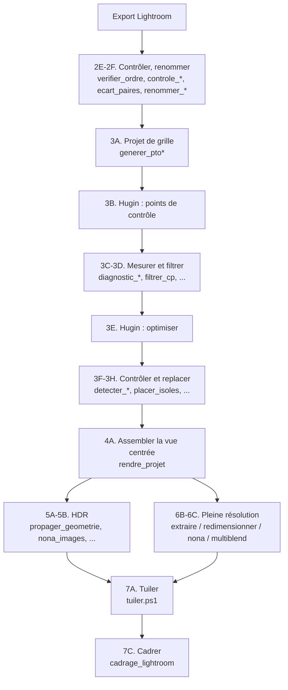

# Index des scripts d'assemblage

Les 43 scripts de ce dossier forment la chaîne qui mène des images exportées de *Lightroom* à un giga-panorama tuilé : renommage, géométrie dans *Hugin*, rendu, mesures de qualité, cadrage, tuilage. Chacun porte, **en tête de fichier**, son propre mode d'emploi.

---

## 🚀 Le lanceur et le pilotage

| Entrée | Rôle |
| --- | --- |
| [***panorama.py***](panorama.py) | **Le lanceur** : `python panorama.py`. Menu par phase du guide ; chaque tâche nomme son script et déclare ce qu'elle écrit. Phase 0 : versions des outils, installation, dossiers des préréglages Lightroom, nouveau panorama (arborescence + `panorama.json`), panorama courant. Configuration : chemins des outils |
| [`pilotage/`](pilotage/) | Le kit partagé : `couleurs.py` (ANSI), `menu.py` (menus déclaratifs), `config.py` (`config.json` du poste et `$T\panorama.json`), `outils.py` (détection, versions, `winget`), `arguments.py` (menu de pilotage des arguments d'un script), `lancer.py` (sous-processus), `declarations_ps.py` (arguments des scripts PowerShell) |

**Menu de pilotage** : chaque script Python de cet index, lancé **sans argument dans un terminal**, affiche la liste de ses arguments, préremplie d'après le panorama courant, et se lance sur `L`. Avec des arguments, il se comporte exactement comme avant. Les scripts PowerShell n'ont pas ce menu : le lanceur le leur fournit. ***verifier_renvois.py*** en est exempté (sans argument, il contrôle).

---

## 📋 Pour qui ?

Pour qui veut savoir « quel script pour quoi ? » sans ouvrir les 43 fichiers : cet index les classe par phase, dans l'ordre où on s'en sert, avec l'identifiant de l'étape du [guide](../docs/GUIDE.md) qui les emploie (**3F**, **6C**…) et leur **portée**. Le détail des gestes dans *Hugin* et *Lightroom* est dans le guide (voir son aide-mémoire pour la séquence complète).

---

## 🎯 Portée : trois familles

| Portée | Sens | Ce qu'il faut adapter pour un autre panorama |
| :---: | --- | --- |
| 🟢 **Générique** | <ul><li>Ne suppose rien de la grille ni de l'objectif</li><li>Lit ce dont il a besoin dans les fichiers, le projet ou les arguments</li></ul> | Rien, ou les chemins d'installation des outils (en tête des `.ps1`, ou en paramètre) |
| 🟡 **Paramétré par la grille** | Contient en tête des **constantes** écrites pour une prise de vue donnée :<ul><li>colonnes</li><li>lignes</li><li>focale</li><li>pas</li><li>champ</li></ul> | Les constantes en tête du script (voir les [conventions](#️-conventions-communes)) |
| 🔵 **Rédaction** | Sert à tenir le guide, pas à assembler | Rien |

Les 43 scripts sont des outils de **méthode** : aucun n'est propre à un seul panorama. Ce qui est propre à un panorama (table RAW → `L_C_E`, préréglages Lightroom, mesures) est dans son dossier `etudes-de-cas/`.

---

## 📚 Le mode d'emploi en tête de chaque script

Tous les scripts suivent le même plan. Python : docstring de module (visible avec `help()` ou en ouvrant le fichier). PowerShell : bloc de commentaires avant `param(`.

| Rubrique | Contenu |
| --- | --- |
| **Titre** | Une phrase : ce que fait le script (première ligne) |
| **CONTEXTE** | Où il se place dans la chaîne, et pourquoi il existe |
| **MODE OPÉRATOIRE** | Ce qu'il fait, dans l'ordre |
| **ENTRÉES** | <ul><li>Arguments</li><li>Options</li><li>Constantes à adapter en tête de script</li></ul> |
| **SORTIES** | <ul><li>Ce qui s'affiche</li><li>Ce qui est écrit</li><li>Ce qui n'est pas écrit</li></ul> |
| **EXEMPLE** | Une ligne de commande prête à adapter |
| **Usage** | La syntaxe courte |

> Les scripts PowerShell sont **volontairement sans accents** : ils se lancent aussi bien avec *Windows PowerShell* qu'avec *PowerShell 7*.

---

## ⚙️ Conventions communes

| Convention | Valeur |
| --- | --- |
| Grille | <ul><li>`COLS` colonnes × `ROWS` lignes</li><li>Numéro d'image `k = ligne × COLS + colonne`</li><li>Image 0 = `L0_C00` (haut, côté où chaque ligne commence)</li></ul> |
| Noms d'images | `L{ligne}_C{colonne}_E{expo}.tif` produits par ***renommer_pano.py*** ou ***renommer_par_raw.py*** |
| Pas et champ | `PAS_H`, `PAS_V` en degrés champ d'une image calculé d'après `FOCALE` et `LARGEUR_MM` |
| Projets | `.pto` de *Hugin* les scripts de géométrie lisent et écrivent ce texte, sans passer par *Hugin* |
| Sécurité | <ul><li>Les scripts qui renomment ou déplacent des images travaillent en essai à blanc par défaut (`--apply` pour agir)</li><li>Les scripts de projet écrivent le `.pto` de sortie qu'on leur indique (il n'écrase l'entrée que si on donne le même chemin)</li></ul> |

Les valeurs **actuellement en dur** dans les scripts 🟡 sont celles de l'[étude de cas](../etudes-de-cas/2026-06-19-wattenberg-200mm/ETUDE-DE-CAS.md#-paramètres-du-panorama) : 37 colonnes, 6 lignes, 200 mm, pas de 5,0° × 5,8°, champ horizontal 6,87°. Pour une autre prise de vue, les adapter en tête de chaque script concerné.

---

## ✨ Vue d'ensemble

---

## 🚀 Les scripts, phase par phase

### Phase 2 — Contrôler et renommer l'export

Étapes [**2E**](../docs/GUIDE.md#2e--vérifier-lexport) et [**2F**](../docs/GUIDE.md#2f--renommer).

| Script | Portée | Rôle |
| --- | :---: | --- |
| [***verifier_ordre.py***](verifier_ordre.py) | 🟢 | <ul><li>Contrôle d'après l'EXIF que l'export est complet et dans l'ordre de prise (rafales d'expositions, heures, ouverture/ISO/focale)</li><li>Grille passée en argument</li></ul> |
| [***controle_reglages_export.py***](controle_reglages_export.py) | 🟢 | Contrôle les réglages Lightroom enregistrés dans chaque TIFF :<ul><li>uniformité (images en minorité)</li><li>RAW complets</li><li>dimensions</li><li>profil</li><li>curseurs de tonalité à 0</li><li>balance des blancs fixe</li></ul> |
| [***ecart_paires.py***](ecart_paires.py) | 🟡 | <ul><li>Écart de luminosité et de teinte entre images voisines sur la même scène (médiane de tuiles, 16 bits)</li><li>Signale les paires hors lot</li><li>Juge le **rendu**, que le contrôle des réglages ne voit pas</li></ul> |
| [***renommer_pano.py***](renommer_pano.py) | 🟢 | <ul><li>Renomme les fichiers Lightroom en `L_C_E` d'après leur numéro de fin de nom</li><li>Options :<ul><li>`--lignes --colonnes --expos`</li><li>Essai à blanc</li><li>`--apply`</li><li>`--undo`</li></ul></li></ul> |
| [***renommer_par_raw.py***](renommer_par_raw.py) | 🟢 | <ul><li>Même renommage, mais d'après le RAW d'origine lu dans les métadonnées, avec un export renommé ou une table CSV comme référentiel</li><li>Indépendant de l'ordre de tri</li></ul> |
| [***tiffinfo.py***](tiffinfo.py) | 🟢 | D'un TIFF, sans le décoder :<ul><li>Taille</li><li>Orientation</li><li>Bits</li></ul> |

### Phase 3 — Projet de grille

Étape [**3A**](../docs/GUIDE.md#3a--générer-le-projet-de-grille).

| Script | Portée | Rôle |
| --- | :---: | --- |
| [***generer_pto.py***](generer_pto.py) | 🟡 | Projet *Hugin* avec les vues centrées `_E0` posées sur la grille théorique |
| [***generer_pto_hdr.py***](generer_pto_hdr.py) | 🟡 | Idem pour toutes les expositions, en piles |

### Phase 3 — Mesurer, nettoyer, filtrer, préparer l'optimisation

Étapes [**3C**](../docs/GUIDE.md#3c--nettoyer-et-mesurer-le-pas-vertical) à **3E**.

| Script | Portée | Rôle |
| --- | :---: | --- |
| [***diagnostic_cp.py***](diagnostic_cp.py) | 🟡 | Écart angulaire des points de contrôle par type de paire :<ul><li>horizontale</li><li>verticale</li><li>diagonale</li></ul> |
| [***diagnostic_pas_v.py***](diagnostic_pas_v.py) | 🟡 | Cherche le pas vertical et horizontal réel qui minimise l'écart des points |
| [***corriger_pas_v.py***](corriger_pas_v.py) | 🟡 | Remet les images à la grille avec un nouveau pas vertical |
| [***filtrer_cp.py***](filtrer_cp.py) | 🟡 | Retire les points de contrôle trop éloignés de leur homologue (seuil en degrés) |
| [***preparer_optimisation.py***](preparer_optimisation.py) | 🟢 | Écrit dans le projet les variables à optimiser, à la place de l'onglet Optimisation |

### Phase 3 — Contrôler, replacer les images du ciel

Étapes **3E**, [**3G**](../docs/GUIDE.md#3g--replacer-les-images--orphelines--ciel) et [**3H**](../docs/GUIDE.md#3h--détecter-les-trous).

| Script | Portée | Rôle |
| --- | :---: | --- |
| [***voir_positions.py***](voir_positions.py) | 🟡 | Correction d'une plage d'images par rapport à la grille :<ul><li>lacet</li><li>tangage</li><li>roulis</li></ul> |
| [***lister_pires_cp.py***](lister_pires_cp.py) | 🟡 | Points de contrôle les plus éloignés de leur homologue, et images concernées |
| [***detecter_aberrantes.py***](detecter_aberrantes.py) | 🟡 | Images dont la correction s'écarte de celle de leurs voisines |
| [***detecter_trous.py***](detecter_trous.py) | 🟡 | Paires voisines qui se recouvrent trop peu (risque de bande noire) |
| [***compter_cp_paire.py***](compter_cp_paire.py) | 🟢 | Nombre de points de contrôle entre des paires données |
| [***placer_isoles.py***](placer_isoles.py) | 🟡 | Replace par interpolation les images sans (ou presque sans) point de contrôle |
| [***affiner_images_faibles.py***](affiner_images_faibles.py) | 🟡 | Récupère les points valides des images faibles et les déclare à optimiser |

### Phase 3 — Qualité du ciel : vignettage et raccords

Étape [**3F**](../docs/GUIDE.md#3f--corriger-le-vignettage-tonalité-du-ciel), et contrôle du rendu complet ([**6C.5**](../docs/GUIDE.md#6c5--contrôler-le-rendu-complet)).

| Script | Portée | Rôle |
| --- | :---: | --- |
| [***mesurer_ciel.py***](mesurer_ciel.py) | 🟡 | Luminosité du ciel par image et vignettage, sur les originaux |
| [***mesurer_gain_paires.py***](mesurer_gain_paires.py) | 🟡 | Écart d'exposition entre images voisines, sur la même portion de ciel |
| [***mesurer_bandes_ciel.py***](mesurer_bandes_ciel.py) | 🟢 | Ondulation périodique (« store vénitien ») d'un panorama assemblé |
| [***localiser_sauts_ciel.py***](localiser_sauts_ciel.py) | 🟢 | Position des sauts brutaux de luminosité, et image concernée |
| [***comparer_rendus.py***](comparer_rendus.py) | 🟢 | Avant / après : luminosité et ondulation d'une zone de ciel |
| [***comparer_couleur.py***](comparer_couleur.py) | 🟢 | Ondulation de couleur d'une zone de ciel :<ul><li>R</li><li>G</li><li>B</li><li>Chrominance</li></ul> |
| [***rehausser_ciel.py***](rehausser_ciel.py) | 🟢 | Image qui exagère les petites variations de tonalité, pour *voir* les raccords |

### Phases 4 à 6 — Rendus : vue centrée, HDR et pleine résolution

Étapes [**4A**](../docs/GUIDE.md#4a--assembler-la-vue-centrée-nona-puis-multiblend), **4B**, [**5A**](../docs/GUIDE.md#5a--reporter-la-géométrie-sur-les-n-expositions), **5B** et [**6A**](../docs/GUIDE.md#6a--exporter-les-vues-centrées-à-pleine-taille) à **6C**.

| Script | Portée | Rôle |
| --- | :---: | --- |
| [***propager_geometrie.py***](propager_geometrie.py) | 🟡 | Reporte la géométrie optimisée de la vue centrée sur toutes les expositions |
| [***extraire_sous_projet.py***](extraire_sous_projet.py) | 🟢 | Garde seulement certaines images d'un projet (zone d'essai, ou projet de rendu sans variables) |
| [***redimensionner_projet.py***](redimensionner_projet.py) | 🟢 | Change la taille des images et/ou du panorama de sortie |
| [***deplacer_projet.py***](deplacer_projet.py) | 🟢 | Copie un projet ailleurs en réécrivant les chemins d'images |
| [***nona_images.ps1***](nona_images.ps1) | 🟢 | Rend avec *nona* une plage d'images, une par une, reprenable après interruption |
| [***rendre_projet.ps1***](rendre_projet.ps1) | 🟢 | <ul><li>Rend un projet complet : *nona* puis *enblend* ou *multiblend*, durées et pics de RAM</li><li>`-Lisible` en tire une copie lisible</li></ul> |
| [***rendre_lisible.ps1***](rendre_lisible.ps1) | 🟢 | <ul><li>Copie lisible d'un rendu de *multiblend* (BigTIFF sans profil) : TIFF classique 16 bits avec le profil des images, et JPEG sRGB</li><li>Jusqu'à ≈ 700 Mpx</li></ul> |
| [***fusionner_par_exposition.ps1***](fusionner_par_exposition.ps1) | 🟢 | Fusionne avec *enblend* ou *multiblend* les images reprojetées d'un HDR, un panorama par exposition |
| [***enblend_vers_multiblend.cmd***](enblend_vers_multiblend.cmd) | 🟢 | <ul><li>Adaptateur à déclarer dans les préférences de *Hugin* à la place d'*enblend*</li><li>Traduit la ligne de commande et fait fusionner par *multiblend*</li><li>Lance `enblend_vers_multiblend.ps1`, à garder dans le même dossier</li></ul> |
| [***surveiller_multiblend.ps1***](surveiller_multiblend.ps1) | 🟢 | Relève, pendant une fusion :<ul><li>RAM du processus</li><li>RAM libre</li><li>Taille de `TEMP`</li></ul> |
| [***mesurer_charge.ps1***](mesurer_charge.ps1) | 🟢 | Charge CPU et mémoire pendant un rendu :<ul><li>de *Hugin*</li><li>de *nona*</li><li>de *enblend*</li></ul> |
| [***profil_jonction.ps1***](profil_jonction.ps1) | 🟢 | Profil par bandes d'une jonction : fusion contre les deux sources |
| [***ranger_intermediaires.py***](ranger_intermediaires.py) | 🟢 | Range les images intermédiaires dans `_a_supprimer/` (ne supprime jamais) |

### Phase 7 — Tuiler et cadrer

Étapes [**7A**](../docs/GUIDE.md#7a--tuiler-avec-libvips) et [**7C**](../docs/GUIDE.md#7c--cadrer-les-deux-sources-facultatif).

| Script | Portée | Rôle |
| --- | :---: | --- |
| [***tuiler.ps1***](tuiler.ps1) | 🟢 | Pyramide Deep Zoom (`.dzi` + `_files`) d'un TIFF géant avec *libvips* :<ul><li>Conversion sRGB 8 bits</li><li>Aplatissement de l'alpha</li><li>`dzsave` en WebP ou JPEG</li><li>Durée et RAM relevées</li></ul> |
| [***cadrage_lightroom.py***](cadrage_lightroom.py) | 🟢 | <ul><li>Relit le recadrage décidé dans *Lightroom* et l'applique au HDR et à la pleine résolution (commandes `vips extract_area`)</li><li>`--controle` mesure le vide par coin</li></ul> |

### Rédaction du guide

| Script | Portée | Rôle |
| --- | :---: | --- |
| [***verifier_renvois.py***](verifier_renvois.py) | 🔵 | <ul><li>Vérifie la numérotation du guide : identifiants cités mais absents, liens internes cassés, restes de l'ancienne numérotation, dans le guide, cet index, les études de cas et les scripts</li><li>`python verifier_renvois.py` (code de sortie 1 s'il y a un écart)</li><li>`--releve` pour l'inventaire</li></ul> |

---

## 🛠️ Prérequis

| Outil | Pour quels scripts |
| --- | --- |
| ***Python*** 3 (bibliothèque standard) | Tous les scripts de géométrie |
| ***Pillow*** | Les scripts qui lisent des pixels : <ul><li>***mesurer_ciel***</li><li>***mesurer_gain_paires***</li><li>***mesurer_bandes_ciel***</li><li>***localiser_sauts_ciel***</li><li>***comparer_rendus***</li><li>***comparer_couleur***</li><li>***rehausser_ciel***</li><li>Et `--controle` de ***cadrage_lightroom***</li></ul> |
| ***exiftool*** (dans le `PATH`) | <ul><li>***verifier_ordre***</li><li>***controle_reglages_export***</li><li>***renommer_par_raw***</li><li>***cadrage_lightroom*** (option `--dng`)</li></ul> |
| ***Hugin*** (*nona*, *enblend*) | <ul><li>***rendre_projet.ps1***</li><li>***nona_images.ps1***</li><li>***fusionner_par_exposition.ps1***</li></ul> |
| ***multiblend*** | <ul><li>***rendre_projet.ps1***</li><li>***fusionner_par_exposition.ps1***</li><li>***enblend_vers_multiblend***</li></ul> |
| ***libvips*** | <ul><li>***ecart_paires*** (`vips` dans le `PATH`, ou variable d'environnement `VIPS`)</li><li>***tuiler.ps1*** (`-Vips`)</li><li>***rendre_lisible.ps1***</li><li>***profil_jonction.ps1***</li><li>Commandes imprimées par ***cadrage_lightroom***</li></ul> |

Les chemins d'installation (*Hugin*, *multiblend*, *libvips*) se passent en paramètre aux scripts PowerShell concernés (`-Hugin` dossier bin, `-Multiblend`, `-Vips` ; valeur par défaut en tête de chaque script), ou se règlent une fois dans le menu **Configuration** du lanceur, qui les transmet.

---

## ❓ FAQ

**Un script plante sans message clair : par où commencer ?**
Ouvrir le fichier : la rubrique **ENTRÉES** liste les arguments attendus. Beaucoup de scripts lisent `sys.argv` directement : un argument manquant se traduit par une erreur d'index plutôt que par un message d'aide.

**Les scripts modifient-ils mes fichiers d'origine ?**
Les scripts de diagnostic ne font que lire. Les scripts de projet écrivent un **nouveau** `.pto` (ou le même si on le leur demande explicitement). Ceux qui touchent à des images (***renommer_pano***, ***renommer_par_raw***, ***ranger_intermediaires***) sont en essai à blanc tant qu'on n'ajoute pas `--apply`, et savent défaire (`--undo`) ou ne suppriment rien. Seul ***rendre_projet.ps1*** supprime des fichiers (les intermédiaires), et seulement après une fusion réussie.

**Pourquoi tant de constantes en dur ?**
Les scripts 🟡 ont été écrits pour une prise de vue précise. Les adapter reste plus simple que de tout paramétrer, et la rubrique **CONTEXTE** de chaque en-tête dit où se trouvent les valeurs. Le menu de pilotage rappelle ces constantes et avertit quand elles contredisent le panorama courant (`panorama.json`).

**Pourquoi un seul dossier et pas un dossier par portée ?**
Les scripts s'appellent entre eux (***rendre_projet.ps1*** → ***rendre_lisible.ps1***, ***enblend_vers_multiblend.cmd*** → `.ps1`) et toutes les commandes du guide se lancent depuis `$OUTILS`. Un seul dossier évite de casser ces liens ; la portée est dite ici.

---

## 📚 Pour aller plus loin

- [Guide général](../docs/GUIDE.md) : la séquence complète, phase par phase.
- [Étude de cas](../etudes-de-cas/2026-06-19-wattenberg-200mm/ETUDE-DE-CAS.md) et son [carnet](../etudes-de-cas/2026-06-19-wattenberg-200mm/TESTS-ANALYSES.md) : mesures et comparaisons faites avec ces scripts.

---

**Version** : 2.1
**Dernière mise à jour** : 2026-10-18
